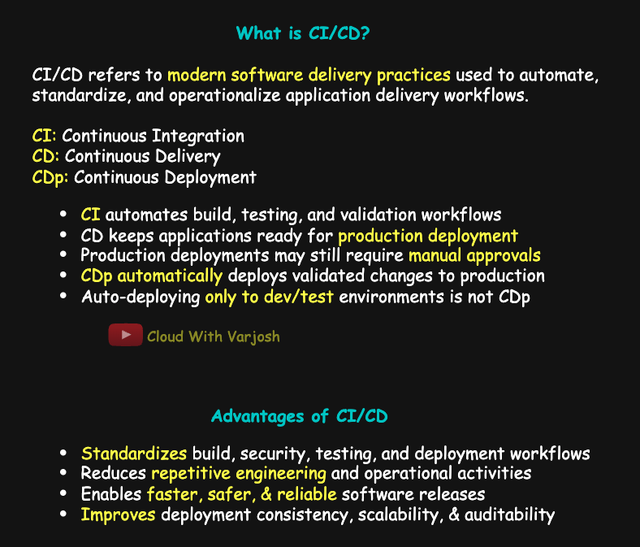
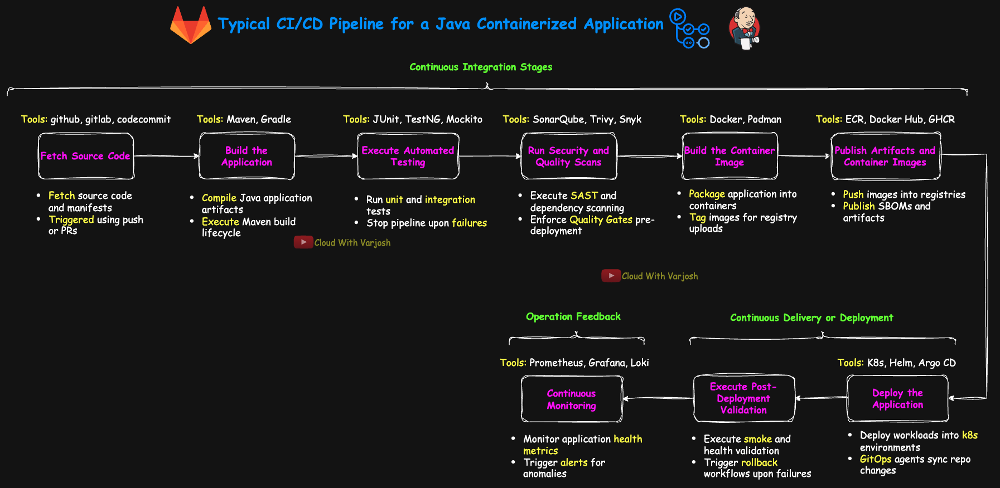

# 01 · What is CI/CD?

> **Part A: Foundations** · Next: [02 · Git and GitHub recap](02-git-and-github-recap.md) · [Back to INDEX](INDEX.md)
>
> **Video for this part of the course:** [What is GitHub Actions | Build Your First Workflow from Scratch](https://www.youtube.com/watch?v=w4c_NIjO3XI)
>
> [](https://www.youtube.com/watch?v=w4c_NIjO3XI)

---

## Before you start: what this course expects

GitHub Actions is an **automation tool**. It does not build, test, or deploy anything by itself. It **runs other tools for you** at the right moment. So it helps to know the tools around it.

You do **not** need to be an expert in any of them. Whenever a later topic needs one, it gives a short recap right there.

| You should be comfortable with | Why GitHub Actions needs it | Where it's recapped in these notes | Original course resources |
|---|---|---|---|
| **Git** (commits, branches, merging, rebasing, cherry-picking, pull requests, remotes, production Git workflows) | Workflows live inside Git repositories and are started by Git events like a push. | [02 · Git and GitHub recap](02-git-and-github-recap.md) | [Git Masterclass playlist](https://www.youtube.com/playlist?list=PLmPit9IIdzwT6nq8hIuf7MBcPVzw3cX3K) · [Git Masterclass notes](https://github.com/CloudWithVarJosh/Git-Masterclass) |
| **YAML** | Every workflow file is written in YAML. YAML is also used by Kubernetes, Docker Compose, Ansible, Helm, Argo CD, GitLab CI/CD and Azure Pipelines. | [03 · YAML for GitHub Actions](03-yaml-for-github-actions.md) | [YAML video](https://youtu.be/LT3U9fkOVDQ) · [YAML notes (CKA course, Day 09)](https://github.com/CloudWithVarJosh/CKA-Certification-Course-2025/tree/main/Day%2009) |
| **Modern SDLC** (compiled vs interpreted languages, build workflows for containerized and non-containerized apps, why build automation and deployment standardization matter) | CI/CD automates the SDLC. You must know the stages before you automate them. | This topic, below | [SDLC video](https://youtu.be/imEHsgvJbYo) · [Jenkins course Day 01 notes](https://github.com/CloudWithVarJosh/Jenkins-Basics-To-Production/tree/main/Day%2001) (recorded for Jenkins, but the ideas apply to any CI/CD tool) |
| **CI/CD fundamentals** (CI, Continuous Testing, Continuous Delivery, Continuous Deployment, Continuous Monitoring, GitFlow vs trunk-based development, environment promotion, production deployment workflows) | This is the "why" behind every workflow you will write. | This topic, below | [CI/CD fundamentals video](https://youtu.be/szPE1NKc614) · [Jenkins course Day 02 notes](https://github.com/CloudWithVarJosh/Jenkins-Basics-To-Production/tree/main/Day%2002) |
| **Linux shell** | Most workflow steps are shell commands running on a Linux machine. | [04 · Linux shell recap for runners](04-linux-shell-recap-for-runners.md) | Your Linux notes |

### The tools GitHub Actions will drive later in this course

As the course goes on, your workflows will call tools like these:

- **Maven** or **Gradle**: build tools for Java. They download libraries, compile code, run tests, and package the app.
- **SonarQube**: checks code quality and does **SAST** (Static Application Security Testing, which means finding security bugs by reading the source code without running it).
- **Docker**: packages an app and everything it needs into a **container image**.
- **Kubernetes**: runs and manages containers across many machines.
- **Argo CD**: a **GitOps** tool. GitOps means "Git is the single source of truth for what should be deployed". A tool watches Git and makes the cluster match it.
- **Terraform**: creates cloud infrastructure (servers, networks) from code.
- Cloud platforms: **AWS** (Amazon Web Services), **Azure**, **GCP** (Google Cloud Platform).

Learning resources for these tools:

- **Git:** [Git Masterclass](https://www.youtube.com/playlist?list=PLmPit9IIdzwT6nq8hIuf7MBcPVzw3cX3K)
- **Kubernetes & CKA Prep:** [CKA Course Preparation](https://lnkd.in/g-7UEQfk)
- **Argo CD & GitOps:** [Argo CD Tutorial Series](https://youtu.be/m4lDTQwK1T8)
- **Maven:** [Maven Tutorial](https://youtu.be/3OKc5y_3wMM)
- **DevSecOps & SonarQube:** [DevSecOps and SonarQube Tutorial](https://youtu.be/qyYsLVZDieU)
- **Real-World Kubernetes Projects:** [Kubernetes Projects Playlist](https://lnkd.in/gg4tFfTD)
- **Jenkins Basics to Production:** [notes](https://github.com/CloudWithVarJosh/Jenkins-Basics-To-Production)

---

## What it is

**SDLC** (Software Development Life Cycle) is the journey your code takes: write it → build it → test it → package it → release it → run it in production → watch it.

**CI/CD** is the practice of **automating that journey** so a computer does the boring, repeatable parts the same way every time.

- **CI = Continuous Integration.** Every time someone changes code, a machine automatically **merges it with everyone else's work, builds it, and tests it**.
- **CD** has two meanings. People mix them up all the time, so learn the difference:
  - **Continuous Delivery**: every change is automatically made **ready to release**. A human still presses the final "deploy to production" button.
  - **Continuous Deployment**: every change that passes all checks goes **all the way to production automatically**. No human button.



A **pipeline** is the chain of automated stages (build → test → scan → package → deploy). CI/CD tools like Jenkins, GitLab CI/CD and GitHub Actions are the engines that run pipelines.

---

## Why it exists

Imagine a team of 10 developers who all build and deploy by hand:

- **People are inconsistent.** One person forgets a test, another uses a different tool version.
- **Releases are slow.** Each release waits for "the one person who knows how to deploy".
- **There are bottlenecks.** Teams wait on each other.
- **Deployments are risky.** A manual typo in production causes an outage.
- **Nothing is recorded.** Nobody knows who deployed what, when, or how (poor **auditability**).
- **It doesn't scale.** It works for 1 repo, not for 200 repos and 50 teams.

CI/CD fixes this. The same steps run **automatically, the same way, every time**, and every run is recorded. Teams ship **faster, more reliably, and with less risk**.

### The CI side in detail

**Continuous Integration** means you integrate (merge) code changes into a shared repository **often**, and a machine checks each change straight away.

Typical CI activities:

- **Fetch the source code** from the repository
- **Build** the application (compile it, produce binaries)
- **Run automated tests**
- **Run security and quality scans**
- **Build container images**
- **Publish build artifacts** (the files the build produced)

The goal: **catch problems early**. A bug found 5 minutes after the commit is cheap. A bug found in production is expensive.

### The CD side in detail

**Continuous Delivery** keeps the app **always in a deployable state**. Release preparation and validation are automated. But production may still need:

- manual approvals
- change-management reviews
- release sign-off steps

**Continuous Deployment** (some people write **CDp** to keep it apart from Continuous Delivery) goes one step further: validated changes go to **production** automatically, with **no manual approval**.

> **Important:** if you automatically deploy only to **development, testing or staging**, and production still needs a human, that is **not** Continuous Deployment. It is Continuous Delivery.

Typical CD activities:

- **Deploy the app** to environments (dev, staging, prod)
- **Run integration checks** after deployment
- **Manage approvals and promotions** (moving the same build from dev → staging → prod)
- **Run post-deployment checks**

The goal of CD: deliver changes **faster, more reliably, and with lower risk**.

---

## Analogy

Think of a **car factory assembly line**.

- Before assembly lines, one craftsman built each car by hand. Every car came out slightly different, slowly.
- An assembly line has fixed **stations** (the pipeline stages): fit the frame → add the engine → paint → **quality inspection** → ship.
- **CI** is the inspection that happens every time a new part arrives: does it fit, does it work?
- **Continuous Delivery** means every finished car is parked at the gate, ready to ship, and a manager signs off on each shipment.
- **Continuous Deployment** means the truck takes every car that passed inspection straight away, with no sign-off.
- The **CI/CD tool** (GitHub Actions) is the **conveyor belt and the factory controller**. It doesn't paint the car itself. It moves the car to the paint robot (Docker), the inspection robot (tests), and so on, in the right order.

---

## How it works inside

Here is a typical **production-grade pipeline for a Java app that runs in containers**. Tools differ between companies, but the stages are almost always the same.



**1. Fetch the source code**
- The CI/CD tool downloads the latest **app code, manifests** (config files that describe deployments) **and workflow definitions** before anything runs.
- Something starts the pipeline: a **push**, a **pull request**, a **release**, or a **schedule**.
- **Common tools:** Git, GitHub, GitLab, AWS CodeCommit, Bitbucket.

**2. Build the application**
- Source code is compiled and packaged into **deployable artifacts**, for Java usually a **JAR** (Java ARchive) or **WAR** (Web application ARchive) file.
- Java build tools also do **dependency resolution** (download the libraries your code needs), run **lifecycle phases** (Maven's fixed order: validate → compile → test → package → verify → install → deploy), and package the artifact.
- **Common tools:** Maven, Gradle, `.jar`, `.war`.

> **Note:** even **interpreted** languages (code run directly by an interpreter without a separate compile step, like **Python, JavaScript, or PHP**) usually have a build stage. It may install dependencies, **transpile** (convert code from one language version to another, like TypeScript → JavaScript), **bundle** (combine many files into a few), **minify** (shrink code by removing spaces and long names), package, run static analysis, or produce an executable.

**3. Run automated tests**
- Tests check that the app **behaves correctly** and catch **regressions** (old features that broke because of a new change).
- CI usually runs **unit tests** (test one small piece of code alone), **integration tests** (test pieces working together), **API tests**, and dependency checks.
- **Common tools:** JUnit, Mockito, TestNG.

> **Example:** in Maven projects, **JUnit** and **TestNG** run **unit tests** through the **Surefire plugin** and **integration tests** through the **Failsafe plugin**, during commands like `mvn test` or `mvn verify`. **JaCoCo** (Java Code Coverage) records **code coverage**, meaning what percentage of your code the tests actually ran. **SonarQube** later reads that coverage number during quality analysis.

**4. Run security and quality scans**
- Scanners check **source code, dependencies, secrets** (passwords or keys accidentally committed) **and configuration** for vulnerabilities or policy violations.
- Pipelines often enforce a **Quality Gate**: a pass/fail rule like "coverage ≥ 80% and zero critical bugs". If the gate fails, the pipeline stops.
- **Common tools:** SonarQube, Trivy, Snyk, SAST, dependency scanning.

**5. Build the container image**
- The app and everything it needs at runtime are packed into an **OCI-compliant container image**. **OCI** (Open Container Initiative) is the open standard for image formats, so any compliant tool can run the image.
- Images are **tagged** (labelled) with a **version, commit ID, or release name** before they are published.
- **Common tools:** Docker, Podman.

**6. Publish artifacts and container images**
- Build outputs and images are pushed to a **central artifact repository** or **container registry** (a server that stores images).
- Mature pipelines also publish an **SBOM** (Software Bill of Materials: the full list of every library inside your app), **signatures** (cryptographic proof of who built the artifact), and **provenance** (a record of how and where it was built).
- **Common tools:** Amazon ECR (Elastic Container Registry), Docker Hub, GHCR (GitHub Container Registry), JFrog Artifactory.

**7. Deploy the application**
- The app is deployed to **development, testing, staging or production** environments.
- In **GitOps** setups, an agent inside the cluster **watches a Git repository and syncs the cluster to match it** automatically.
- **Common tools:** Kubernetes, Helm (a package manager for Kubernetes), Argo CD.

**8. Post-deployment validation**
- After deploying, check that the app is **up, healthy, reachable, and deployed correctly**.
- Common checks: **smoke tests** (a few quick "is it basically alive?" tests), health checks, API checks, and checking that metrics and logs are flowing.
- **Common tools:** Postman, Prometheus, Grafana, k6.

**9. Continuous monitoring**
- Monitoring tracks **health, availability, performance, logs and metrics** in production, all the time.
- It is the safety net: it raises **alerts**, shows **dashboards**, and spots **anomalies** (unusual behaviour) so incidents are seen quickly.
- **Common tools:** Prometheus, Grafana, Loki, ELK Stack (Elasticsearch, Logstash, Kibana), Alertmanager.

> **Key learning:** CI/CD platforms usually **do not** build, test, scan, or deploy anything themselves. They **orchestrate**: they run the right tool at the right stage, in the right order, and record what happened.

---

## The CI/CD tool landscape

GitHub Actions wasn't the first CI/CD tool. Companies have automated pipelines for years.

**The old way (for example, classic Jenkins).** Teams had to do all of this themselves:

- set up the servers (**provision infrastructure**)
- manage **build agents** (the worker machines that run jobs)
- install and upgrade **plugins**
- configure **credentials**
- design and maintain the pipelines
- scale the whole system when the company grew

**The new way: platform-native and managed CI/CD.** Over time the industry moved to tools that are **built into the source-control platform** and **managed for you**.

Today the three dominant CI/CD ecosystems are:

- **Jenkins**: a very customizable automation server, widely used in enterprises.
- **GitLab CI/CD**: built into GitLab. It combines source control, CI/CD, security and deployment tooling in one product.
- **GitHub Actions**: GitHub's automation platform, triggered by events and built into GitHub.

They lead because each one takes a different approach to the same problem. They make different trade-offs between:

- infrastructure control
- developer experience
- ecosystem integration
- platform standardization
- enterprise **governance** (rules, audits and controls over who can do what)

### Comparing popular CI/CD tools

| Tool | How it runs | Main strengths | Main limitations | Best for |
|---|---|---|---|---|
| **Jenkins** | Mostly **self-managed**: you run the server | • **Extremely flexible**, highly customizable workflows<br>• Huge **plugin** ecosystem<br>• Strong **infrastructure-level control** | • High **operational overhead** (you run and patch it)<br>• Plugin compatibility and upgrade problems<br>• You manage the infrastructure, agents and security | Enterprises that need deep customization and control |
| **GitLab CI/CD** | Integrated **DevSecOps platform** (DevSecOps = Development + Security + Operations) | • One platform for source code, CI/CD, security scanning and registry<br>• Strong DevSecOps and governance features<br>• Native integration across GitLab | • Best experience mainly inside GitLab<br>• Self-hosted GitLab can get complex to run<br>• Advanced enterprise features add complexity | Organizations standardized on GitLab |
| **GitHub Actions** | **Managed, event-driven** automation platform | • Deep native integration with GitHub repos and pull requests<br>• Developer-friendly YAML workflows, easy onboarding<br>• Large Marketplace of reusable actions, plus managed runners | • Optimized mainly for code hosted on GitHub<br>• Advanced scaling may need self-hosted runners<br>• Less infrastructure-level customization than Jenkins | Teams already using GitHub for source control |

---

## Workflow YAML / commands

You'll write real workflows from topic 06 onwards. For now, here is a **preview** of what a tiny CI pipeline looks like in GitHub Actions, so the words above have a shape. Don't worry about the syntax yet. Every line is explained in later topics.

```yaml
name: CI                      # name shown in the GitHub UI
on: push                      # start this pipeline on every push (stage 1 trigger)
jobs:
  build-and-test:
    runs-on: ubuntu-latest    # the machine that does the work
    steps:
      - uses: actions/checkout@v7      # stage 1: fetch source code
      - run: mvn -B package            # stage 2+3: build and run unit tests
```

**Sample log output** (what you'd see in the GitHub "Actions" tab):

```text
✓ Set up job
✓ Run actions/checkout@v7
    Syncing repository: your-user/your-repo
✓ Run mvn -B package
    [INFO] Tests run: 12, Failures: 0, Errors: 0, Skipped: 0
    [INFO] BUILD SUCCESS
✓ Complete job
```

What each part means:

- `✓ Run actions/checkout@v7`: the code was fetched (pipeline stage 1).
- `Tests run: 12, Failures: 0`: Maven ran 12 unit tests and all passed (stage 3).
- `BUILD SUCCESS`: the build produced a JAR (stage 2). The whole run gets a green tick ✅.

---

## Hands-on lab

No repository needed yet. This is a thinking lab.

1. Pick any app you know (a personal project, or your company's app).
2. Write down its 9 stages using the list above. For each stage write: **what happens**, **which tool**, and **is it automated today? (yes/no)**.
3. Mark which stages belong to **CI** and which belong to **CD**.
4. Decide: does your app do **Continuous Delivery** or **Continuous Deployment**? (Hint: is there a human approval before production?)

You'll turn this list into a real workflow in later topics.

---

## Where you'll use it

- **Every DevOps/SRE job.** "Walk me through your CI/CD pipeline" is one of the most common interview questions. The 9 stages above are your answer skeleton.
- **Choosing tools.** When your team debates Jenkins vs GitHub Actions vs GitLab, the comparison table is your starting point.
- **Explaining risk to managers.** Continuous Delivery (with an approval) vs Continuous Deployment (no approval) is a real business decision, often driven by compliance.

---

## When it breaks

At this level, things break in your **design**, not in YAML:

| Symptom | What it means | Fix |
|---|---|---|
| "We have CI, but bugs still reach production" | Tests are missing or the Quality Gate is too weak. | Add tests and enforce a gate (coverage, critical bugs = 0). |
| "Deployments are still scary" | Steps are still manual, or there's no post-deployment check. | Automate deployment and add smoke tests and monitoring. |
| "We call it Continuous Deployment but someone approves prod" | It's really **Continuous Delivery**. | Use the right name, especially in interviews. |
| "The pipeline is slow" | Stages run one after another when they could run in parallel, and nothing is cached. | Covered later: parallel jobs (06), caching (25), matrix (26). |

---

## Quick recap

- **CI** = merge often and automatically build and test every change.
- **Continuous Delivery** = always ready to release, with a human approving production. **Continuous Deployment** = straight to production automatically.
- A pipeline has about 9 stages: fetch → build → test → scan → image → publish → deploy → validate → monitor.
- CI/CD tools **orchestrate other tools**. They don't do the work themselves.
- Jenkins = self-managed and flexible. GitLab CI/CD = all-in-one platform. GitHub Actions = managed and built into GitHub.

**Interview questions**

1. **Q: What's the difference between Continuous Delivery and Continuous Deployment?**
   A: Both automate the release pipeline. In Delivery, production needs a manual approval. In Deployment, every change that passes the checks goes to production automatically.
2. **Q: Does a CI/CD tool compile your code?**
   A: No. It runs your build tool (Maven, npm…) on a machine and coordinates the stages. The build tool compiles the code.
3. **Q: Why add a Quality Gate?**
   A: To stop low-quality or insecure code automatically, before it is packaged and deployed. The pipeline fails when the rules aren't met.
