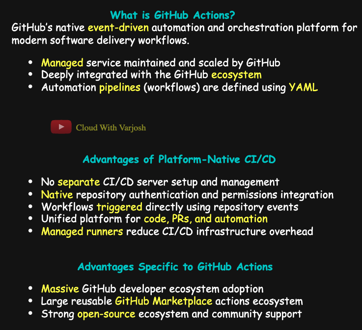

# 05 · What is GitHub Actions?

> **Part A: Foundations** · Previous: [04 · Linux shell recap](04-linux-shell-recap-for-runners.md) · Next: [06 · Workflows, jobs and steps](06-workflows-jobs-steps.md) · [Back to INDEX](INDEX.md)

---

## What it is

**GitHub Actions** is GitHub's built-in automation system. You put a YAML file in your repo that says:

> "**When** *this* happens (an event), **do** *these* things (jobs and steps) **on** *this* kind of machine (a runner)."

GitHub watches for the event and does the work for you.



### Why it's called "event-driven"

An **event** is something that happens in your repo: a `push`, a `pull_request`, a `release`, an `issue_comment`, a new branch, a new tag. **Event-driven** means workflows start **because** an event happened.

Since GitHub Actions is **inside** GitHub, these events reach it directly. You don't need to configure an external **webhook** (an HTTP message one system sends another when something happens).

**Jenkins comparison:** Jenkins is an external server. GitHub must send it a webhook through a plugin, and Jenkins needs credentials to clone the code.

### It's more than CI/CD

People call GitHub Actions a CI/CD tool, but it's really a **general automation platform** built into GitHub. It can automate:

- application builds
- test pipelines
- security scans
- container workflows
- release automation
- deployment pipelines
- infrastructure provisioning
- repository chores (label issues, close stale PRs, welcome new contributors)

### Who runs what: the control plane and the data plane

GitHub Actions is mostly a **managed service**: you write the automation logic, GitHub runs the system that powers it.

It has two layers:

| Layer | Plain meaning | Who manages it |
|---|---|---|
| **Control plane** (the "brain") | Receives events, decides which workflows to start, queues jobs, assigns them to machines, stores logs and results. | **Always GitHub** |
| **Data plane** (the "hands") | The machines that actually run your jobs and steps: the **runners**. | Your choice: **GitHub-hosted runners** (GitHub manages them) or **self-hosted runners** (you manage them) |

**Jenkins comparison:** in a traditional Jenkins setup you manage **both** layers: the Jenkins controller (brain) **and** the agents (hands). That's the biggest operational difference.

> Runners and hosting models are covered in depth in topic 07 and topic 38.

---

## Why it exists

Before tools like this, teams ran a separate CI server that connected to GitHub through **plugins, webhooks, PATs** (Personal Access Tokens) **and SSH keys**. Someone had to install it, patch it, scale it and secure it.

GitHub Actions removes most of that because it's **built into the platform where your code already lives**.

### Advantages of platform-native CI/CD

**Platform-native** CI/CD means the automation is built into the source-control platform itself (GitHub Actions in GitHub, GitLab CI/CD in GitLab), instead of being a separate server.

- **No separate CI/CD server to set up and manage.** You start writing pipelines inside the repo. There's nothing to provision, patch or upgrade.
- **Repository authentication and permissions are built in.** Workflows can reach the repo, PRs, secrets and environments through GitHub's own auth system. For many common workflows you don't need to set up PATs, SSH keys or repository credentials. (This built-in credential is the `GITHUB_TOKEN`, topic 18.)
- **Repository events trigger workflows directly.** `push`, `pull_request`, `release`, `issue_comment`, branch creation and tag creation start workflows natively, so external webhook setup is usually unnecessary.
- **Code, PRs and automation live in one place.** Code, pull requests, issues, releases, environments, secrets and workflows all sit in one product, so there's less switching between tools.
- **Managed runners cut the infrastructure work.** GitHub supplies ready machines, so teams spend time on pipelines, not on servers.

### Advantages specific to GitHub Actions

Many of the advantages above also apply to GitLab CI/CD. These are more specific to GitHub:

- **A huge developer base already on GitHub.** GitHub is one of the largest software platforms in the world, so Actions was instantly available to millions of engineers. That sped up adoption in startups, enterprises and open source.
- **A large Marketplace of reusable actions.** Ready-made building blocks for Docker, Kubernetes, cloud login, security scanning, notifications and much more (topic 15).
- **A strong open-source community.** The community keeps building reusable actions, workflow templates, integrations and best-practice examples.

---

## Analogy

GitHub Actions is like a **smart home system** built into your house:

- **Events** = sensors: "front door opened", "it's 2 a.m."
- **Workflow** = a rule card: "when the door opens after midnight, turn on the lights and send me a photo."
- **Control plane** = the home hub that watches the sensors and decides which rule to fire.
- **Runners** = the devices that actually do the work (lights, camera). You can use the ones the builder installed (GitHub-hosted) or wire in your own (self-hosted).

Jenkins is like buying a separate security company's system. It's powerful, but **you** install the hub, wire it to every sensor, and maintain it.

---

## How it works inside

```text
 Developer             GitHub (control plane)                        Runner (data plane)
 ─────────             ──────────────────────                        ───────────────────
 git push ─────► 1. event "push" recorded
                 2. read .github/workflows/*.yml at that commit
                 3. which workflows listen for "push"? → match
                 4. create a workflow run, split it into jobs
                 5. put jobs in a queue
                 6. pick a runner whose labels match runs-on ──────► 7. runner pulls the job
                                                                      8. runs the steps in order
                 10. show logs, status ✅/❌, artifacts ◄──────────── 9. streams logs + result back
```

You'll trace this in full detail, with real logs, in topic 08.

---

## Workflow YAML / commands

The smallest possible workflow shows the three ideas: **event → work → machine**.

```yaml
name: Hello Actions        # display name in the Actions tab
on: push                   # EVENT: run on every push
jobs:
  say-hello:               # a job (a unit of work)
    runs-on: ubuntu-latest # MACHINE: a GitHub-hosted Ubuntu runner
    steps:
      - run: echo "Hello from GitHub Actions"   # WORK
```

**Sample log output:**

```text
Set up job
  Current runner version: '2.3xx.x'
  Runner Image: ubuntu-26.04
Run echo "Hello from GitHub Actions"
  Hello from GitHub Actions
Complete job
```

- `Current runner version`: the version of the **runner application** (the agent program on the machine that talks to GitHub).
- `Runner Image: ubuntu-26.04`: the OS that `ubuntu-latest` points to now (it moved from 24.04 to 26.04 between 19 Oct and 19 Nov 2026).
- `Hello from GitHub Actions`: your command's output.

---

## Hands-on lab

1. In the repo from topic 02, create `.github/workflows/hello.yml` with the YAML above.
2. Commit and push.
3. Open **Repository → Actions**. Click the run → the job → the step. Find the "Runner Image" line under **Set up job**.
4. Write down: which **event** started it, which **runner** ran it, and how long it took.

---

## Where you'll use it

- **CI** on every PR (topics 13, 19).
- **CD** to Kubernetes (capstone topics 51–53).
- **Repo automation:** auto-creating PRs (capstone topic 52), labelling, releases.
- **Interviews:** "GitHub Actions vs Jenkins" and "control plane vs data plane" come up constantly.

---

## When it breaks

| Symptom | Likely cause | Fix |
|---|---|---|
| Nothing appears in the Actions tab | File is not in `.github/workflows/`, Actions is disabled for the repo, or the event doesn't match. | Check the path. Check **Settings → Actions → General → Allow actions**. Check the `on:`. |
| Run shows "Invalid workflow file" | YAML or schema error. | See topic 03. |
| Job stays **Queued** for a long time | No runner matches `runs-on` (common with self-hosted labels), or you hit a concurrency limit. | Topics 07 and 38. |

---

## Quick recap

- GitHub Actions = event-driven automation built into GitHub.
- **Control plane** (always GitHub) decides. **Data plane** (runners) does the work.
- Jenkins = you run both planes yourself. GitHub Actions = GitHub runs the brain, and you choose who runs the hands.
- It's built in, so there are no webhooks and fewer credentials.
- It's a general automation platform, not only CI/CD.

**Interview questions**

1. **Q: Why is GitHub Actions called event-driven?**
   A: Workflows start in response to repository events (push, PR, release, schedule…) that GitHub receives natively.
2. **Q: What's the main operational difference from Jenkins?**
   A: GitHub always manages the control plane. With Jenkins you manage the controller and the agents.
3. **Q: Can GitHub Actions run on your own servers?**
   A: Yes, through self-hosted runners (the data plane). The control plane is still GitHub.
