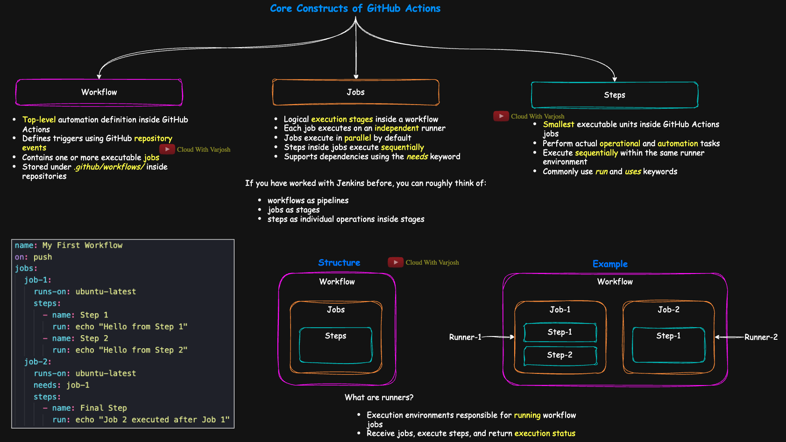

# 06 · Workflows, Jobs and Steps

> **Part A: Foundations** · Previous: [05 · What is GitHub Actions?](05-what-is-github-actions.md) · Next: [07 · Runners](07-runners.md) · [Back to INDEX](INDEX.md)

---

## What it is

GitHub Actions has **three building blocks** arranged in a tree, plus the machines that run them:

```text
Workflow           ← the whole automation (one YAML file)
 └── Jobs          ← big chunks of work (build, test, deploy)
      └── Steps    ← individual commands or actions, run in order
           └── executed by Runners (the machines)
```



1. **Workflow**: the top-level automation definition. It says **when** to run and **what** to run.
2. **Job**: a logical unit inside a workflow, such as build, test, security scan, packaging or deployment.
3. **Step**: one task inside a job, like running a shell command, checking out code, building, or calling a reusable action.

A repo can have **many workflows**, each workflow **many jobs**, and each job **many steps** that run one after another.

---

## Why it exists

Real pipelines need structure:

- Different automations (CI, release, nightly scan) should be **separate files** so they're easy to own and change. That's why there are **workflows**.
- Some work can run **at the same time** (frontend tests and backend tests) and some must **wait** (deploy waits for tests). That's why there are **jobs**, which run in parallel and can depend on each other.
- Inside one unit of work, things happen **in order** on the **same machine** (download code → install → test). That's why there are **steps**.

**Jenkins comparison:**

| GitHub Actions | Jenkins |
|---|---|
| Workflow file (`.github/workflows/ci.yml`) | `Jenkinsfile` (pipeline definition) |
| Job | `stage` (roughly; a job also gets **its own machine**) |
| Step | `steps { sh '...' }` |
| `needs:` | Stage order / `parallel` blocks |
| Runner | Agent / node |

Conceptually, a **workflow is like a pipeline definition** in other CI/CD tools. It's the top layer that coordinates everything.

---

## Analogy

A **restaurant**:

- **Workflow** = a recipe book entry: "Dinner service for table 5, triggered when the order arrives."
- **Jobs** = stations: **starter station, main-course station, dessert station**. Different cooks at different counters can work **at the same time**. Dessert might **wait** until the main course is served (`needs`).
- **Steps** = the instructions at one station, **in order**: chop → fry → plate.
- **Runner** = the cook and their counter. Each station (job) gets its **own counter**. Ingredients chopped at the starter counter are **not** on the main-course counter unless someone carries them over (artifacts, topic 24).

---

## How it works inside

### Workflow

A **workflow** defines:

- which GitHub **events** trigger it
- which **jobs** run
- the job **order and dependencies**
- **permissions, conditions and environment** settings
- the overall CI/CD or repo-automation behaviour

It's a **YAML** file stored in exactly this folder:

```text
.github/workflows/
```

for example `.github/workflows/ci.yml`.

A repo usually has **several workflows**, each with one purpose:

- `ci.yml`: build, lint (check code style) and test.
- `deployment.yml`: deploy to staging or production.
- `release.yml`: package and publish a release.
- `security-scan.yml`: vulnerability and dependency scans.

Each workflow runs in response to one or more **events**. Common **triggers** (the events a workflow listens to):

- `push`: commits are pushed to a branch.
- `pull_request`: a PR is opened or updated.
- `workflow_dispatch`: someone clicks **Run workflow** in the UI (manual).
- `schedule`: runs on a timetable written in **cron** syntax (topic 09).
- `release`: a GitHub release is created or published.
- `issues` and `issue_comment`: repo-management automation.

Example scenarios:

- A **pull request** triggers tests and validation.
- A **merge of a PR into `main`** triggers deployment.
- A **nightly scheduled** workflow runs dependency or security scans.
- A **release** event publishes container images and deploys.

All triggers are covered in topic 09.

### Jobs

A **job** is a logical unit of work inside a workflow, used to separate major stages:

- building the application
- unit and integration tests
- security and compliance scans
- Docker image packaging
- publishing artifacts
- deployment

Each job **runs on a runner** and has one or more **steps that run in order**.

A job defines important settings:

- the operating system (`runs-on`)
- runtime environment setup
- environment variables (topic 11)
- permissions (topic 18)
- dependencies on other jobs (`needs`)
- conditions (topic 13)

Runner operating systems: **Ubuntu, Windows, macOS**.

```yaml
runs-on: ubuntu-latest
```

**Default execution rules (very important):**

- **Jobs run in parallel** (at the same time), unless you say otherwise.
- **Steps run one after another** (sequentially) inside a job.

These two rules drive **pipeline speed**, **optimization** and **dependency design**. For example:

- frontend tests and backend tests can run in **parallel** to save time
- a deploy job can **wait** until all test jobs succeed

You make a job wait with **`needs`**:

```yaml
deploy:
  needs: test      # deploy starts only after the job "test" succeeds
```

This builds **multi-stage pipelines**: build first → tests depend on build → deploy depends on tests (and approvals, topic 28).

### Steps

A **step** is the **smallest unit of work** in a job. Examples:

- check out the source code
- install dependencies
- run unit or integration tests
- build binaries
- run shell commands
- build Docker images
- publish artifacts
- deploy

Steps run **in order** and **share the same runner** (the same machine, the same files and the same workspace) during the job.

There are two kinds of step:

#### A. `run`: execute shell commands

```yaml
- name: Install dependencies
  run: npm install
```

`run` steps are used for:

- **Shell scripting:** Linux, Windows or macOS commands like `echo`, `ls`, `pwd`.
- **Build and test:** `mvn package`, `npm test`.
- **Installing packages:** `npm install`, `pip install -r requirements.txt`.
- **Deployment commands:** `kubectl apply`, Helm commands.
- **Infrastructure automation:** Terraform or Ansible, e.g. `terraform apply`.

The commands run directly in the runner's OS through a shell: **Bash**, **PowerShell** or **CMD** (topic 04, topic 14).

#### B. `uses`: run a reusable action

```yaml
- name: Checkout source code
  uses: actions/checkout@v7
```

> ⚠️ Corrected: was `actions/checkout@v4`, now `actions/checkout@v7` because v7 is the current major release (June 2026). Older majors run on deprecated Node.js runtimes (see topic 33).

An **action** is a pre-packaged, reusable step that someone else (or you) wrote. Actions come from:

- the **GitHub Marketplace**
- **public repositories**
- **internal company repositories**

Actions are covered in topic 15, and building your own in topics 32–35.

### What happens when a step fails

- **Inside a job:** if a step fails, **the remaining steps in that job are skipped** and the job is marked **failed**.

  > ⚠️ Corrected: was described as GitHub Actions' "fail-fast execution model at the job level", now described as "a failing step stops the rest of its job" because **`fail-fast`** is the name of a separate matrix setting (topic 26) that cancels *sibling matrix jobs*. Using the same name for both causes confusion in interviews.

- **For the workflow:** by default, if **any** job fails, the whole **workflow run is marked failed**, unless you change failure handling (`continue-on-error`, topic 14).
- **For dependent jobs:** jobs that `needs` a failed or skipped job are **skipped automatically**, unless they have an explicit condition such as `if: always()` (topic 12).

---

## Workflow YAML / commands

### Putting everything together

```yaml
name: My First Workflow
on: push
jobs:
  job-1:
    runs-on: ubuntu-latest
    steps:
      - name: Step 1
        run: echo "Hello from Step 1"
      - name: Step 2
        run: echo "Hello from Step 2"
  job-2:
    runs-on: ubuntu-latest
    needs: job-1
    steps:
      - name: Final Step
        run: echo "Job 2 executed after Job 1"
```

| Line | Meaning |
|---|---|
| `name: My First Workflow` | The workflow name shown in the Actions UI. |
| `on: push` | Run the workflow whenever code is pushed. |
| `jobs:` | The list of jobs in this workflow. |
| `job-1:` / `job-2:` | Two separate units of work. You choose the **job IDs**. |
| `runs-on: ubuntu-latest` | Which runner (OS) runs the job. |
| `steps:` | The steps of that job, run in order. |
| `run:` | Run a shell command on the runner. |
| `needs: job-1` | `job-2` starts **only after `job-1` succeeds**. |

> **Note:** `job-1` and `job-2` run on **separate runner machines**. Without `needs`, they would run **in parallel**.

**Sample log output (Actions tab):**

```text
My First Workflow  #1  ·  push  ·  main
  ✓ job-1   (8s)
      ✓ Set up job
      ✓ Step 1      → Hello from Step 1
      ✓ Step 2      → Hello from Step 2
      ✓ Complete job
  ✓ job-2   (5s)    ← started only after job-1 finished
      ✓ Set up job
      ✓ Final Step  → Job 2 executed after Job 1
      ✓ Complete job
```

The workflow graph shows an arrow **job-1 → job-2**. Remove `needs` and the two boxes sit side by side, running at the same time.

### Seeing a failure

```yaml
jobs:
  build:
    runs-on: ubuntu-latest
    steps:
      - run: echo "compile"
      - run: exit 1            # fails
      - run: echo "never runs" # skipped
  deploy:
    needs: build               # skipped because build failed
    runs-on: ubuntu-latest
    steps:
      - run: echo "deploy"
```

```text
✗ build
    ✓ Run echo "compile"
    ✗ Run exit 1
        Error: Process completed with exit code 1.
    ⊘ Run echo "never runs"      (skipped)
⊘ deploy                         (skipped: dependency failed)
Workflow run: ✗ Failure
```

---

## Hands-on lab

1. Push "Putting everything together" to your practice repo and check the graph shows `job-1 → job-2`.
2. Delete `needs: job-1`, push again, and see both jobs start together.
3. Push the "Seeing a failure" example. Confirm `never runs` is skipped and `deploy` is skipped.
4. Add a third job `job-3` with `needs: [job-1, job-2]` (a list) and predict the graph before you push.

---

## Where you'll use it

- **Split CI into parallel jobs** (lint, unit tests, scan) to cut pipeline time.
- **Gate deployment** with `needs` so you never deploy untested code.
- **One workflow per purpose** so each team owns its files (CI vs release vs nightly).
- The capstone (topics 42–54) has jobs like `backend-job`, `frontend-job`, `*-image-build-scan-job` and `*-ecr-push-job`, all chained with `needs`.

---

## When it breaks

| Symptom | Meaning | Fix |
|---|---|---|
| `The workflow is not valid. Job 'deploy' depends on unknown job 'tests'` | A `needs` points to a job ID that doesn't exist (typo). | Match the job ID exactly. |
| Deploy job shows **skipped** | A job it `needs` failed or was skipped. | Fix the upstream job, or use `if: always()` / `if: success() \|\| failure()` deliberately (topic 12). |
| "My file from job 1 is missing in job 2" | Each job gets a fresh machine. | Use artifacts (topic 24) or outputs (topic 21). |
| Jobs run in the wrong order | Without `needs`, jobs are parallel and have no order. | Add `needs`. |
| `Error: Process completed with exit code 1.` | A `run` command failed. | Read the lines above it (topic 04). |

---

## Quick recap

- Workflow → jobs → steps, and runners execute the jobs.
- **Jobs are parallel by default. Steps are sequential.**
- `needs` creates order between jobs. Each job gets its own fresh runner.
- Steps are either `run` (shell) or `uses` (an action).
- A failing step skips the rest of its job, and dependent jobs are skipped.

**Interview questions**

1. **Q: Do two jobs in a workflow share files?**
   A: No. Each job runs on its own runner. Share data with artifacts, caches or outputs.
2. **Q: How do you make deploy wait for test?**
   A: `needs: test` on the deploy job.
3. **Q: What's the difference between `run` and `uses`?**
   A: `run` runs shell commands. `uses` runs a reusable action (from the Marketplace, a repo, or a local path).
