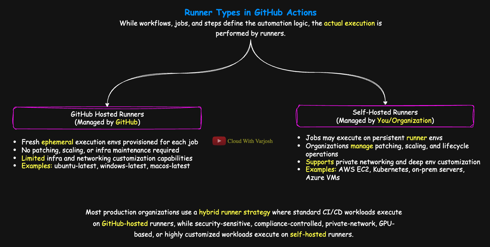

# 07 · Runners: GitHub-Hosted vs Self-Hosted

> **Part A: Foundations** · Previous: [06 · Workflows, jobs and steps](06-workflows-jobs-steps.md) · Next: [08 · First workflow and what happens after `git push`](08-first-workflow-and-what-happens-after-push.md) · [Back to INDEX](INDEX.md)
>
> **Video for the runner-types part of this topic:** [GitHub Actions Triggers & Runners Explained](https://www.youtube.com/watch?v=zpDH_tfOOqc). The first half is also covered in the intro video ([w4c_NIjO3XI](https://www.youtube.com/watch?v=w4c_NIjO3XI)).

---

## What it is

Workflows, jobs and steps describe the **logic**. A **runner** is the **machine that actually does the work**.

A runner:

- **receives** a job from GitHub
- **runs** the job's steps
- **streams** the logs back live
- **reports** the final status (success or failure) to GitHub

Technically, a runner is a computer (VM, physical server, container or Kubernetes pod) running GitHub's open-source **runner application**. That's an agent program that connects to GitHub, asks "any jobs for me?", and runs them.



There are **two types**:

1. **GitHub-hosted runners**: GitHub owns and manages the machines. You just pick the OS. GitHub handles provisioning, scaling, patching, maintenance and the runner lifecycle.

   > **Note:** GitHub-hosted runners are mostly **fresh, ephemeral virtual machines (VMs)**. **Ephemeral** means "used once, then destroyed". A **VM** is a full computer simulated in software. You get a new one **for every job**. Depending on your workflow, steps run **directly on the VM** or **inside containers on that VM** (topic 27).
   >
   > ```text
   > GitHub Hosted Runner
   >         └── Ephemeral VM
   >                 ├── Workflow steps execute directly on VM
   >                 └── OR inside containers running on that VM
   > ```

2. **Self-hosted runners**: machines **you** own and manage. You control the OS, networking, installed software, hardware and security.

   > **Note:** self-hosted runners are **far more flexible**. They can be **VMs, physical servers, containers, Kubernetes pods, GPU machines**, or other custom hardware.

**Jenkins comparison:** a runner is the GitHub Actions version of a **Jenkins agent** (also called a node or worker). The difference is that GitHub can give you agents (hosted runners) without you running any servers.

---

## Why it exists

Code has to run *somewhere*. Teams have different needs:

- A small team wants **zero servers to manage** → GitHub-hosted.
- A bank needs builds **inside its private network** with **compliance controls** → self-hosted.
- An ML (machine learning) team needs **GPUs** → larger hosted runners or self-hosted.

The choice usually depends on:

- who should **own the infrastructure**
- **compliance and security** rules
- special **software or hardware** needs
- access to a **private network** (for example, a database inside your **VPC**, Virtual Private Cloud, which is your private network in the cloud)
- **operational effort** and **cost**

By default every job runs in an **isolated** runner environment: jobs usually run on **separate runners**, while steps inside one job share the **same** runner.

---

## Analogy

- **GitHub-hosted runner** = a **rental car**. You say "I need a sedan" (`ubuntu-latest`), it arrives clean and fuelled, you use it for one trip (one job), and it's returned and cleaned. You never change its oil.
- **Self-hosted runner** = **your own car**. You can install a roof rack and a GPU in the boot, park it inside your company gate (private network)… but **you** service it. And if someone leaves rubbish in it, it's still there for the next trip (it's persistent unless you make it ephemeral).
- **Larger runner** = renting a **truck** from the same rental company: more power, same "they maintain it" deal, higher price.

---

## How it works inside

### Job → runner matching

```text
1. A job is ready (its needs: are satisfied).
2. GitHub reads runs-on: (for example ubuntu-latest).
3. runs-on is a LABEL. GitHub looks for a runner with ALL the labels you listed.
   • Hosted label (ubuntu-latest, windows-latest, macos-latest …)
       → GitHub creates a brand-new VM from that image.
   • Self-hosted labels (self-hosted, linux, x64, gpu …)
       → GitHub waits for an idle registered runner that has those labels.
4. The runner application on that machine picks up the job (it polls GitHub over HTTPS,
   so no inbound ports are needed).
5. Steps run. Logs stream live. Status is reported.
6. Hosted VM → destroyed. Self-hosted → stays (unless configured as ephemeral).
```

### 1. GitHub-hosted runners in detail

- **GitHub manages the infrastructure.** GitHub handles provisioning, scaling, patching, maintenance, security updates and lifecycle. Your team focuses on workflows.
- **Fresh ephemeral machine for every job.** Each job gets its own new VM. That gives better isolation, **reproducibility** (the same input gives the same result) and no **environment drift** (machines slowly becoming different over time).
  - each job runs in an isolated environment
  - jobs don't share files by default
  - an earlier run can't affect a later one
  - runs are reproducible and predictable
- **No patching or maintenance for you.** No OS updates, runner upgrades, monitoring agents, hardening or availability work.
- **Less customization than self-hosted.** You mostly pick Ubuntu, Windows or macOS with `runs-on`. You can install extra tools during the run, but deep infrastructure changes and private network access are limited.
- **Best for** common CI/CD workloads where you want fast onboarding and little operational work.

```yaml
runs-on: ubuntu-latest
```

Other facts:

- Linux, Windows and macOS are available.
- GitHub also offers **larger runners** with more CPU, memory, GPUs, autoscaling and networking options (see below).
- Billing depends on your GitHub plan and minutes used (topic 41).

GitHub-hosted runners are split into **standard runners** and **larger runners**.

#### Standard runners

Standard runners are included by default. GitHub defines and manages their size.

> ⚠️ Corrected: was one table "Ubuntu/Windows 2-4 vCPUs, 8-16 GB RAM, 14 GB SSD; macOS 3-4 vCPUs, 7-14 GB RAM, 14 GB SSD", now split by repository visibility because GitHub gives **public** repos bigger standard runners than **private** repos, and the old single range hid that. Numbers from the official docs (Nov 2026). Always check the [official runner reference](https://docs.github.com/en/actions/reference/runners/github-hosted-runners), because they change.

| Runner (label examples) | Private repos | Public repos |
|---|---|---|
| Linux x64 (`ubuntu-latest`, `ubuntu-26.04`, `ubuntu-24.04`, `ubuntu-22.04`) | 2 vCPU, 8 GB RAM, 14 GB SSD | 4 vCPU, 16 GB RAM, 14 GB SSD |
| Linux arm64 (`ubuntu-26.04-arm`, `ubuntu-24.04-arm`, `ubuntu-22.04-arm`) | 2 vCPU, 8 GB RAM, 14 GB SSD (available in private repos since Jan 2026) | 4 vCPU, 16 GB RAM, 14 GB SSD |
| Windows x64 (`windows-latest`, `windows-2025`) | 2 vCPU, 8 GB RAM, 14 GB SSD | 4 vCPU, 16 GB RAM, 14 GB SSD |
| macOS (`macos-latest`, arm64 / Apple silicon) | about 3 vCPU (M1), 7 GB RAM, 14 GB SSD | same |
| macOS Intel (`macos-*-large`, older images) | about 4 vCPU, 14 GB RAM, 14 GB SSD | same |

> **vCPU** = virtual CPU core. **arm64** = the ARM processor family (like Apple silicon and AWS Graviton). **x64** = the classic Intel/AMD family.

Standard runners are **enough for many CI/CD workloads**. Real needs vary a lot with app architecture, tooling, concurrency, test strategy and pipeline complexity.

Common labels: `ubuntu-latest`, `windows-latest`, `macos-latest`.

> **Production tip (🆕):** `-latest` labels **move** to a new OS version over time, which can break a pipeline overnight. That's happening right now: **`ubuntu-latest` moved from Ubuntu 24.04 to Ubuntu 26.04 between 19 Oct and 19 Nov 2026** ([GitHub changelog](https://github.blog/changelog/2026-09-17-ubuntu-26-generally-available-and-latest-migration)), and 26.04 has updated or removed some pre-installed tools. Production pipelines often **pin** a version, like `ubuntu-26.04` (the capstone does this) or `ubuntu-24.04` if you aren't ready yet, and upgrade on purpose.

#### Why runner sizing matters

- Pipeline speed depends on available **CPU, memory, disk, network** and **parallel capacity**.
- As pipelines grow, standard runners may not be enough for: large **monolithic** builds (one huge codebase), multi-module Maven/Gradle builds, browser-based **end-to-end tests** (testing the whole app like a real user would), heavy integration tests, large Docker image builds, **SAST** scanning, **SBOM** generation, GPU workloads, and high-concurrency **matrix** workflows (topic 26).
- Too little capacity causes slow runs, **memory exhaustion**, **disk pressure** (running out of disk), **timeouts**, flaky behaviour, or failed runs.

#### Larger runners

Larger runners are GitHub-hosted runners with much more compute, memory, storage, networking or scale. Unlike standard runners they support:

- more vCPUs and memory
- **autoscaling**
- **static IP addresses** (fixed IPs you can whitelist in a firewall)
- **Azure private networking** (connect the runner to your private Azure network)
- **grouping and access control** (runner groups)
- **GPU** configurations

They're useful for:

- high-concurrency workloads
- heavy parallel matrix builds
- browser end-to-end testing at scale
- large **monorepo** builds (one repo holding many projects)
- GPU-based ML workloads
- performance-heavy security scanning
- enterprise deployment pipelines

> **Important:** larger runners are only for organizations and enterprises on **GitHub Team** or **GitHub Enterprise Cloud** plans. Organization or enterprise owners create and manage them. [Docs: larger runners](https://docs.github.com/en/actions/using-github-hosted-runners/about-larger-runners)

### 2. Self-hosted runners in detail

Self-hosted runners run jobs on **your** infrastructure:

- on-premises servers (in your own data centre)
- cloud VMs
- Kubernetes clusters
- specialized hardware

With self-hosted runners:

- **Your organization manages the infrastructure:** provisioning, scaling, patching, monitoring, securing and maintaining.
- **Jobs may run on persistent machines.** Unlike hosted runners, they're **not ephemeral by default**. Files, installed software, caches and config can remain between runs.
- **You do the patching and lifecycle work:** OS updates, runner upgrades, hardening, monitoring, scaling strategy.
- **Deep customization and private network access.** You can pre-install custom software, enterprise agents, internal tools and dependencies, and let jobs reach private infrastructure, internal VPC resources, licensed software or special hardware.
- **Best for** compliance-controlled workloads, private networking, GPUs, special hardware, restricted enterprise environments and highly customized needs.

```yaml
runs-on: self-hosted
```

Other facts:

- Self-hosted runners can be configured as **ephemeral runners** (one job, then deregister) for stronger isolation and clean environments.
- **Security matters a lot.** A malicious or compromised workflow can damage a **persistent** self-hosted machine and every job that runs after it. (Never use self-hosted runners on **public** repos, because anyone can open a PR. See topic 37.)
- Billing is whatever your infrastructure costs: AWS EC2, Azure VMs, Google Cloud VMs, and so on.

Self-hosted runners give much more flexibility but also much more operational responsibility. Installing one, labels, groups, ephemeral mode and **ARC** (Actions Runner Controller, which runs runners as Kubernetes pods that scale up and down) are covered in **topic 38**.

### Runner strategy in production

> **Production insight:** most mature companies use a **hybrid runner strategy**:
>
> - **Standard GitHub-hosted runners** for general CI/CD: simple, quick to start, almost no infrastructure work.
> - **Self-hosted runners** for security-sensitive, compliance-controlled, private-network, GPU or highly customized workloads that need ownership and control.
>
> Reference: [GitHub blog: when to choose GitHub-hosted runners or self-hosted runners](https://github.blog/enterprise-software/ci-cd/when-to-choose-github-hosted-runners-or-self-hosted-runners-with-github-actions/)

**Larger hosted runners** are usually adopted only for specific needs:

- high-concurrency enterprise CI/CD
- large-scale browser or integration testing
- GPU-based ML
- memory-hungry security scanning or code analysis
- workflows needing static IPs, autoscaling or Azure private networking

Many companies choose **self-hosted instead of larger hosted runners** when they need:

- deeper infrastructure customization
- stronger compliance isolation
- private network integration
- lower cost at large scale
- Kubernetes-native runner orchestration (ARC)
- long-running specialized workloads

> **Operational insight:** runner strategy depends not only on technical needs but also on security policies, compliance, networking limits, who owns the infrastructure, scalability and total CI/CD cost.

Official docs: [GitHub-hosted runners](https://docs.github.com/en/actions/reference/runners/github-hosted-runners) · [Larger runners](https://docs.github.com/en/actions/using-github-hosted-runners/about-larger-runners) · [Self-hosted runners](https://docs.github.com/en/actions/hosting-your-own-runners)

---

## Workflow YAML / commands

### Demo step 1: print runner details

Create `.github/workflows/03-ci-runners.yaml`:

```yaml
name: 03 - Understanding Runners

on: push

jobs:
  runner-info:
    runs-on: ubuntu-latest

    steps:
      - name: Print Runner Details
        run: |
          echo "Workflow is executing on a GitHub-hosted runner."
          echo "Runner Name: $RUNNER_NAME"
          echo "Runner OS: $RUNNER_OS"
          echo "Runner Architecture: $RUNNER_ARCH"
```

| Line | Meaning |
|---|---|
| `runs-on: ubuntu-latest` | Ask GitHub to create an Ubuntu hosted runner for this job. |
| `$RUNNER_NAME`, `$RUNNER_OS`, `$RUNNER_ARCH` | **Predefined environment variables** the runner sets automatically ([variables reference](https://docs.github.com/en/actions/reference/variables-reference)). |
| `run: |` | YAML multi-line block (topic 03). Several shell commands run in order in the same step. Without `|` you'd have to chain them with `&&` or `;`, or use another YAML string format. |

```bash
# Stage the newly created workflow file
git add .

# Create a commit containing the runner demo workflow
git commit -m "feat: add github-hosted runner demo"

# Push workflow changes to GitHub
git push -u origin main
```

**Sample log output:**

```text
Set up job
  Current runner version: '2.3xx.x'
  Runner Image Provisioner
  Operating System
    Ubuntu 26.04 LTS
  Runner Image
    Image: ubuntu-26.04
    Included Software: https://github.com/actions/runner-images/blob/.../Ubuntu2404-Readme.md
Run echo "Workflow is executing on a GitHub-hosted runner."
Workflow is executing on a GitHub-hosted runner.
Runner Name: GitHub Actions 1000001234
Runner OS: Linux
Runner Architecture: X64
```

What to look at:

- Open **Set up job**, then expand **Runner Image** and **Included Software**.
- You'll see a **huge** list of pre-installed tools: **Git, Docker, Java, Python, Node.js, .NET, Azure CLI, AWS CLI, kubectl, Terraform**, plus build tools and package managers.

> GitHub-hosted runners come with a large software set pre-installed. This matters in practice: many workflows need no install step at all.

> **Note:** if you need software that isn't pre-installed, install it during the run with shell commands or a **setup action** (like `actions/setup-python`, topic 15).

### Demo step 2: Ubuntu and Windows in one workflow

Create `.github/workflows/04-ci-runners.yaml`:

```yaml
name: 04 - Understanding Runners (Win + Ubuntu)

on: push

jobs:
  ubuntu-runner:
    runs-on: ubuntu-latest

    steps:
      - name: Print Ubuntu Runner Details
        run: |
          echo "Workflow is executing on a GitHub-hosted Ubuntu runner."
          echo "Runner Name: $RUNNER_NAME"
          echo "Runner OS: $RUNNER_OS"
          echo "Runner Architecture: $RUNNER_ARCH"

  windows-runner:
    runs-on: windows-latest

    steps:
      - name: Print Windows Runner Details
        shell: bash

        run: |
          echo "Workflow is executing on a GitHub-hosted Windows runner."
          echo "Runner Name: $RUNNER_NAME"
          echo "Runner OS: $RUNNER_OS"
          echo "Runner Architecture: $RUNNER_ARCH"
```

Observations:

- The workflow has **two independent jobs on different OSs**, running **at the same time**.
- `ubuntu-latest` gives an Ubuntu runner. `windows-latest` gives a Windows runner.
- Each job still gets its **own fresh, isolated, ephemeral** machine.
- Jobs **don't share** files, installed software, memory or generated artifacts by default.

**Why `shell: bash`?**

- Ubuntu runners use **Bash** by default.
- Windows runners use **PowerShell** by default.
- The commands use Bash-style variables (`$RUNNER_NAME`), which won't work the same way in native PowerShell (PowerShell uses `$env:RUNNER_NAME`).
- `shell: bash` tells the Windows runner to use **Git Bash** (pre-installed on hosted Windows runners) instead of PowerShell.
- This keeps the syntax **consistent, beginner-friendly and cross-platform**.

Why multi-OS matters in practice:

- different OSs have different tooling
- some enterprise apps need Windows
- some workflows need Linux-native tools
- cross-platform apps must be tested on several OSs at the same time (topic 26 does this with a matrix)

```bash
# Stage the multi-runner workflow
git add .

# Create a commit containing Ubuntu and Windows runner jobs
git commit -m "feat: add multi-runner workflow demo"

# Push workflow changes to GitHub
git push -u origin main
```

**Sample log output (Windows job):**

```text
Run echo "Workflow is executing on a GitHub-hosted Windows runner."
Workflow is executing on a GitHub-hosted Windows runner.
Runner Name: GitHub Actions 1000001240
Runner OS: Windows
Runner Architecture: X64
```

After pushing:

- Open the **Actions** tab. Both jobs run independently in the same workflow run.
- Compare the two job logs and their runner metadata.
- Notice how a different OS is provisioned on demand for each job.
- Compare software, shell behaviour and metadata between Ubuntu and Windows.
- Both jobs ran on isolated ephemeral machines even though they're in the same run.
- Open **Set up job** for both and compare the installed software lists.

---

## Hands-on lab

1. Push both demo workflows.
2. Add a third job with `runs-on: macos-latest` and print `$RUNNER_ARCH`. You should see `ARM64`.
3. Add a job with `runs-on: ubuntu-24.04-arm`. Compare its architecture output.
4. Add a job with `runs-on: self-hosted` **without** registering any runner. Watch it sit in **Queued**, then cancel it. That's the classic "self-hosted runner offline" symptom.
5. In one step, run `df -h` and `nproc` and `free -h`. Check the disk, CPU and memory against the table above.

---

## Where you'll use it

- **Choosing runners** for a new pipeline (hosted first, self-hosted when private network or compliance requires it).
- **Speeding up slow builds** (larger runners or self-hosted).
- **Deploying into private networks** (self-hosted runner inside the VPC, or OIDC + cloud APIs, topic 36).
- **Interview staple:** "hosted vs self-hosted, and what are the security risks of self-hosted?"

---

## When it breaks

| Symptom | Meaning | Fix |
|---|---|---|
| Job stuck on **"Waiting for a runner to pick up this job…"** | No online runner matches **all** labels in `runs-on`. For self-hosted: runner offline, wrong label, or runner group not allowed for this repo. | **Settings → Actions → Runners**: is it *Idle* (online)? Do the labels match? Topic 38. |
| `No space left on device` | 14 GB disk filled (big Docker builds, caches). | Clean up (`docker system prune -af`), remove unused tools, or use a larger runner. |
| Job killed / `The runner has received a shutdown signal` / exit code 137 | Out of memory, or the hosted VM was reclaimed. | Reduce parallelism (`-j` flags), use a larger runner. |
| `$RUNNER_NAME` prints literally / empty on Windows | PowerShell syntax differs. | Use `shell: bash` or `$env:RUNNER_NAME`. |
| Build broke "by itself" overnight | `-latest` moved to a new OS image (e.g. `ubuntu-latest` → 26.04 in Nov 2026). | Pin `ubuntu-26.04` (or `ubuntu-24.04` temporarily) and upgrade deliberately. |
| `The job was not started because ... larger runners` / label not found | Larger runner labels need a Team/Enterprise plan and must be created by an org owner. | Check your plan and the runner group. |

---

## Quick recap

- A runner = a machine running the **runner application**. It pulls jobs, runs steps, streams logs.
- **Hosted:** fresh ephemeral VM per job, managed by GitHub. **Self-hosted:** your machine, your responsibility, persistent by default.
- `runs-on` is a **label match**.
- Standard → larger hosted runners → self-hosted is a trade-off between control, cost and operational work.
- Hybrid strategy is the norm in production.

**Interview questions**

1. **Q: Why are GitHub-hosted runners considered secure and reproducible?**
   A: Each job gets a brand-new VM that's destroyed afterwards, so there's no leftover state or drift between runs.
2. **Q: What's the main security risk of self-hosted runners?**
   A: They're persistent by default. A malicious job can leave malware or steal data that affects later jobs. That's especially dangerous on public repos with fork PRs. Use ephemeral runners and keep them off public repos.
3. **Q: Your job is stuck in "Queued". What do you check?**
   A: Whether any online runner has all the `runs-on` labels, whether the runner group allows the repo, and whether concurrency or plan limits are reached.
