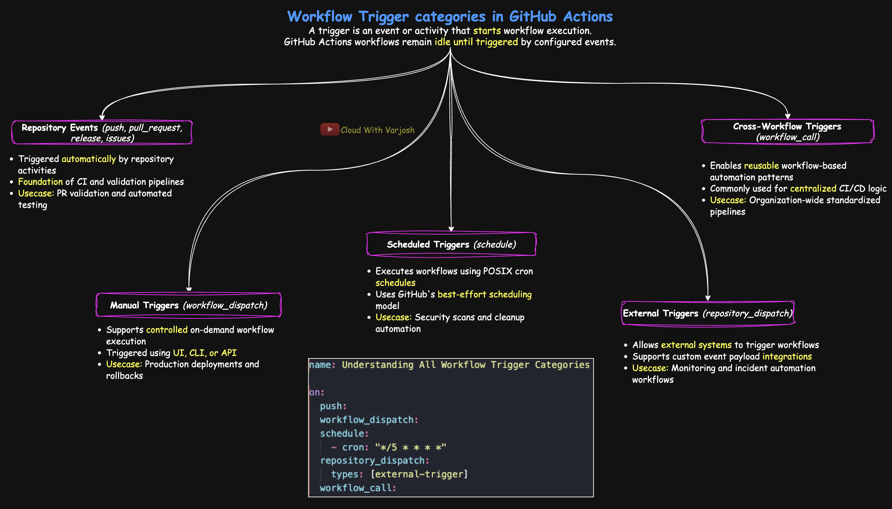

# 09 · Workflow Triggers (Events)

> **Part B: Triggers and logic** · Previous: [08 · First workflow](08-first-workflow-and-what-happens-after-push.md) · Next: [10 · Event filters and activity types](10-event-filters-and-activity-types.md) · [Back to INDEX](INDEX.md)
>
> **Video:** [GitHub Actions Triggers & Runners Explained | Events, Contexts & Hosted Runners](https://www.youtube.com/watch?v=zpDH_tfOOqc)
>
> [](https://www.youtube.com/watch?v=zpDH_tfOOqc)

---

## What it is

A **trigger** is the event listed under `on:` that **starts** a workflow. Until a matching event happens, a workflow does nothing. It's idle.

One workflow can listen to **several triggers at once**.



There are five categories:

1. **Repository events**: automatic, when something happens in the repo: `push`, `pull_request`, `release`, `issues`…
2. **Manual triggers** (`workflow_dispatch`): on demand, from a button, the CLI or the API.
3. **Scheduled triggers** (`schedule`): on a timetable, using **cron** syntax.
4. **External triggers** (`repository_dispatch`): a system **outside** GitHub calls GitHub's API to start the workflow.
5. **Cross-workflow triggers** (`workflow_call`): one workflow **calls** another, reusable workflow.

Full list of events: [Events that trigger workflows](https://docs.github.com/en/actions/reference/workflows-and-actions/events-that-trigger-workflows)

---

## Why it exists

Different automation needs to start for different reasons:

- tests → every time code changes (**push / pull_request**)
- production deploy → only when a person decides (**workflow_dispatch**)
- nightly security scan → at 2 a.m., nothing changed (**schedule**)
- incident clean-up → when the monitoring system raises an alert (**repository_dispatch**)
- shared company pipeline → called by hundreds of repos (**workflow_call**)

**Jenkins comparison:** Jenkins has "build triggers": SCM polling / webhook (≈ push), "Build with Parameters" (≈ `workflow_dispatch` with inputs), "Build periodically" with cron (≈ `schedule`), "Trigger builds remotely" with a token URL (≈ `repository_dispatch`), and **Shared Libraries** (≈ `workflow_call`).

---

## Analogy

A **coffee machine** that can be started in five ways:

1. **Repository event** = a motion sensor: someone walks into the kitchen (a push) → it makes coffee.
2. **workflow_dispatch** = the **button** on the front (or an app on your phone).
3. **schedule** = the **timer**: every weekday at 7 a.m.
4. **repository_dispatch** = your **smart-home hub** (an outside system) sends "make coffee" over Wi-Fi.
5. **workflow_call** = the machine's "**make a latte**" program calls the built-in "**froth milk**" program, which other drinks reuse too.

---

## How it works inside

```text
event happens ─► GitHub builds an event PAYLOAD (JSON: who, what, which branch/PR/tag…)
             ─► for each workflow file, check on: <event>
                    + filters (branches, paths, types — topic 10)
             ─► match → create a run where:
                    github.event_name = "push" | "pull_request" | "schedule" | …
                    github.event      = the full payload
                    GITHUB_SHA / GITHUB_REF = depend on the event (table below)
```

**Which commit and branch a run uses depends on the event** (🆕, a common source of confusion):

| Event | Which workflow file version is used | `GITHUB_SHA` (commit checked out by default) |
|---|---|---|
| `push` | the pushed commit | the pushed commit |
| `pull_request` | the PR's **merge preview** | a temporary **merge commit** of PR + base (`refs/pull/<n>/merge`) |
| `workflow_dispatch` | the branch you pick in the UI (default branch by default) | latest commit on that branch |
| `schedule` | **default branch only** | latest commit on the default branch |
| `repository_dispatch` | **default branch only** | latest commit on the default branch |

---

## Workflow YAML / commands

### 1. Repository events (`push`, `pull_request`, `issues`, `release`)

**What it is:** workflows start automatically when something happens in the repo: commits, PRs, releases, branch creation, issue updates, and other repository activity. These are the foundation of **event-driven CI/CD**, because workflows react whenever the repository changes.

```yaml
on:
  push:
  pull_request:
```

**Production use case:**

- `push` on feature, development or integration branches runs CI: **Maven builds, unit tests, Docker image builds, SAST scans and container publishing**.
- `pull_request` runs **pre-merge** checks: **quality gates, SonarQube, dependency scanning, integration tests, policy checks**, before code can merge into a **protected branch** like `main` (a branch with rules that block direct pushes, topic 30).

> **Insight:** `pull_request` workflows are used heavily in production to **"shift left"**, moving checks earlier in development, before code reaches protected branches.

### 2. Manual triggers (`workflow_dispatch`)

**What it is:** the workflow runs only when someone (or something) deliberately starts it. It adds a **Run workflow** button in the UI, and also works from the GitHub CLI and REST API.

> **Note:** it's listed under "manual", but `workflow_dispatch` really means **"triggerable on demand"**. Once a workflow has:
>
> ```yaml
> on:
>   workflow_dispatch:
> ```
>
> GitHub automatically enables:
>
> - the **Run workflow** button in the UI
> - CLI execution:
>
>   ```bash
>   gh workflow run workflow.yaml
>   ```
>
> - API execution through the dispatch endpoint:
>
>   ```text
>   POST /repos/{owner}/{repo}/actions/workflows/{workflow_id}/dispatches
>   ```
>
> So it's used both for manual operations and for controlled, programmatic runs. (`gh` is the **GitHub CLI**, a command-line tool for GitHub. **REST API** = GitHub's web API, called with HTTP requests.)

> 🆕 **Gotcha:** the **Run workflow** button only appears once the workflow file is on the **default branch** (usually `main`). On a feature branch only, there's no button. The capstone (topic 54) runs into exactly this.

Inputs for `workflow_dispatch` (dropdowns, text boxes) are covered in **topic 20**.

**Production use case:**

- Manually testing new workflows, checking automation behaviour, debugging CI/CD logic, and running workflows on demand when `push`/`pull_request` aren't configured or are disabled on purpose.
- Controlled operations: **production deployments, rollbacks, infrastructure maintenance, environment-specific tasks** that need a deliberate human decision through the UI, CLI or API.

> **Insight:** use `workflow_dispatch` whenever a workflow must run **on demand** instead of waiting for a repo, schedule or external event.

### 3. Scheduled triggers (`schedule`)

**What it is:** runs the workflow periodically using **POSIX cron syntax** (POSIX = Portable Operating System Interface, the Unix standard, here meaning the classic 5-field Unix cron format). No repo activity, human or external system is needed.

```yaml
on:
  schedule:
    - cron: "*/5 * * * *"
```

Cron fields:

```text
┌──────── minute (0-59)
│ ┌────── hour (0-23)
│ │ ┌──── day of month (1-31)
│ │ │ ┌── month (1-12)
│ │ │ │ ┌ day of week (0-6, Sunday = 0)
* * * * *
```

- `*/5 * * * *` = every 5 minutes.
- `30 2 * * 1-5` = 02:30 every Monday–Friday.

Useful cron generator: [crontab.guru](https://crontab.guru/)

GitHub officially supports a **minimum interval of 5 minutes**.

> ⚠️ Corrected: was "uses standard cron syntax" with no other rules, now three missing facts are added because they cause real "my schedule never runs" bugs:
> 1. **Times are in UTC** (Coordinated Universal Time). `0 9 * * *` is 09:00 UTC, which is 14:30 in India (IST).
> 2. Scheduled workflows run **only from the default branch**. A `schedule:` on a feature branch never fires.
> 3. In **public** repos, scheduled workflows are **automatically disabled after 60 days without repository activity**. Re-enable them from the Actions tab.

**Production use case:**

- Nightly **dependency vulnerability scans, SBOM regeneration, container image rescans and compliance checks** across many repos.
- Periodic **reconciliation**: checking **Kubernetes cluster state, backup health, credential rotation, artifact clean-up and compliance reporting**.

> **Important:** scheduled workflows are **best-effort** on all GitHub plans, including with self-hosted runners. They're reliable enough for most automation, but GitHub **does not guarantee exact timing**. Runs can be delayed when the platform is busy. **Self-hosted runners** can **reduce** the extra queueing and runner-allocation delay, because your organization controls the machines instead of sharing GitHub's pool.

Production considerations:

- Schedules are **not guaranteed to start on time**.
- At high platform load, delays can be noticeable.
- Popular times like `*/5 * * * *` or `0 * * * *` (the top of the hour) suffer more **contention** (many repos competing at the same moment).
- GitHub recommends **avoiding heavily synchronized times**: pick odd minutes like `17 3 * * *`.
- Typical uses: dependency update automation, security scanning, periodic clean-up, infrastructure reconciliation, scheduled reports, health checks.

> **Operational insight:** use schedules for background automation that **doesn't need real-time guarantees**.
>
> Official docs: [schedule event](https://docs.github.com/en/actions/reference/events-that-trigger-workflows#schedule)

### 4. External triggers (`repository_dispatch`)

**What it is:** a system **outside GitHub** starts the workflow by sending an **HTTP POST** request with a **custom payload** (your own JSON data) to GitHub's REST API. This lets GitHub Actions plug into the wider company automation world: ops tools, cloud services, monitoring systems, deployment orchestrators and internal platforms.

```yaml
on:
  repository_dispatch:
    types: [prometheus-alert]   # your own event names
```

```bash
# Sent by the external system (needs a token allowed to write to the repo)
curl -X POST \
  -H "Authorization: Bearer $TOKEN" \
  -H "Accept: application/vnd.github+json" \
  https://api.github.com/repos/OWNER/REPO/dispatches \
  -d '{"event_type":"prometheus-alert","client_payload":{"severity":"critical"}}'
```

In the workflow, read the data as `${{ github.event.client_payload.severity }}`.

**Production use case:**

- Start incident workflows when **high-severity Prometheus, Datadog or cloud monitoring alerts** fire: collect logs, create incident artifacts, send notifications, or run remediation.
- Let enterprise systems like **ServiceNow** (an **ITSM**, IT Service Management, tool), internal deployment managers or governance platforms start provisioning, rollback, disaster recovery or compliance workflows.

> **Insight:** use `repository_dispatch` when an **external** system must start GitHub Actions workflows from its own events.

### 5. Cross-workflow triggers (`workflow_call`)

**What it is:** lets one workflow **call** another workflow. That builds modular, reusable, standardized CI/CD across repos and teams. Instead of copying deployment, test, security and compliance logic into hundreds of repos, you write it once.

```yaml
# reusable workflow
on:
  workflow_call:
```

> **Note (Jenkins comparison):** reusable workflows with `workflow_call` are similar to **Jenkins Shared Libraries**. Both give you **central CI/CD logic, reusable patterns, organization-wide standards and less duplicated pipeline code**.

Full details (inputs, outputs, secrets) are in **topic 22: Reusable workflows**. You need inputs (topic 20) and outputs (topic 21) first.

**Production use case:**

- A central **platform engineering team** (the team that builds internal tools for other developers) publishes reusable workflows for **build, testing, security scans, SBOM generation, artifact signing and deployment**, used by hundreds of repos.
- Governance: every app team **must** use the centrally managed workflows instead of maintaining its own scattered pipelines.

> **Insight:** reusable workflows matter most at scale, when an organization has hundreds or thousands of repos that need the same CI/CD behaviour.

### Production perspective: combining triggers

Real organizations rarely use just one trigger category. They combine them based on operational, security, governance and deployment needs:

- **`push` + `pull_request`** → CI, automated tests, validation, pre-merge quality checks
- **`workflow_dispatch`** → controlled prod deployments, rollbacks, maintenance, human-approved releases
- **`schedule`** → security scans, dependency management, clean-up, compliance, reconciliation
- **`repository_dispatch`** → integration with monitoring, ITSM, cloud automation, deployment orchestrators
- **`workflow_call`** → central platform engineering, reusable CI/CD standards, governance, standardization at scale

> **Operational insight:** the trigger strategy is decided by the app's operational needs, how critical deployments are, governance controls, security posture, and the organization's automation maturity.

---

### Demo step 1: Repository setup

Use the `cwvj-gha-practice` private repo and SSH setup from [topic 02](02-git-and-github-recap.md).

### Demo step 2: Print which event triggered the run

Create `.github/workflows/01-ci-contexts.yaml`:

```yaml
name: "01 - Understanding Contexts"

on: push

jobs:
  event-info-job:
    runs-on: ubuntu-latest

    steps:
      - name: Print Trigger Event
        run: echo "My trigger is ${{ github.event_name }} event"
```

`${{ github.event_name }}` is the **first context you meet**. Here's a quick explanation now, and the full one in topic 11:

- `${{ }}` = **expression syntax**. GitHub computes the value **before** handing the command to the runner.
- `github` = the built-in **`github` context**: an object full of run information (repo, actor, branch, event payload, workflow IDs…).
- `event_name` = a property in that object: **which event started this run**.

Since the trigger is `on: push`, the output is:

```text
My trigger is push event
```

```bash
# Initialize a new local Git repository
git init

# Stage all files for commit
git add .

# Create a new commit with a meaningful message
git commit -m "feat: add workflow event trigger demo"

# Rename the current branch to main
git branch -M main

# Connect the local repository to the remote GitHub repository
git remote add origin git@github.com:<YOUR_GITHUB_USERNAME>/cwvj-gha-practice.git

# Push the local main branch to GitHub
git push -u origin main
```

> **Note:** if the repo already has files from earlier demos, the push may fail because of **unrelated Git history** (the two histories share no common commit). Either clean the repo first, or use a force push (`--force`) carefully, and only if that's acceptable in a demo environment.

After pushing: open the **Actions** tab, see the new run, open the logs, and check the step output. The value of `${{ github.event_name }}` changes depending on the event. For now only `push` is configured.

> **Note (Jenkins comparison):** GitHub Actions mainly uses a **context-based metadata system** (`github`, `runner`, `job`, `steps`, …) instead of only **flat** environment variables like Jenkins.
>
> - Contexts give **structured, namespaced** metadata through expressions like `${{ github.event_name }}` or `${{ github.event.pull_request.title }}`.
> - Unlike flat variables, contexts support **nested (hierarchical) access** into rich event payloads.
> - Jenkins exposes metadata as flat variables like `BUILD_NUMBER`, `JOB_NAME` and `WORKSPACE`.
> - Contexts give **better organization, fewer naming collisions, richer expressions and easy access to deeply nested data**.

### Demo step 3: Many triggers in one workflow

Create `.github/workflows/02-ci-events.yaml`:

```yaml
name: "02 - Understanding Events"

on:
  workflow_dispatch:
  push:
  pull_request:
  schedule:
    - cron: "*/5 * * * *"

jobs:
  event-info-job:
    runs-on: ubuntu-latest

    steps:
      - name: Print Trigger Event
        run: echo "My trigger is ${{ github.event_name }} event"
```

Observations:

- The same workflow now runs through **manual, repository and scheduled** triggers.
- `on:` is now a **map** (dictionary) instead of a single value (topic 03).
- The map form is more flexible, because each event can have its own settings:
  - branch filters
  - path filters
  - activity types
  - cron schedules
  - conditional behaviour
  - workflow input parameters

Example:

```yaml
on:
  push:
    branches:
      - main
```

This limits the workflow to pushes on `main` (topic 10).

This workflow now supports:

- `workflow_dispatch` → manual, from the UI, API or CLI
- `push` → whenever commits are pushed
- `pull_request` → whenever PR activity happens
- `schedule` → periodically, by cron

```bash
# Stage the modified workflow file
git add .

# Create a new commit containing multiple workflow triggers
git commit -m "feat: add multiple workflow event triggers"

# Push the updated workflow to GitHub
git push -u origin main
```

**Sample log output** (four different runs):

```text
Run #3  (push)               → My trigger is push event
Run #4  (workflow_dispatch)  → My trigger is workflow_dispatch event
Run #5  (pull_request)       → My trigger is pull_request event
Run #6  (schedule)           → My trigger is schedule event     ← may arrive minutes late
```

After pushing:

- Open the **Actions** tab and see runs created by **different triggers**.
- Click **Run workflow** (from `workflow_dispatch`).
- Open a PR or push more commits and watch the event name change.
- Check `${{ github.event_name }}` in each run's logs.
- The same logic behaves differently depending on which event started it.

> **Important observation:** scheduled (cron) runs may not fire immediately or exactly on time, especially on free tiers, low-activity repos, or crowded times. GitHub documents schedules as **best-effort**.

> **Tip:** don't leave a `*/5` schedule running in your practice repo. It uses minutes all day. Remove it after the demo.

---

## Hands-on lab

1. Push `02-ci-events.yaml`. Trigger it four ways: push, **Run workflow**, open a PR, and wait for the schedule.
2. Run it from your terminal: `gh workflow run 02-ci-events.yaml` and then `gh run list --limit 5`.
3. Add `repository_dispatch:` with `types: [hello]` and trigger it with the `curl` command above (use a fine-grained PAT with **Contents: write**, or `gh api repos/OWNER/REPO/dispatches -f event_type=hello`). Print `${{ github.event.client_payload }}`.
4. Change the cron to a time 10 minutes from now **in UTC**. Did it run on time?
5. Delete the schedule when you're done.

---

## Where you'll use it

- **CI:** `pull_request` + `push` to `main`.
- **CD:** `push` to `main` (or tags) for dev, `workflow_dispatch` for prod or rollback.
- **Nightly:** `schedule` for Trivy rescans, dependency checks, clean-up.
- **Integration:** `repository_dispatch` from monitoring or ITSM.
- **Platform teams:** `workflow_call` reusable pipelines (topic 22).
- **Chaining workflows:** `workflow_run` (start when another workflow finishes) is covered in topic 31. The capstone uses it.

---

## When it breaks

| Symptom | Meaning | Fix |
|---|---|---|
| Workflow **not triggering** on push | Wrong branch filter, `paths` didn't match, or the file isn't on that branch. | Check the `on:` filters (topic 10). Is the workflow file in the pushed commit? |
| No **Run workflow** button | The workflow isn't on the default branch, or there's no `workflow_dispatch:`. | Merge it to `main` first. |
| `schedule` never runs | Not on the default branch, wrong UTC time, repo inactive 60+ days (public), or just delayed. | Move it to the default branch, re-check the UTC time, re-enable in the Actions tab. |
| `repository_dispatch` returns **404** | The token lacks access, or the owner/repo URL is wrong. | Use a token with repo write access. Check the URL. |
| `repository_dispatch` returns 204 but no run | `event_type` doesn't match `types:`, or the workflow isn't on the default branch. | Match the names. Merge to the default branch. |
| Pushes made **by a workflow** using `GITHUB_TOKEN` don't trigger other workflows | Deliberate rule to prevent infinite loops. | Use `workflow_run`, a GitHub App token or a PAT (topics 18, 31). |
| Push fails: unrelated histories | The local repo and remote don't share history. | Clean the repo, or `--force` carefully in a demo repo. |

---

## Quick recap

- Five trigger categories: repository events, `workflow_dispatch`, `schedule`, `repository_dispatch`, `workflow_call`.
- One workflow can have many triggers. `on:` as a map allows per-event settings.
- Cron runs in **UTC**, from the **default branch only**, is **best-effort**, minimum 5 minutes, and is auto-disabled after 60 inactive days in public repos.
- `workflow_dispatch` = UI button + `gh workflow run` + API.
- `${{ github.event_name }}` tells you which event started the run.

**Interview questions**

1. **Q: How do you let an external monitoring tool start a workflow?**
   A: `on: repository_dispatch` with custom `types`. The tool POSTs to `/repos/{owner}/{repo}/dispatches` with an `event_type` and an optional `client_payload`.
2. **Q: Your nightly schedule didn't run. Name three possible reasons.**
   A: It isn't on the default branch, the time was computed in local time instead of UTC, it was auto-disabled after 60 days of inactivity (public repo), or it was simply delayed (best-effort).
3. **Q: What's the Jenkins equivalent of `workflow_call`?**
   A: Jenkins Shared Libraries: central, reusable pipeline logic.

---

### References

- [Events that trigger workflows](https://docs.github.com/en/actions/using-workflows/events-that-trigger-workflows)
- [Variables reference](https://docs.github.com/en/actions/reference/variables-reference)
- [Contexts reference](https://docs.github.com/en/actions/reference/workflows-and-actions/contexts)
- [GitHub-hosted runners](https://docs.github.com/en/actions/reference/runners/github-hosted-runners)
- [Larger runners](https://docs.github.com/en/actions/using-github-hosted-runners/about-larger-runners)
- [Self-hosted runners](https://docs.github.com/en/actions/hosting-your-own-runners)
- [Workflow syntax](https://docs.github.com/en/actions/using-workflows/workflow-syntax-for-github-actions)
