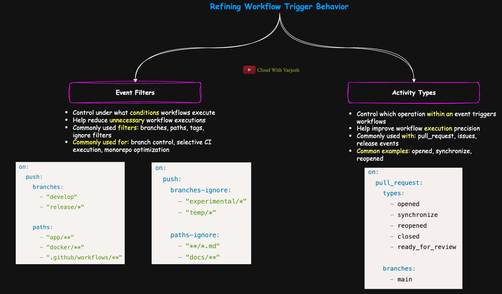

# 10 · Event Filters and Activity Types

> **Part B: Triggers and logic** · Previous: [09 · Workflow triggers](09-workflow-triggers.md) · Next: [11 · Variables, contexts and expressions](11-variables-contexts-expressions.md) · [Back to INDEX](INDEX.md)
>
> **Video:** [GitHub Actions Workflow Logic Explained | Filters, Contexts, Variables & Expressions](https://www.youtube.com/watch?v=KIH79Y3xJ8c) (first half)
>
> [](https://www.youtube.com/watch?v=KIH79Y3xJ8c)

---

## What it is

`on: push` means "run on **every** push". In real companies that's far too often. GitHub gives you two ways to narrow it down:

1. **Event filters**: **under what conditions** the event counts. Examples: only for certain **branches**, **tags**, or **file paths**.
2. **Activity types**: **which action inside an event** counts. Example: a PR being `opened` vs `closed` vs `labeled`.



---

## Why it exists

Companies rarely want a workflow to run for every possible event. They want it to run only when something meaningful changed.

Without filters you get:

- **unnecessary runs**: workflows run even when nothing important changed
- **higher CI/CD cost**: more runs use more minutes and infrastructure
- **wasted runner capacity**: runners busy with irrelevant jobs
- **longer queues**: important workflows wait behind useless ones
- **lower productivity**: slower feedback for engineers

So this topic is about running **only when meaningful changes happen**, which also brings in conditional orchestration, AND vs OR logic, and the difference between what the workflow engine decides and what the runner does.

**Jenkins comparison:** in Jenkins you'd use the "Included/Excluded Regions" or "Branches to build" settings, or a `when { branch 'main'; changeset 'app/**' }` block. GitHub does this filtering **before** any runner starts, so a filtered-out event costs nothing.

---

## Analogy

A **mail-room clerk** with rules:

- **Event filter** = "only accept letters addressed to the **Develop** or **Feature** departments (`branches`), and only if they're about the **App** or **Docker** projects (`paths`)."
- **Activity type** = "for parcels (pull requests), only process them when one is **opened**, **re-sent** (`synchronize`), or **closed**, not when someone only puts a sticker on it (`labeled`)."
- Every rule for one kind of mail must be true (**AND**). But letters and parcels are handled separately, and either one can trigger work (**OR**).

---

## How it works inside

```text
event arrives (e.g. push to feature/login changing app/main.py)
   │
   ├─ for EACH top-level event under on: … evaluated independently (OR between events)
   │
   └─ inside one event, ALL configured conditions must match (AND):
         branches / branches-ignore   → does the branch name match a pattern?
         tags / tags-ignore           → (for tag pushes)
         paths / paths-ignore         → does ANY changed file match? (for paths)
         types                        → is this activity one of the listed types?
   │
   ├─ all true  → workflow run created
   └─ any false → nothing happens (no run, no log, no cost)
```

Two important details (🆕):

- For `pull_request`, `branches:` checks the **target (base) branch** of the PR (the branch you're merging **into**), not the feature branch.
- A filtered-out event leaves **no trace** in the Actions tab. "My workflow didn't run" is often a filter doing exactly what you told it to do.

---

## Workflow YAML / commands

### 1. Event filters

So far you've used blanket triggers:

```yaml
on:
  push:
```

This means: run on any push, with no extra filtering. Every push can start the workflow. That's fine for learning and small repos, but **production** usually needs finer control. Companies may want to:

- trigger only for **specific branches**
- ignore **documentation-only changes**
- run only when **application code** changes
- deploy only from **release branches**
- skip CI for **non-operational changes**

The common filters:

- **`branches`** / **`branches-ignore`**
- **`tags`** / **`tags-ignore`**
- **`paths`** / **`paths-ignore`**

#### Example 1: `branches` and `paths` (include filters)

```yaml
on:
  push:
    branches:
      - "develop"
      - "release/*"

    paths:
      - "app/**"
      - "docker/**"
      - ".github/workflows/**"
```

This runs only when:

- the push goes to **`develop`** or **`release/*`**, **and**
- the push changes something inside **`app/`**, **`docker/`** or **`.github/workflows/`**

**Wildcards** (also called **glob patterns**):

| Pattern | Matches |
|---|---|
| `*` | anything **except** `/` (one folder level). `release/*` matches `release/1.0` but **not** `release/1.0/hotfix`. |
| `**` | anything **including** `/`, so **recursive** (any depth). |
| `!pattern` | 🆕 negates a pattern inside a list (for example `- "!release/old"`). |

So `app/**` matches all files and folders inside `app/` at any depth:

```text
app/main.py
app/api/routes.py
app/services/auth/login.py
```

All three match `app/**`. That's very useful because real apps have **deeply nested** folders.

#### Example 2: ignore filters (exclude filters)

```yaml
on:
  push:
    branches-ignore:
      - "experimental/*"
      - "temp/*"

    paths-ignore:
      - "**/*.md"
      - "docs/**"
```

This does **not** run for:

- pushes to **`experimental/*`** or **`temp/*`**
- pushes that change **only** Markdown files or files in **`docs/`**

Used to:

- avoid unnecessary CI runs
- reduce workflow cost
- stop temporary branches from using runner capacity

> **Important:** for a single event, you **cannot** combine:
>
> - `branches` with `branches-ignore`
> - `paths` with `paths-ignore`
>
> Choose either include or exclude for each event. (If you need both, use `branches` with `!` negative patterns.)

> **Production insight:** large repos and **monorepos** (one repo holding many apps) depend heavily on path filters, so each workflow runs only for its own app or infrastructure, not for the whole repo.

> **Production insight:** filters reduce unnecessary runs, cut CI/CD cost, improve runner use, and reduce queue congestion.

### 2. Activity types

Filters control **under what conditions**. **Activity types** control **which operation within an event** triggers the workflow.

Many events have several possible activities. A pull request can be **opened, updated, reopened, closed, marked ready for review, assigned reviewers**, and more. All of these are the same event:

```yaml
pull_request
```

Activity types let you choose which of those activities matter:

```yaml
on:
  pull_request:
    types:
      - opened
      - synchronize
      - reopened
      - closed
      - ready_for_review

    branches:
      - main
```

This runs when a PR is:

- **opened**
- updated with **new commits** (`synchronize`)
- **reopened** after being closed
- **closed** (merged or not)
- moved from draft to **ready for review**

…and only for PRs that **target `main`**.

> **Important:** by default, `pull_request` runs for only three activity types:
>
> - `opened`
> - `synchronize`
> - `reopened`
>
> Others, like `closed` and `ready_for_review`, must be listed explicitly with `types`.

**`synchronize` is the one people misunderstand.** Many beginners think it means "repository sync". In GitHub Actions it means: **new commits were pushed to the branch of an existing PR.**

1. Developer opens a PR
2. CI runs
3. Reviewer gives feedback
4. Developer pushes more commits
5. GitHub generates a **`synchronize`** activity
6. The workflow runs again automatically

That matters because CI should re-run whenever the PR's content changes.

The `branches: - main` part is an extra **event filter**. The workflow runs only when **both** are true:

- the PR targets **`main`**, **and**
- one of the listed activity types happened

> 🆕 **Tip:** to run something **only when a PR is merged**, use `types: [closed]` plus `if: github.event.pull_request.merged == true` on the job (`if:` is covered in topic 13).

#### Activity types on other events

Activity types aren't only for pull requests. Many events support them.

**Issues:**

```yaml
on:
  issues:
    types:
      - opened
      - closed
      - labeled
```

Runs when an issue is created, closed, or labelled.

**Releases:**

```yaml
on:
  release:
    types:
      - published
      - prereleased
```

Runs when a production release is published, or a pre-release is published.

#### Key production insights

- **Activity types and filters** prevent **unnecessary runs**, which reduces cost, runner use and queue congestion.
- **PR workflows** usually re-run on every new commit, so CI always reflects the **latest code**.
- **Release activity types** are used a lot for **deployment automation, artifact publishing, release notifications and production release orchestration**.
- Understand the **AND** relationship between activity types and filters. Wrong trigger conditions are one of the most common reasons for **unexpected runs** and **skipped CI** in production.

---

### Demo: event filters and activity types in action

You'll check push-based runs, branch filtering, path filtering, PR activity types, run conditions, and cases where nothing triggers.

#### Step 1: Repository setup

Use the `cwvj-gha-practice` private repo and SSH setup from [topic 02](02-git-and-github-recap.md).

#### Step 2: Create the workflow file

Inside `project-files`:

```bash
mkdir -p .github/workflows
```

Create `.github/workflows/01-filter-type-demo.yaml`:

```yaml
name: 01 - Production Workflow Trigger Demo

on:
  push:
    branches:
      - "develop"
      - "feature/*"

    paths:
      - "app/**"
      - "docker/**"
      - ".github/workflows/**"

  pull_request:
    types:
      - opened
      - synchronize
      - reopened
      - closed
      - ready_for_review

    branches:
      - "main"

jobs:
  validation-job:
    runs-on: ubuntu-latest

    steps:
      - name: Print Workflow Context
        run: |
          echo "Workflow triggered successfully"
          echo "Event Type: $GITHUB_EVENT_NAME"
          echo "Branch: $GITHUB_REF_NAME"
```

It shows branch filters, path filters, PR activity types, and multiple trigger conditions. `$GITHUB_EVENT_NAME` and `$GITHUB_REF_NAME` are **default environment variables** that GitHub sets on the runner (topic 11).

**When will this workflow trigger?** From **either** of these top-level events. They don't need to happen together:

- a matching **`push`**, **OR**
- a matching **`pull_request`**

For **`push`**, it triggers only when:

- the push goes to `develop` **or** `feature/*`
- **and** it changes something in `app/**`, `docker/**` or `.github/workflows/**`

For **`pull_request`**, it triggers only when:

- the PR targets `main`
- **and** the activity is `opened`, `synchronize`, `reopened`, `closed` or `ready_for_review`

> **Important:** the **AND** behaviour applies to the filters and types **within one event** (like `push` or `pull_request`).
>
> Different **top-level events** behave like **OR**:
>
> - a matching `push` can trigger the workflow
> - a matching `pull_request` can also trigger it
>
> GitHub checks each event independently. A run is created whenever any configured event matches.
>
> If several events each match, GitHub can create **several runs**.
>
> Docs: [Using activity types and filters with multiple events](https://docs.github.com/en/actions/writing-workflows/workflow-syntax-for-github-actions#using-activity-types-and-filters-with-multiple-events)

#### Step 3: Create the application folders

```bash
mkdir app
mkdir docker
touch app/app.py
```

> **Note:** `app.py` can be empty. This demo only checks trigger behaviour.

These folders matter because of the path filter:

```yaml
paths:
  - "app/**"
  - "docker/**"
  - ".github/workflows/**"
```

The workflow runs only when files in these paths change.

#### Step 4: Initialize Git and set the main branch

```bash
git init
git branch -M main
git remote add origin git@github.com:<YOUR_GITHUB_USERNAME>/<YOUR_REPOSITORY_NAME>.git
```

- `git init` creates `.git/` and enables tracking, commits and branches.
- `git branch -M main`: some Git installs still default to **`master`**, GitHub uses **`main`**, and matching names avoids confusion with pushes and PRs.
- The repo must already exist and SSH must work (topic 02).

#### Step 5: Show that a push to main does NOT trigger it

Add to `app/app.py`:

```python
print("GitHub Actions Trigger Demo")
```

```bash
git add .
git commit -m "feat: add trigger demo application"
git push -u origin main
```

(`-u` sets the upstream, so later pushes and pulls don't need the branch name.)

Even though a valid **`push`** happened and the changed file matched **`app/**`**, the workflow does **NOT** run.

Why? The push filter only allows:

```yaml
branches:
  - "develop"
  - "feature/*"
```

So a direct push to

```text
main
```

fails the branch condition.

**The lesson:**

- workflows run only when **all configured conditions** match
- even a valid event is **skipped** if the branch filter doesn't match

**Sample "log output":** nothing. The Actions tab shows **no new run**. That's the expected result.

> **Production insight:** in real companies, direct pushes to **`main`** are usually **blocked** by **branch protection rules** (topic 30). Developers must open a PR, pass CI, and get approvals before merging.

#### Step 6: Feature branch → the workflow triggers

```bash
git switch -c feature/trigger-demo
```

(`git switch -c` = create a new branch and switch to it.)

The pattern

```yaml
feature/*
```

matches branches like:

```text
feature/login
feature/payment-api
feature/trigger-demo
```

Add another line to `app/app.py`:

```python
print("Triggering workflow from feature branch")
```

```bash
git add .
git commit -m "feat: trigger workflow from feature branch"
git push -u origin feature/trigger-demo
```

This time it runs, because:

- a valid **`push`** happened
- the branch matched **`feature/*`**
- the changed file matched **`app/**`**

All conditions are satisfied.

**Sample log output:**

```text
Run echo "Workflow triggered successfully"
Workflow triggered successfully
Event Type: push
Branch: feature/trigger-demo
```

> **Production insight:** feature branches are used heavily because they isolate changes, let teams test CI/CD safely, and lead to PRs before merging into stable branches like **`main`** or **`develop`**.

#### Step 7: Open a PR and watch it run

Create the PR:

```text
feature/trigger-demo → main
```

When it's created:

- GitHub generates a **`pull_request`** event, and the workflow runs again
- the target branch is **`main`**, and the activity type is **`opened`**
- it succeeds because the branch filter allows **`main`** and the types allow **`opened`**

Matching conditions:

```yaml
branches:
  - main
```

```yaml
types:
  - opened
```

**Sample log output:**

```text
Workflow triggered successfully
Event Type: pull_request
Branch: 1/merge
```

`Branch: 1/merge`: for PR runs, `GITHUB_REF_NAME` is `<PR number>/merge` because the run tests the temporary **merge commit** (topic 09). To get the feature branch name, use `$GITHUB_HEAD_REF`.

This confirms the workflow ran because of a valid PR event with a matching activity type.

#### Step 8: The `synchronize` activity type

Add another line to `app/app.py`:

```python
print("Testing synchronize activity type")
```

```bash
git add .
git commit -m "feat: validate synchronize workflow trigger"
git push origin feature/trigger-demo
```

Since the PR is open:

- GitHub generates the **`synchronize`** activity
- the PR is updated with the new commit
- the workflow runs again automatically

In the **Actions** tab you'll see **two separate runs**:

- one from the **`push`** event on **`feature/trigger-demo`**
- one from the **`pull_request`** event with activity type **`synchronize`**

```text
01 - Production Workflow Trigger Demo  #3  push           feature/trigger-demo
01 - Production Workflow Trigger Demo  #4  pull_request   #1 (synchronize)
```

The production behaviour this shows:

- when new commits are pushed to an open PR
- CI re-runs automatically
- validation always reflects the latest code
- developers get fresh feedback after every change

> 🆕 **Tip:** running both `push` on `feature/*` and `pull_request` doubles your CI minutes. Many teams use `push` only for `main` and `pull_request` for everything else. Topic 29 (concurrency) shows how to cancel the duplicate.

---

## Hands-on lab

1. Follow Steps 1–8.
2. Change only `README.md` on the feature branch and push. **Predict** (push filter: no, because of `paths`. PR synchronize: **yes**, because the PR event has no `paths`) and check.
3. Add `paths-ignore: ["**/*.md"]` to `pull_request` and repeat step 2.
4. Close the PR without merging and see a run with type `closed`. Then reopen it (type `reopened`).
5. Try adding both `paths` and `paths-ignore` to `push` and read the validation error.

---

## Where you'll use it

- **Monorepos:** `paths: ["services/payments/**"]` so each service has its own CI.
- **Docs-only PRs:** `paths-ignore: ["docs/**", "**/*.md"]` saves money.
- **Release pipelines:** `push: tags: ["v*"]` or `release: types: [published]`.
- **Merged-only deploys:** `pull_request: types: [closed]` + `if: github.event.pull_request.merged`.
- The capstone (topic 43) uses filters so a push to a feature branch does **not** trigger CI, only the PR does.

---

## When it breaks

| Symptom | Meaning | Fix |
|---|---|---|
| **Workflow not triggering** | A branch, path or type filter didn't match. That's the #1 cause. | Re-read every filter for that event. Remember AND inside one event. |
| Workflow file has an error: `you may only define one of 'paths' and 'paths-ignore'` | Both include and exclude used for one event. | Choose one, or use `!` patterns. |
| `release/*` didn't match `release/1.0/hotfix` | `*` doesn't cross `/`. | Use `release/**`. |
| PR to `develop` didn't trigger | `branches:` on `pull_request` checks the **target** branch. | Add `develop`. |
| Two runs per commit | `push` and `pull_request` both matched (OR). | Narrow one of them, or use concurrency (topic 29). |
| Required check stuck **"Expected — Waiting for status"** on a docs-only PR | The workflow was skipped by `paths`, so the required check never reported. | Don't use path filters on required workflows. Filter at job level with `if:`, or use a lightweight "always passes" job. |
| Tag push didn't trigger | Only `branches:` was defined. Tags need `tags:`. | Add a `tags:` filter. |

---

## Quick recap

- **Filters** (`branches`, `tags`, `paths`, and their `-ignore` versions) = under what conditions. **Types** = which activity.
- Inside one event: **AND**. Between events: **OR**, and each match is its own run.
- `pull_request` defaults to `opened`, `synchronize`, `reopened`. `synchronize` = new commits on an open PR.
- `*` = one level, `**` = any depth. You can't mix include and ignore for the same filter.
- Filtered-out events leave no run at all.

**Interview questions**

1. **Q: What does `synchronize` mean?**
   A: New commits were pushed to the head branch of an open pull request.
2. **Q: A workflow has `push: branches: [develop]` and `paths: [app/**]`. A push to `develop` changes only `README.md`. Does it run?**
   A: No. Both conditions must be true (AND), and the path didn't match.
3. **Q: Why might path filters be dangerous on required status checks?**
   A: If the workflow is skipped, the required check never reports, so the PR can't be merged.
