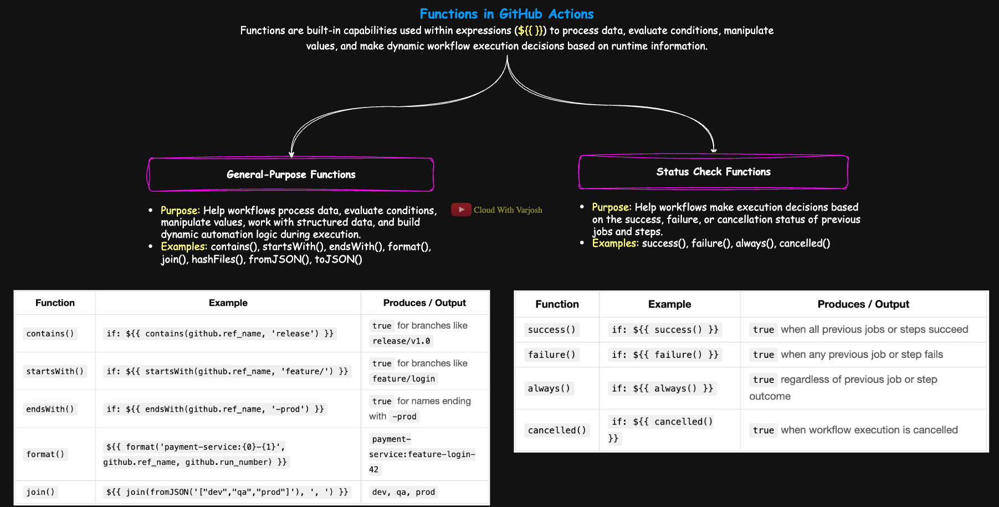

# 12 · Functions and Status Check Functions

> **Part B: Triggers and logic** · Previous: [11 · Variables, contexts and expressions](11-variables-contexts-expressions.md) · Next: [13 · Conditional execution](13-conditional-execution.md) · [Back to INDEX](INDEX.md)
>
> **Video:** [GitHub Actions Functions Explained | Build a Production-Style CI Pipeline](https://www.youtube.com/watch?v=Y0kDz3BEtM4) (theory part. The demo pipeline from this video is in [topic 19](19-lab-docker-build-push.md).)
>
> [](https://www.youtube.com/watch?v=Y0kDz3BEtM4)

---

## What it is

**Functions** are built-in helpers you use **inside expressions** (`${{ }}`) to **process data, check conditions, change values and make decisions** while the workflow runs.

```yaml
${{ startsWith(github.ref_name, 'release/') }}
```

There are two groups:

1. **General-purpose functions**: work with strings, arrays, JSON and files: `contains`, `startsWith`, `endsWith`, `format`, `join`, `hashFiles`, `fromJSON`, `toJSON`.
2. **Status check functions**: answer "how did the earlier steps/jobs go?": `success()`, `failure()`, `always()`, `cancelled()`.



Reference: [Expressions → Functions](https://docs.github.com/en/actions/reference/workflows-and-actions/expressions#functions)

---

## Why it exists

Without functions you'd hard-code everything. With functions, workflows can:

- compare values dynamically
- validate strings and branch names
- process workflow data
- generate dynamic outputs
- work with JSON objects and arrays
- build smarter automation logic

They're used heavily in production for **branch validation, deployment logic, environment selection, caching, orchestration and failure handling**.

**Jenkins comparison:** in a Jenkinsfile you'd write Groovy (`env.BRANCH_NAME.startsWith('release/')`, `post { failure { … } always { … } }`). In GitHub Actions the same ideas are expression functions and status checks in `if:`.

---

## Analogy

- **General-purpose functions** = the **tools on a kitchen counter**: a scale (compare), a label maker (`format`), a sieve (`contains`). They help you prepare ingredients (data).
- **Status check functions** = the **kitchen's rules after cooking**: "serve only if nothing burned" (`success`), "if something burned, call the manager" (`failure`), "always wash the pans at the end" (`always`), "if the order was cancelled, put things back in the fridge" (`cancelled`).

---

## How it works inside

- Functions are evaluated by the **workflow engine** while it evaluates an expression. That happens **before** the result is sent to the runner (topic 11).
- **Where you can use them:** almost anywhere expressions are allowed:
  - job-level `if:`
  - step-level `if:`
  - `env:` values
  - action parameters (`with:`)
  - matrix definitions
  - outputs
- **Where you can't:** the **trigger block (`on:`)**. Whether a workflow **starts** at all is decided by **events, event filters and activity types** (topics 09–10).

> In simple terms:
>
> - **Events, event filters and activity types** → decide **whether the workflow runs**.
> - **Functions and expressions** → decide **what happens after it starts**.
>
> Rule: **expression supported → functions usually work. `on:` → functions never work.**

**How a step's status function is evaluated:**

```text
before each step: has any earlier step in this job failed? been cancelled?
   step if: (nothing written)  → treated as  if: success()
       success()   → true only if nothing failed/cancelled so far
       failure()   → true if an earlier step (or a needed job) failed
       cancelled() → true if the run was cancelled
       always()    → always true (even after cancel)
```

General-purpose functions work anywhere expressions do. **Status check functions** are mainly used in **job-level and step-level `if:`**.

---

## Workflow YAML / commands

### 1. General-purpose functions

Instead of hard-coding values and conditions, these let workflows compare values, validate strings and branch names, process data, generate outputs and handle JSON. As workflows grow, they're central to **conditional execution, orchestration, deployment logic, caching, dynamic configuration and environment-specific behaviour**.

#### `contains(search, item)`

Checks whether a **string** or **array** contains a value. Used when execution depends on a value in branch names, labels, file paths, commit messages, arrays and other workflow data.

**Use case 1: run based on PR labels.** **Labels** are tags you attach to PRs and issues, like:

```text
production-approved
security-review-required
documentation
bug
enhancement
```

Many teams control deployment with labels. For example, deploy only after a reviewer adds `production-approved`:

```yaml
if: ${{ contains(github.event.pull_request.labels.*.name, 'production-approved') }}
```

`labels.*.name` is an **object filter**: "take the `name` of **every** label", which gives an array like `["bug","production-approved"]`. The condition is true only if that array includes `production-approved`.

**Use case 2: branch naming conventions.** With branch names like:

```text
release-v1.0
release-v2.0
feature-login
feature-payment
```

extra logic may apply only to release branches:

```yaml
if: ${{ contains(github.ref_name, 'release') }}
```

```text
release-v1.0       ✓
release-hotfix     ✓
feature-login      ✗
bugfix-auth        ✗
```

> **Production insight:** `contains()` is used for **label-based approvals, branch validation, release automation, environment selection and conditional execution** based on run metadata.

> **Important:** functions aren't limited to steps. They work anywhere expressions do: **jobs, steps, env, outputs, matrix** and more.

#### `startsWith(string, prefix)`

Checks whether a string **starts with** a value. It's one of the most-used functions, because companies follow standard branch, tag and release naming.

**Use case 1: feature branches only.**

```text
feature/login
feature/payment
feature/user-profile
```

```yaml
if: ${{ startsWith(github.ref_name, 'feature/') }}
```

```text
feature/login          ✓
feature/payment        ✓
release/v1.0           ✗
main                   ✗
```

**Use case 2: release branches** that need extra security scans, compliance checks or approvals:

```text
release/v1.0
release/v2.0
release/hotfix
```

```yaml
if: ${{ startsWith(github.ref_name, 'release/') }}
```

```text
release/v1.0           ✓
release/hotfix         ✓
feature/login          ✗
develop                ✗
```

> **Production insight:** used heavily for **branch-based execution, release automation, environment selection and enforcing naming conventions**.

#### `endsWith(string, suffix)`

Checks whether a string **ends with** a value. Useful for **tags, file names, artifacts and environment-specific naming**.

**Use case: production deploys from release tags.** Many teams mark releases with Git **tags** (named pointers to a specific commit) that carry an environment suffix:

```text
v1.0-prod
v1.1-prod
v2.0-prod
```

```yaml
if: ${{ endsWith(github.ref_name, '-prod') }}
```

```text
v1.0-prod          ✓
v2.1-prod          ✓
v1.0-dev           ✗
v1.0-test          ✗
```

> **Production insight:** used for **release tagging strategies, environment-specific deployments, artifact validation, file-type filtering and naming-based conditions**.

#### `format(template, values…)`

Builds a string from **placeholders**. Used to combine several pieces of information into one **dynamic value**.

**Use case: dynamic Docker image tags.** Teams build many versions every day. To identify each build, tags often include the app name, branch, build number and version.

```yaml
${{ format('payment-service:{0}-{1}', github.ref_name, github.run_number) }}
```

```text
payment-service:feature-login-42
```

- **`{0}`** → the branch name
- **`{1}`** → the run number

Every image gets a **unique, traceable** tag.

Artifact names:

```yaml
${{ format('build-artifact-{0}-{1}', github.ref_name, github.run_number) }}
```

```text
build-artifact-main-42
```

> **Production insight:** used for image tags, artifact names, deployment IDs, release names, and any value that must be unique and traceable.

> 🆕 **Careful:** a branch like `feature/login` contains `/`, which is **not allowed** in Docker tags. The example output shows `feature-login`, which assumes the branch used a dash. In practice, clean the name in a shell step (`${GITHUB_REF_NAME//\//-}`) or use the commit SHA.

#### `join(array, separator)`

Combines array values into **one string**. Useful when data is an array but you need one readable value.

**Use case: deployment summaries.** Given:

```yaml
["dev", "qa", "prod"]
```

```yaml
${{ join(fromJSON('["dev","qa","prod"]'), ', ') }}
```

```text
dev, qa, prod
```

That's easy to use in summaries, notifications, logs and reports:

```text
Application deployed successfully to: dev, qa, prod
```

> **Production insight:** used to turn many values into a human-readable form for logs, reports, summaries and notifications.

#### `hashFiles(patterns…)`

Calculates a **unique value (hash)** from the **contents** of one or more files. A **hash** is a fixed-length fingerprint: change one character in the file and the hash changes completely. Use it to detect whether files changed since the last run.

**Use case: rebuild the dependency cache only when dependencies change.** A Node.js app lists its exact dependencies in:

```text
package-lock.json
```

Reinstalling unchanged dependencies on every run wastes time. Instead, hash the lock file and use the hash in the **cache key** (topic 25):

```yaml
key: ${{ runner.os }}-${{ hashFiles('**/package-lock.json') }}
```

Suppose the file contains:

```text
express
axios
```

GitHub calculates a hash and saves a cache. Later a developer adds a dependency:

```text
express
axios
jsonwebtoken
```

The contents changed → a **different hash** → a **new cache** is created instead of reusing the old one.

So:

- caches are **reused** when dependencies are unchanged
- **new** caches are created automatically when they change
- runs are **faster** because unnecessary downloads are skipped

> **Production insight:** `hashFiles()` is the core of dependency caching and build optimization.

> 🆕 **Gotcha:** if **no file matches** the pattern, `hashFiles()` returns an **empty string**. Your key becomes `Linux-` and every run shares one stale cache. Check the path, and remember that `hashFiles` only sees files **after** `actions/checkout`.

#### `fromJSON(string)`

Converts a **JSON string** into a real object, array, number or boolean. Used when one part of a workflow produces structured data and another part consumes it.

**Use case: dynamically create deployment jobs per environment.** A previous job outputs:

```json
["dev","qa","prod"]
```

Outputs are always **plain strings** (topic 21):

```text
["dev","qa","prod"]
```

To use it as a real list, convert it:

```yaml
matrix:
  environment: ${{ fromJSON(needs.prepare.outputs.environments) }}
```

Now GitHub sees a list:

```text
dev
qa
prod
```

and creates **one job per environment** (matrix, topic 26).

Without `fromJSON()`, GitHub would treat the whole value as **one string**, not a list.

> **Production insight:** used for **dynamic matrix generation, multi-environment deployments, orchestration and passing structured data between jobs**.

> 🆕 Also used to turn strings into numbers or booleans: `timeout-minutes: ${{ fromJSON(vars.TIMEOUT) }}`.

#### `toJSON(value)`

Converts an object into **JSON text**. Mainly for **debugging**: seeing what's inside a context.

Contexts like these each hold many properties:

```text
github
runner
job
steps
matrix
```

```yaml
run: echo '${{ toJSON(github) }}'
```

This prints the whole `github` context as JSON:

```json
{
  "repository": "CloudWithVarJosh/github-actions-demo",
  "actor": "varun",
  "event_name": "push",
  "ref": "refs/heads/main"
}
```

Without `toJSON()` it's hard to see a context's full contents.

> **Production insight:** used while developing and troubleshooting workflows, to inspect contexts, understand event payloads and discover properties.

> 🆕 **Security note:** `toJSON(secrets)` prints the secret **names** with masked values, but never dump `github.event` into a `run:` line on untrusted PRs without quoting. The PR title is attacker-controlled text (script injection, topic 37). Safer: `env: CTX: ${{ toJSON(github.event) }}` then `echo "$CTX"`.

### 2. Status check functions

Status check functions decide based on the **result of earlier jobs and steps**. Instead of running every step unconditionally, a workflow can respond differently when earlier work **succeeded**, **failed**, was **cancelled**, or **finished regardless of outcome**.

Used for:

- deployment gates
- failure handling
- notifications
- clean-up
- orchestration

#### `success()`

Returns **`true`** only if **all previous steps succeeded** (nothing failed or was cancelled). At job level: all jobs in `needs` succeeded.

This is the **default**. If you write no status function, GitHub assumes **`success()`**.

**Use case: deploy only after everything passes.** A production deploy should happen only if:

- the build succeeded
- the tests passed
- the security scans passed

```yaml
if: ${{ success() }}
```

> ⚠️ Corrected: was "Without `success()`, a deployment step could potentially execute even when an earlier validation stage fails", now "you rarely need to write `success()` alone, because it's already the default". It matters when you **combine** it, e.g. `if: success() && github.ref == 'refs/heads/main'`. Once you write any `if:` that contains a status function, GitHub stops adding the implicit `success()`.

> **Production insight:** used for deployment gates, artifact publishing, release creation, and anything that should happen only after successful validation.

#### `failure()`

Returns **`true`** if **any previous step** (or, at job level, **any job it needs, directly or indirectly**) **failed**.

**Use case: collect troubleshooting info after a failed deploy.** Instead of just stopping, you may want to:

- collect logs
- capture diagnostics
- notify the team

```yaml
if: ${{ failure() }}
```

> **Production insight:** used for incident-response automation, troubleshooting, diagnostics collection and failure notifications.

#### `always()`

Returns **`true`** no matter what: success, failure or **cancellation**.

**Use case: upload test reports even when tests fail.** Without `always()`, a failed test step would skip the upload, making troubleshooting harder.

```yaml
if: ${{ always() }}
```

> **Production insight:** used for reports, log collection, summaries, notifications and clean-up.

> **Important:** GitHub recommends **avoiding `always()` for critical tasks**, because it runs **even when the run is cancelled**, and a task that hangs could keep a cancelled run alive. Keep it for reporting and clean-up.
>
> 🆕 GitHub's recommended alternative for "run whether it passed or failed, but respect a cancel":
>
> ```yaml
> if: ${{ !cancelled() }}
> ```

#### `cancelled()`

Returns **`true`** if the run was **cancelled**.

**Use case: clean up a half-finished deployment.** A deploy cancelled midway can leave behind:

- temporary infrastructure
- deployment artifacts
- partially configured resources

```yaml
if: ${{ cancelled() }}
```

> **Production insight:** used for deployment clean-up, temporary resource removal, interruption handling and cancellation notifications.

> **Production insight:** status check functions are used heavily to build **deployment gates, failure recovery, incident notifications, clean-up automation and orchestration** based on earlier results.

> **Where can functions be used?** (summary)
>
> - **General-purpose functions** → anywhere expressions are supported: `if:`, `env:`, `with:`, outputs, matrix.
> - **Status check functions** → mainly in **job-level and step-level `if:`**.
> - General-purpose = process data and build dynamic logic. Status check = decide whether jobs/steps run based on success, failure, cancellation or overall status.
> - **Neither** works in `on:`.

### Putting them together

```yaml
name: Functions Demo
on:
  push:
    branches: ["**"]
jobs:
  demo:
    runs-on: ubuntu-latest
    steps:
      - name: Show computed values
        run: |
          echo "Tag: ${{ format('app:{0}-{1}', github.run_number, github.sha) }}"
          echo "Envs: ${{ join(fromJSON('["dev","qa","prod"]'), ', ') }}"
          echo "Is release? ${{ startsWith(github.ref_name, 'release/') }}"
      - name: Simulate test failure
        run: exit 1
      - name: Deploy (skipped on failure)
        run: echo "deploying"
      - name: Collect diagnostics
        if: ${{ failure() }}
        run: echo "collecting logs..."
      - name: Upload report (runs unless cancelled)
        if: ${{ !cancelled() }}
        run: echo "uploading report"
```

**Sample log output:**

```text
✓ Show computed values
    Tag: app:7-3f9a1c2e8b7d4e6f0a1b2c3d4e5f60718293a4b5
    Envs: dev, qa, prod
    Is release? false
✗ Simulate test failure
    Error: Process completed with exit code 1.
⊘ Deploy (skipped on failure)            ← implicit success() is false
✓ Collect diagnostics
    collecting logs...
✓ Upload report (runs unless cancelled)
    uploading report
Job result: ✗ failure
```

The job is still **failed**. `failure()` and `!cancelled()` steps run **in addition**, they don't "fix" the result.

---

## Hands-on lab

1. Push "Putting them together". Match each line of your log to the sample.
2. Cancel a run while a `sleep 60` step is running. Add steps with `if: always()`, `if: cancelled()` and `if: ${{ !cancelled() }}`. Which run after the cancel?
3. Push from `release/test` and confirm `Is release? true`.
4. Add `echo '${{ toJSON(runner) }}'` and find `runner.temp` and `runner.os`.

---

## Where you'll use it

- **Notifications:** Slack or Teams message on `failure()`.
- **Test reports:** upload with `!cancelled()` even if tests fail.
- **Caching:** `hashFiles` in every cache key (topic 25).
- **Dynamic matrices:** `fromJSON(needs.x.outputs.list)` (topic 26).
- **Label-gated deploys:** `contains(github.event.pull_request.labels.*.name, 'deploy')`.

---

## When it breaks

| Symptom | Meaning | Fix |
|---|---|---|
| `Unrecognized function: 'startswith'`… | Function names are case-insensitive, but a typo (`startWith`) isn't a function. | Check the spelling against the docs list. |
| Clean-up step didn't run after a failure | No status function in its `if:`, so the implicit `success()` was false. | Add `failure()`, `always()` or `!cancelled()`. |
| Cancelled run keeps going for minutes | An `always()` step is doing long work. | Use `!cancelled()` instead. |
| Cache never hits / always hits | `hashFiles` matched no files → empty string. | Fix the glob. Run after checkout. |
| `Error from function 'fromJSON': empty input` | The output you're parsing is empty (the job didn't set it). | Make sure the producing job sets the output (topic 21). |
| Using a function in `on:` → `Invalid workflow file` | Not allowed there. | Use filters/types in `on:`, functions in `if:`. |

---

## Quick recap

- General-purpose: `contains`, `startsWith`, `endsWith`, `format`, `join`, `hashFiles`, `fromJSON`, `toJSON`.
- Status: `success()` (the default), `failure()`, `always()`, `cancelled()`. Prefer `!cancelled()` over `always()`.
- Functions work wherever expressions work, **never in `on:`**.
- Writing a status function in `if:` replaces the implicit `success()`.

**Interview questions**

1. **Q: How do you run a step only when an earlier step failed?**
   A: `if: failure()`.
2. **Q: Difference between `always()` and `!cancelled()`?**
   A: Both run after success or failure. `always()` also runs after a cancel. `!cancelled()` respects the cancel, which is safer.
3. **Q: How would you build a cache key that changes only when dependencies change?**
   A: `key: ${{ runner.os }}-${{ hashFiles('**/package-lock.json') }}`.
