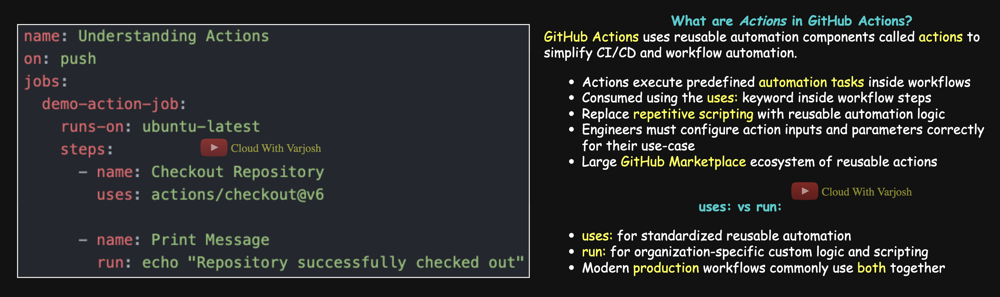
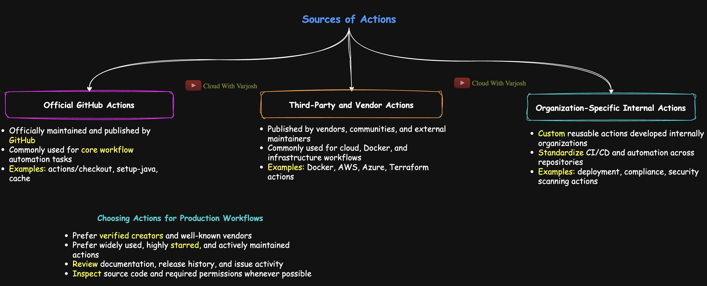

# 15 · Actions and the GitHub Marketplace

> **Part C: Actions, secrets and tokens** · Previous: [14 · Job control options](14-job-control-options.md) · Next: [16 · Lab: Flask CI on a runner](16-lab-flask-ci.md) · [Back to INDEX](INDEX.md)
>
> **Video:** [Build Your First Production-Style Workflow with GitHub Actions](https://www.youtube.com/watch?v=IV2Focqf11Q) (theory part)
>
> [](https://www.youtube.com/watch?v=IV2Focqf11Q)

---

## What it is

An **action** is a **reusable, packaged step** that does a common job for you: check out code, install Python, log in to Docker Hub, upload a file, and so on. You call it with `uses:`.



Actions commonly automate:

- **source code checkout**
- runtime installation (Java, Python, Node.js)
- dependency management
- **Docker authentication**
- **container image builds**
- cloud authentication
- Kubernetes deployments
- security scanning
- caching
- artifact uploads
- notifications
- infrastructure provisioning

> **Note: "GitHub Actions" vs "actions".**
>
> - **GitHub Actions** → the whole automation **platform**
> - **actions** → the individual reusable **building blocks** you run inside workflows

Actions are used with **`uses:`**. Your own commands use **`run:`**.

---

## Why it exists

Without actions you'd write the same 30 lines of shell (install Python, configure caches, log in to a registry…) in every repo, and fix bugs in all of them.

> **Conceptual note:** this idea isn't new to DevOps. Teams have always packaged repeated commands into **shell, Bash or Python scripts** to:
>
> - reduce manual effort
> - minimize human error
> - standardize behaviour
> - keep automation consistent
> - run things faster
>
> GitHub Actions takes this further: reusable components can be **versioned, shared, distributed and used directly** in workflows with `uses:`.

**Jenkins comparison:** actions are like **Jenkins plugins** (and shared-library steps), but they're **per-workflow and versioned in YAML**. There's no server-wide install, no plugin-upgrade crisis, and each repo pins its own version.

---

## Analogy

Actions are **LEGO kits**. You could carve every brick yourself (`run:` scripts), or you can buy the official "wheel" kit (`actions/checkout`), the "Docker engine" kit from Docker, Inc. (`docker/build-push-action`), and your company's own "logo" kit (an internal action). You still decide **how** to assemble them (**inputs** via `with:`).

---

## How it works inside

When a job starts, during **Set up job**, the runner:

1. Reads every `uses: owner/repo@ref` in the job.
2. **Downloads** that repository at that `ref` (tag, branch or commit SHA) into the runner. You see `Download action repository 'actions/checkout@v7' (SHA:…)` in the log.
3. Reads its **`action.yml`** metadata file to learn its inputs, outputs and **how to run it**:
   - **JavaScript action** → run its JS file with the runner's built-in Node.js (`using: node24`)
   - **Docker action** → build or pull a container and run it
   - **Composite action** → run its list of steps
   (You'll build all three in topics 32–34.)
4. When the step runs, `with:` values are passed as **inputs** (as `INPUT_<NAME>` environment variables).
5. Some actions also register a **post** step (for example "Post Checkout Repository") that runs at the end of the job for clean-up.

`uses:` can point to:

| Form | Example |
|---|---|
| Public repo, tag | `actions/checkout@v7` |
| Public repo, full commit SHA | `actions/checkout@<40-char-sha>  # v7.0.0` |
| Subfolder of a repo | `aws-actions/amazon-ecr-login@v2` / `owner/repo/path@v1` |
| Local action in this repo | `./.github/actions/my-action` |
| Docker image | `docker://alpine:3.20` |

---

## Workflow YAML / commands

### Simple example: `uses:` and `run:` together

```yaml
name: Understanding Actions

on: push

jobs:
  demo-action-job:
    runs-on: ubuntu-latest

    steps:
      - name: Checkout Repository
        uses: actions/checkout@v7

      - name: Print Message
        run: echo "Repository successfully checked out"
```

- **`actions/checkout@v7`** is an **official** action maintained by GitHub.
- It downloads your repo's code into the runner. Without it, the runner has **no repo files**.
- **`uses:`** runs reusable packaged logic. **`run:`** runs your own shell commands.
- **`@v7`** is the **version** you're using.

**Sample log output:**

```text
Set up job
  Download action repository 'actions/checkout@v7' (SHA:<40-char-commit-sha>)
Run actions/checkout@v7
  with:
    repository: your-user/cwvj-gha-practice
    fetch-depth: 1
  Syncing repository: your-user/cwvj-gha-practice
  ...
  HEAD is now at 3f9a1c2 feat: add GitHub Actions demo
Run echo "Repository successfully checked out"
Repository successfully checked out
Post Checkout Repository
  Cleaning up credentials
```

- `Download action repository … (SHA:…)`: the tag `v7` was resolved to an exact commit.
- `with: … fetch-depth: 1`: the **default inputs** the action used.
- `Post Checkout Repository`: the action's automatic clean-up step.

> **Operational note:** actions have predefined logic, but **you** must configure them correctly. Most expose **inputs, outputs, parameters, execution settings and authentication options**. For example, checkout supports choosing the **branch/ref, path, fetch depth and authentication**. Every action documents its inputs, outputs and usage in its README.

> **Note:** step `name`s are technically **optional** (`steps` is just a YAML list):
>
> ```yaml
> steps:
>   - uses: actions/checkout@v7
>   - run: echo "Repository successfully checked out"
> ```
>
> In production, **always name your steps**. It improves **readability, troubleshooting, the workflow graph and log navigation**.

### Passing inputs with `with:`

```yaml
- name: Checkout with full history
  uses: actions/checkout@v7
  with:
    fetch-depth: 0          # 0 = all history, branches and tags (default 1 = latest commit only)

- name: Install Python
  uses: actions/setup-python@v6
  with:
    python-version: "3.13"  # quoted (topic 03)
```

### The GitHub Marketplace

GitHub has a central place to find reusable actions and integrations: **[GitHub Marketplace](https://github.com/marketplace)**. It contains:

- **official GitHub actions**
- **vendor actions** from cloud and infrastructure providers
- **community** actions
- open-source workflow integrations and CI/CD tooling

When choosing actions for production:

- prefer **verified creators** (blue verification badge)
- prefer **widely adopted, actively maintained** actions
- review the docs, repo activity, release history and issues
- **read the source code** when possible before using it in production

> **Important:** a missing verification badge doesn't mean an action is unsafe. But always do your **due diligence** before using third-party actions in production.

Useful signals:

- **GitHub stars** and adoption
- maintenance and release frequency
- how quickly issues get answered, and contributor activity
- source transparency and documentation quality
- the publisher's reputation

### Sources of actions



1. **Official GitHub actions**: maintained by GitHub for common tasks.
2. **Third-party and vendor actions**: from cloud providers, infrastructure vendors, open-source communities and other maintainers.
3. **Organization-specific internal actions**: built inside a company to standardize automation across its repos and teams.

> **Operational insight:** modern pipelines rarely rely only on shell scripts. Reusable actions speed up delivery, standardize behaviour, cut repetitive work and integrate external tools.

> **Recommendation:** if both GitHub and a third party offer similar actions, companies often prefer the **official GitHub action** for its tighter integration and trust. For **platform-specific** work, though, **vendor** actions are often preferred. For AWS, many companies use actions maintained by **AWS**, because they follow AWS services, authentication models and new features closely.
>
> There's no strict rule. The action you choose should:
>
> - fit your use case
> - be actively maintained
> - be widely adopted
> - have good docs and support
> - meet your organization's security and operational rules

#### 1. Official GitHub actions

Heavily used in production:

- **`actions/checkout`** → check out repo code onto the runner
- **`actions/setup-java`** → install and configure Java
- **`actions/setup-python`** → install Python
- 🆕 **`actions/setup-node`** → install Node.js
- **`actions/cache`** → cache dependencies and build outputs (topic 25)
- **`actions/upload-artifact`** → upload workflow artifacts (topic 24)
- **`actions/download-artifact`** → download artifacts (topic 24)

They're **widely adopted**, maintained by GitHub, production-grade and stable, and tightly integrated.

> **Operational note:** official actions are usually the **first choice** for standard tasks.

#### 2. Third-party and vendor actions

- **`docker/login-action`** → log in to Docker registries
- **`docker/build-push-action`** → build and publish Docker images
- **`aws-actions/configure-aws-credentials`** → authenticate with AWS
- **`azure/login`** → authenticate with Microsoft Azure
- **`google-github-actions/auth`** → authenticate with Google Cloud
- **`hashicorp/setup-terraform`** → install Terraform
- **`anchore/sbom-action`** → generate SBOMs

They connect GitHub Actions to **cloud ecosystems**, container platforms, infrastructure tooling, DevOps workflows, and security and compliance tooling.

> **Operational insight:** this large vendor ecosystem is one of the main reasons GitHub Actions grew so fast. Companies plug in tools they already use without building everything from scratch.

#### 3. Organization-specific internal actions

Large companies build their own:

- internal deployment actions
- reusable Kubernetes deployment actions
- organization-wide security scanning actions
- enterprise compliance checks
- central approval or notification actions
- internal build and release automation

This matters at scale, with **hundreds or thousands of repos** that need consistent CI/CD behaviour, central governance, standard security controls, reusable operational workflows and organization-wide standards.

> **Operational note:** internal actions cut duplication and let **platform engineering** teams manage CI/CD patterns, security controls, compliance and deployment standards centrally. (How to build them: topics 32–35.)

### 🆕 Versioning: tags vs SHAs

| Reference | Example | Pros | Cons |
|---|---|---|---|
| **Major tag** | `@v7` | Automatic bug-fix updates | The tag can be **moved** by the owner, or by an attacker who steals their credentials |
| **Exact tag** | `@v7.0.1` | Readable, more stable | Tags can still be moved |
| **Full commit SHA** | `@<40-char-commit-sha>  # v7.0.1` (copy the real SHA from the release page) | **Immutable**: it can never change | You must update it yourself (Dependabot can do it) |
| **Branch** | `@main` | Always latest | Unpredictable. Never use in production |

> **Real incident (March 2026):** attackers stole a credential and **rewrote 75+ version tags** of `aquasecurity/trivy-action` to point at malicious code that stole CI secrets. Workflows using `@v0.x` tags ran the malware. Workflows **pinned to a full commit SHA** were not affected. GitHub's security guidance: **pin third-party actions to a full-length commit SHA**. Details are in topic 37.

---

## Hands-on lab

1. Push the "Understanding Actions" workflow and find `Download action repository … (SHA:…)` in **Set up job**.
2. Add `fetch-depth: 0` and run `git log --oneline | wc -l` after checkout. Compare with the default.
3. Open [actions/checkout on the Marketplace](https://github.com/marketplace/actions/checkout) and read its inputs list.
4. Pin checkout to the SHA you saw in step 1 (`uses: actions/checkout@<sha>  # v7`) and run again.
5. Try `uses: actions/checkout@v999` and read the error.

---

## Where you'll use it

- **Every workflow** starts with `actions/checkout`.
- **Setup actions** (`setup-java`, `setup-node`, `setup-python`) in the capstone CI jobs.
- **Vendor actions** for Docker Hub (topic 19), AWS/ECR (topic 36, capstone), Trivy and SonarQube (capstone).
- **Security reviews:** "which third-party actions do we use, and are they SHA-pinned?" is a common audit question.

---

## When it breaks

| Error | Meaning | Fix |
|---|---|---|
| `Unable to resolve action 'actions/checkout@v999', unable to find version 'v999'` | The tag or branch doesn't exist. | Check the action's Releases page. |
| `Unable to resolve action … repository not found` | Typo in owner/repo, a private action you can't access, or the org blocks it. | Fix the name. Check **Settings → Actions → General → Allowed actions**. |
| `The action … is not allowed in <org>` | The org policy allows only selected or verified actions. | Ask an admin to allow it, or use an approved alternative. |
| Warning: `Node.js 20 actions are deprecated` / action fails after Sep 2026 | An old action version on a removed runtime. | Upgrade to the latest major (topic 33). |
| `fatal: not a git repository` in later steps | No checkout step, or a checkout into a different `path`. | Add checkout. Match `working-directory`. |
| Git commands can't see history or tags | Shallow clone (`fetch-depth: 1`). | `fetch-depth: 0`. |

---

## Quick recap

- An **action** = a reusable step called with `uses:`. **GitHub Actions** = the platform.
- Sources: official (GitHub), vendor/community, internal.
- Configure actions with `with:` inputs. Read each action's README.
- Prefer verified, maintained, widely used actions, and **pin third-party actions to a full commit SHA**.
- `actions/checkout` does a shallow clone by default (`fetch-depth: 1`).

**Interview questions**

1. **Q: Difference between GitHub Actions and an action?**
   A: GitHub Actions is the CI/CD platform. An action is a reusable component used with `uses:` inside a workflow.
2. **Q: Why pin actions to a commit SHA instead of `@v1`?**
   A: Tags can be moved (for example by a compromised maintainer account). A full SHA is immutable, so the code can't change underneath you.
3. **Q: What does `fetch-depth: 0` do?**
   A: It fetches the full Git history, branches and tags instead of only the latest commit.

---
