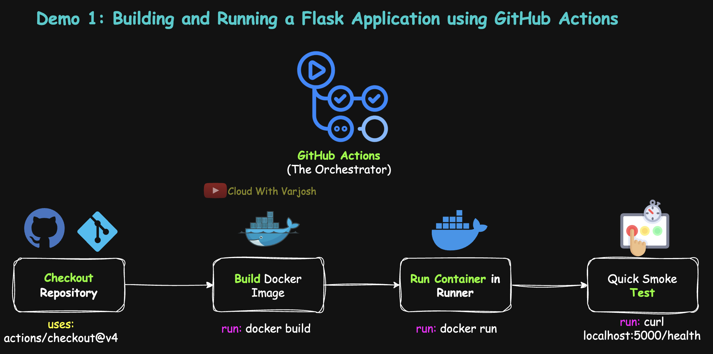

# 16 · Lab: Build and Smoke-Test a Flask App on a Runner

> **Part C: Actions, secrets and tokens** · Previous: [15 · Actions and the Marketplace](15-actions-and-marketplace.md) · Next: [17 · Secrets and variables](17-secrets-and-variables.md) · [Back to INDEX](INDEX.md)
>
> **Video:** [Build Your First Production-Style Workflow with GitHub Actions](https://www.youtube.com/watch?v=IV2Focqf11Q) (Demo 1)
>
> **Code for this lab:** [`code/16-19-flask-app/`](code/16-19-flask-app/) (`app.py`, `Dockerfile`, `requirements.txt`)

---

## What it is

Your first workflow that does **real CI work**. On a GitHub-hosted runner it will:

1. check out the code (`uses:`)
2. build a Docker image (`run:`)
3. start a container (`run:`)
4. run a **smoke test**: a quick "is it alive?" HTTP check (`run:`)



In this pipeline:

1. GitHub Actions is the **orchestrator**
2. the repo is checked out onto the runner
3. a Docker image is built on the runner
4. a container starts on the runner
5. a smoke test checks that the app started

The goal is to **see** how workflows run step by step on runners, how actions and shell commands work together, how Docker runs on GitHub's infrastructure, and how CI combines **actions** with **custom scripts**.

By the end you will have pushed code, triggered the workflow with `push`, built a **Docker image**, started a **containerized app**, run a **smoke test**, and watched it all in the Actions UI.

> **Operational insight:** the GitHub-hosted runner is a **temporary machine**. All Docker operations, container start-up and checks happen there during the run. Afterwards the runner is **destroyed**.

---

## Why it exists

"It works on my laptop" isn't proof. CI proves that the code **builds from scratch on a clean machine** and the app **actually starts**. A smoke test catches the most embarrassing failures (crash on start-up, wrong port) within minutes.

---

## Docker recap (from your Docker notes)

This is the first topic that uses Docker, so here is what this lab relies on:

| Term | Plain meaning |
|---|---|
| **Image** | A packaged, read-only template: OS files + runtime + your app. Built from a `Dockerfile`. |
| **Container** | A running instance of an image, an isolated process on the host. |
| **Dockerfile** | A recipe: each instruction (`FROM`, `COPY`, `RUN`…) adds a **layer** to the image. |
| **Tag** | A label for an image version: `name:tag`, like `cwvj-flask-app:v1.0.0`. |
| **Build context** | The folder sent to Docker during `docker build` (the `.` at the end). |
| **Port mapping** `-p H:C` | Traffic to host port H goes to container port C. |
| **Docker daemon** (`dockerd`) | The background service that actually builds and runs containers. The `docker` CLI talks to it. |

> **Terminology note:** this lecture says **Docker image** because it uses Docker tools and Docker Hub, and even `docker/build-push-action` uses Docker terms. The industry term is **container image**, because the output is an **OCI-compliant image** (Open Container Initiative). OCI images can be built with **Docker, Podman, Buildah or Kaniko** and run on platforms like **Kubernetes**.

> **Operational note:** GitHub-hosted Ubuntu runners have **Docker pre-installed**, so you can run `docker build`, `docker run` and `docker push` directly in steps.

---

## Analogy

The runner is a **rented test kitchen** for one afternoon. You bring the recipe (Dockerfile) and ingredients (code), cook the dish (build the image), serve one plate (run the container), and **taste it** (smoke test). At the end of the day the kitchen is wiped clean.

---

## How it works inside

```text
push → workflow matched → ubuntu runner VM boots (Docker daemon already running)
  step 1 actions/checkout  → git fetch of your commit into $GITHUB_WORKSPACE
  step 2 docker build      → CLI sends build context (.) to dockerd → layers built → image cwvj-flask-app:v1.0.0
  step 3 docker run -d     → dockerd starts a container, maps runner:5000 → container:5000
  step 4 curl localhost:5000/health → HTTP request from runner into container
job ends → VM destroyed (image + container gone)
```

> **Workflow design note:** all steps are in **one job** on purpose, because each step depends on what the previous step created (the smoke test needs the running container). Every hosted job gets a **fresh** runner. If the smoke test were in a separate job, that new runner wouldn't have the image, the running container, or any runtime state from the earlier job. It would fail unless you **transferred** them (artifacts, topic 24) or **recreated** them.

---

## Workflow YAML / commands

### Step 1: Repository setup

Use the `cwvj-gha-practice` private repo and SSH setup from [topic 02](02-git-and-github-recap.md).

> **Operational note:** workflows live in the repo. When workflow YAML files are pushed, GitHub detects them and evaluates their triggers.

### Step 2: Project structure

```text
project-files/
├── app.py
├── Dockerfile
├── requirements.txt
└── .github/
    └── workflows/
        └── 01-actions-demo.yaml
```

#### 2.1 `app.py`: the Flask application

```python
from flask import Flask, jsonify
import os

app = Flask(__name__)

@app.get("/")
def home():
    return jsonify(
        message="Welcome to Cloud With VarJosh",
        platform="GitHub Actions",
        runtime="Docker + Flask"
    )

@app.get("/health")
def health():
    return jsonify(status="healthy"), 200

if __name__ == "__main__":
    app.run(
        host="0.0.0.0",
        port=int(os.getenv("PORT", 5000))
    )
```

This app:

- creates a small **Flask** web server (Flask = a lightweight Python web framework)
- serves an app endpoint at `/`
- serves a **health-check** endpoint at `/health`
- listens on port `5000`
- runs inside a Docker container

The `/health` endpoint matters because production pipelines use **health endpoints, smoke tests, readiness checks** (is it ready for traffic?) and **liveness checks** (is it still alive?) to confirm start-up.

**Line by line:**

- `from flask import Flask, jsonify`: imports Flask and the `jsonify` helper for JSON responses.
- `import os`: Python's OS module, used to read environment variables like `PORT`.
- `app = Flask(__name__)`: creates the main application object.
- `@app.get("/")`: an HTTP GET endpoint at `/` that returns app info as JSON.
- `jsonify(...)`: turns Python data into a proper JSON HTTP response. Modern APIs usually return JSON.
- `@app.get("/health")`: the health-check endpoint.
- `return jsonify(status="healthy"), 200`: JSON plus HTTP status **200** (OK).
- `host="0.0.0.0"`: listen on **all network interfaces** in the container. Required so traffic from outside the container can reach it.
- `port=int(os.getenv("PORT", 5000))`: use the `PORT` environment variable, or `5000` if it isn't set.

> **Operational note:** health endpoints like `/health` are used for smoke tests, readiness and liveness checks, monitoring, and automated deployment validation.

#### 2.2 `Dockerfile`

```dockerfile
FROM python:3.13-slim

WORKDIR /app

COPY requirements.txt .

RUN pip install --no-cache-dir -r requirements.txt

COPY app.py .

EXPOSE 5000

CMD ["python", "app.py"]
```

- `FROM python:3.13-slim`: the official lightweight Python 3.13 base image, which provides the runtime.
- `WORKDIR /app`: sets `/app` as the working directory. Later commands run relative to it.
- `COPY requirements.txt .`: copies the dependency list into the image.
- `RUN pip install --no-cache-dir -r requirements.txt`: installs dependencies. `--no-cache-dir` stops pip storing its download cache in the image layers, which keeps the image smaller.
- `COPY app.py .`: copies the app code. (It's copied **after** installing dependencies, so changing code doesn't redo the slow install layer. That's Docker layer caching.)
- `EXPOSE 5000`: **documents** that the app listens on 5000. It doesn't publish the port, `-p` does.
- `CMD ["python", "app.py"]`: the default start-up command.

#### 2.3 `requirements.txt`

```text
flask==3.1.1
```

This lists the Python dependencies. **Flask** is commonly used for REST APIs, microservices, backends and small web apps. `flask==3.1.1` means "install Flask, exactly version 3.1.1".

> **Operational note:** `requirements.txt` defines dependencies in a **standard, reproducible** way, so developers, CI pipelines and images all install the same versions.

### Step 3: The workflow

`.github/workflows/01-actions-demo.yaml`:

```yaml
name: 01 - CWVJ Flask CI Pipeline

on:
  push:

jobs:
  flask-ci-job:
    runs-on: ubuntu-latest

    steps:
      - name: Checkout Repository
        uses: actions/checkout@v7

      - name: Build Docker Image
        run: docker build -t cwvj-flask-app:v1.0.0 .

      - name: Run Container
        run: docker run -d -p 5000:5000 --name cwvj-flask-container cwvj-flask-app:v1.0.0

      - name: Smoke Test
        run: |
          sleep 5
          curl http://localhost:5000/health
```

**Line by line:**

```yaml
on:
  push:
```

Run whenever new commits are pushed.

```yaml
runs-on: ubuntu-latest
```

Allocate a **GitHub-hosted Ubuntu runner** and run all steps there.

```yaml
- name: Checkout Repository
  uses: actions/checkout@v7
```

- an **official** action
- checks out the repo into the runner workspace
- uses Git operations internally
- lets later steps see your files

Without it, the runner has no repo contents.

> **Operational note:** by default `actions/checkout` does a **shallow fetch** with `fetch-depth: 1`: only the **latest commit**, not the full history. That's faster, uses less network and saves runner time. `fetch-depth: 0` fetches the **complete history**, all branches and tags.

```yaml
- name: Build Docker Image
  run: docker build -t cwvj-flask-app:v1.0.0 .
```

- `docker build` → build an image from the Dockerfile in the build context
- `-t` → give the image a tag
- `cwvj-flask-app:v1.0.0` → the full image reference: `cwvj-flask-app` = repository name, `v1.0.0` = tag/version
- `.` → the current folder is the **build context**. Docker can read files from it during the build.

The build context usually contains the Dockerfile, source code, dependency files and config files.

> **Operational note:** Docker sends the build context to the **Docker daemon**. Large or unnecessary files slow the build and increase transfer. That's why real projects use a **`.dockerignore`** file (like `.gitignore`, but for the build context).

```yaml
- name: Run Container
  run: docker run -d -p 5000:5000 --name cwvj-flask-container cwvj-flask-app:v1.0.0
```

- `docker run` → create and start a container from an image
- `-d` → **detached**: run it in the background, so the step finishes and the next one can start
- `-p 5000:5000` → first `5000` = **runner (host)** port, second `5000` = **container** port
- `--name cwvj-flask-container` → a custom container name
- `cwvj-flask-app:v1.0.0` → the image to start

Now the app inside the container is reachable from the runner at:

```bash
curl http://localhost:5000/health
```

```yaml
- name: Smoke Test
  run: |
    sleep 5
    curl http://localhost:5000/health
```

- waits briefly for the container to start
- sends an HTTP request to `/health`
- checks that the app started

> **YAML note:** `|` is a **literal block scalar**, which keeps line breaks so several commands run in one `run:` step (topic 03).

> **Operational note:** production pipelines run **smoke tests** right after deploying or starting containers, to confirm the app works before moving on.

> 🆕 **Make the smoke test actually fail on errors.** Plain `curl` exits **0** even when the app returns HTTP 500, so the step stays green. A sturdier version:
>
> ```yaml
> - name: Smoke Test
>   run: |
>     for i in {1..10}; do
>       curl -fsS http://localhost:5000/health && exit 0   # -f: fail on HTTP errors
>       echo "waiting for app... ($i)"; sleep 2
>     done
>     docker logs cwvj-flask-container                      # show why it failed
>     exit 1
> ```
>
> The retry loop replaces the fixed `sleep 5`, which is either too long (wasted time) or too short (a flaky failure).

> **Operational note:** this demo uses `run:` for Docker work to keep it simple. Production workflows usually use **`docker/login-action`** and **`docker/build-push-action`** instead of hand-written Docker commands. **You'll see them in [topic 19](19-lab-docker-build-push.md).**

### Step 4: Push to GitHub

```bash
# Initialize a new local Git repository
git init

# Stage all files for commit
git add .

# Create a new commit
git commit -m "feat: add GitHub Actions demo"

# Rename branch to main
git branch -M main

# Connect local repository to GitHub
git remote add origin git@github.com:<YOUR_GITHUB_USERNAME>/cwvj-gha-practice.git

# Push code to GitHub
git push -u origin main
```

> **Note:** if the repo has files from earlier demos, the push may fail because of unrelated history. Clean the repo first, or carefully `--force` push in a demo environment.

### Step 5: Watch it run

After the push, GitHub detects the workflow, the `push` event triggers it, a **hosted Ubuntu runner** is provisioned, and the steps run one by one.

In the repo: **Actions** → open the run → look at:

- workflow and job status
- step-by-step logs
- the Docker build logs
- container start-up
- the smoke test result

**Sample log output:**

```text
✓ Checkout Repository
    HEAD is now at 3f9a1c2 feat: add GitHub Actions demo
✓ Build Docker Image
    #1 [internal] load build definition from Dockerfile
    #5 [1/5] FROM docker.io/library/python:3.13-slim
    #8 [3/5] RUN pip install --no-cache-dir -r requirements.txt
    #8 Successfully installed blinker-1.9.0 click-8.2.1 flask-3.1.1 itsdangerous-2.2.0 jinja2-3.1.6 ...
    #10 naming to docker.io/library/cwvj-flask-app:v1.0.0 done
✓ Run Container
    9c1e2b7d4a5f...                     ← container ID printed by docker run -d
✓ Smoke Test
    {"status":"healthy"}
```

| Log line | Meaning |
|---|---|
| `#5 [1/5] FROM … python:3.13-slim` | BuildKit (Docker's build engine) pulling the base image. `[1/5]` = Dockerfile instruction 1 of 5. |
| `Successfully installed … flask-3.1.1` | The `RUN pip install` layer. |
| `naming to …cwvj-flask-app:v1.0.0` | The image got its tag. |
| `9c1e2b7d…` | `docker run -d` printed the new container's ID. |
| `{"status":"healthy"}` | The `/health` endpoint answered. Smoke test passed. |

What to notice:

- **`uses:`** runs reusable actions. **`run:`** runs shell commands on the runner.
- Docker commands work fine on the hosted runner.
- The run **stops automatically if a step fails**.

> **Operational insight:** hosted runners are **ephemeral**. When the run finishes, the runner is destroyed along with all containers, files and runtime state.

---

## Hands-on lab

1. Build the project (copy the files from [`code/16-19-flask-app/`](code/16-19-flask-app/)) and push. Match your log to the sample.
2. Break the app: change `/health` to return `500`. With plain `curl` the run stays **green**. Switch to the `curl -fsS` retry version and it turns **red**. That's why `-f` matters.
3. Move the smoke test into a **second job** with `needs:` and watch it fail (`Connection refused`). That proves jobs don't share runners.
4. Add a `.dockerignore` with `.git` and compare the "transferring context" size in the build log.

---

## Where you'll use it

- **Every containerized app's CI**: build → run → smoke test is the basic pattern.
- **Pre-deploy validation** before pushing an image (topic 19) or deploying to Kubernetes (capstone).
- **Debugging Dockerfiles** in a clean environment that matches CI.

---

## When it breaks

| Symptom | Meaning | Fix |
|---|---|---|
| `unable to prepare context: unable to evaluate symlinks in Dockerfile path: … no such file` | No Dockerfile in the build context (wrong folder, or no checkout). | Check out first. Use `-f path/Dockerfile` or `working-directory`. |
| `curl: (7) Failed to connect to localhost port 5000` | The app isn't up yet, crashed, or is on another port. | Retry loop. `docker logs <name>`. Check `host="0.0.0.0"`. |
| Smoke test green but the app is broken | `curl` without `-f` ignores HTTP errors. | `curl -fsS`. |
| `Bind for 0.0.0.0:5000 failed: port is already allocated` | Something already uses port 5000 (common on **self-hosted** runners with leftovers). | Use another host port, or clean up old containers. |
| `ERROR: failed to solve: … pip install … exit code 1` | A dependency install failed (typo in requirements, network). | Read the pip error above it. |
| `No space left on device` | Large images on a 14 GB runner disk. | `docker system prune -af`, smaller base images. |

---

## Quick recap

- checkout → `docker build` → `docker run -d -p` → smoke test, all in **one job** because they share state.
- Docker is pre-installed on hosted Ubuntu runners.
- Use `curl -f` and a retry loop for real smoke tests.
- The runner is destroyed afterwards, so nothing persists unless you publish it (topic 19) or upload it (topic 24).

**Interview questions**

1. **Q: Why are build, run and smoke test in one job?**
   A: Each job gets a fresh runner. A separate job wouldn't have the image or the running container.
2. **Q: What does `-p 5000:5000` mean?**
   A: Map host (runner) port 5000 to container port 5000.
3. **Q: Why does `EXPOSE` alone not make the app reachable?**
   A: `EXPOSE` is only documentation. Publishing a port needs `-p` (or a Kubernetes Service).
