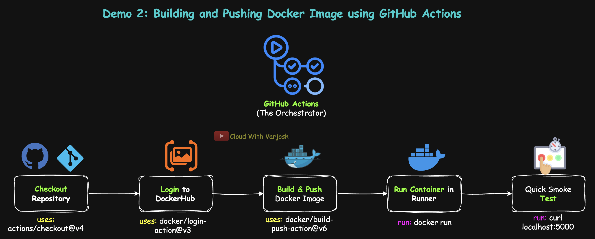

# 19 · Lab: Build, Test and Push a Docker Image (Production-Style)

> **Part C: Actions, secrets and tokens** · Previous: [18 · `GITHUB_TOKEN` and permissions](18-github-token-and-permissions.md) · Next: [20 · Inputs](20-inputs.md) · [Back to INDEX](INDEX.md)
>
> **Videos:** [Build Your First Production-Style Workflow](https://www.youtube.com/watch?v=IV2Focqf11Q) (Demo 2) and [GitHub Actions Functions Explained | Build a Production-Style CI Pipeline](https://www.youtube.com/watch?v=Y0kDz3BEtM4) (Demo 1)
>
> **Code:** [`code/16-19-flask-app/`](code/16-19-flask-app/) (Part 1) and [`code/19-production-flask-ci-app/`](code/19-production-flask-ci-app/) (Part 2: `app/app.py`, `app/Dockerfile`, `app/requirements.txt`)
>
> **You need:** topics 10–13 (filters, contexts, functions, `if:`), 16 (the Docker recap), 17 (secrets).

---

## What it is

Two labs that grow your topic 16 pipeline into what real teams run:

- **Part 1:** replace hand-written Docker commands with **reusable vendor actions** (`docker/login-action`, `docker/build-push-action`) and **GitHub Secrets**, then push the image to a **private Docker Hub repo**.
- **Part 2:** a **production-style Build → Test → Publish** pipeline that uses **event filters, activity types, variables, contexts, expressions, functions, secrets and conditional execution** together. It has dynamic image tags, smoke tests, publishing only after tests pass, diagnostics on failure and clean-up.



---

## Why it exists

An image that only lives on a runner disappears when the job ends. To deploy anywhere you must **publish** it to a **container registry** (a server that stores and serves images). And you must publish **only tested images**, with **unique, traceable tags**.

> **Operational insight:** container registries are a core part of CI/CD. They're the central store from which images are distributed to dev, staging, test and production.

**Jenkins comparison:** `withCredentials([usernamePassword(credentialsId: 'dockerhub', …)]) { sh 'docker login …; docker build …; docker push …' }` plus `post { failure { sh 'docker logs …' } always { sh 'docker rm -f …' } }`. That's the same flow, in Groovy.

---

## Analogy

A **bakery**:

- **Build** = bake the cake.
- **Test** = taste one slice (smoke test).
- **Publish** = put it in the **shop window** (the registry), where customers (servers and clusters) can get it.
- **Tag** = the label "Chocolate, batch #42, baked at 09:15" (`v42-3f9a1c2`), so you know exactly which batch it is.
- **Never put an untasted cake in the window** (Build → Test → Publish, not Build → Publish → Test).
- If a cake fails the taste test, **write down why** (collect logs). **Always clean the oven** (clean-up).

---

## How it works inside

```text
docker/login-action  → runs `docker login` with your secret → writes credentials to
                        ~/.docker/config.json on the runner (removed in its post step)
docker/build-push-action → uses Docker Buildx/BuildKit (Docker's modern build engine):
                           builds layers → tags the image → if push: true, uploads layers to
                           the registry (only layers the registry doesn't already have)
docker run / curl     → same as topic 16
docker push           → uploads the tested local image
post steps            → login-action logs out (credentials removed)
```

> **Operational insight:** `docker/build-push-action` uses **Docker Buildx/BuildKit**, which supports better caching, **multi-platform builds** (one image for amd64 and arm64), parallel build steps and faster builds.

🆕 **Why Part 2's `push: false` + `docker push` works:** without a separate `docker/setup-buildx-action` step, build-push-action uses Docker's default `docker` driver, which **stores the built image in the runner's local image store**. So `docker run` and `docker push` can use it. If you add `setup-buildx-action` (the `docker-container` driver), you must also set `load: true` to get the image locally.

---

## Workflow YAML / commands

## Part 1: Reusable Docker actions and secrets

Compared with topic 16, this workflow uses **official reusable actions**, **vendor-maintained Docker actions**, **GitHub Secrets for authentication**, and reusable automation instead of hand-written Docker commands. That's much closer to real production pipelines.

The pipeline:

1. GitHub Actions is the **orchestrator**
2. code is checked out onto the runner
3. the workflow **authenticates with Docker Hub securely**
4. an image is **built and pushed** to a private Docker Hub repo
5. a container starts on the runner
6. a smoke test checks start-up

By the end you'll have stored credentials in **GitHub Secrets**, used **Docker actions**, published an image to a private registry, run and smoke-tested it, and seen the image in Docker Hub.

> **Operational insight:** production workflows combine **reusable actions** for standard operations (login, build, publish) with **`run:` commands** for organization-specific logic. Companies also build their own **custom actions** to standardize CI/CD behaviour, security, deployments, compliance and platform automation. You'll build them in topics 32–35.

### Step 1: Create a private Docker Hub repository

At [Docker Hub](https://hub.docker.com), create a repository:

- **Repository name:** `cwvj-flask-app`
- **Visibility:** Private

### Step 1.1 and Step 2: Token and secrets

Do [topic 17, Steps 1–2](17-secrets-and-variables.md): create a Docker Hub access token (description `gha-demo`, 1-day expiry, Read & Write), then store `DOCKERHUB_USERNAME` and `DOCKERHUB_TOKEN` as repository secrets.

### Step 3: The workflow

`.github/workflows/02-actions-demo.yaml`:

```yaml
name: 02 - CWVJ Flask CI Pipeline

on:
  push:

jobs:
  flask-ci-job:
    runs-on: ubuntu-latest

    steps:
      - name: Checkout Repository
        uses: actions/checkout@v7

      - name: Login to DockerHub
        uses: docker/login-action@v4
        with:
          username: ${{ secrets.DOCKERHUB_USERNAME }}
          password: ${{ secrets.DOCKERHUB_TOKEN }}

      - name: Build and Push Docker Image
        uses: docker/build-push-action@v7
        with:
          context: .
          push: true
          tags: cloudwithvarjosh/cwvj-flask-app:v1.0.1

      - name: Run Container
        run: docker run -d -p 5000:5000 --name cwvj-flask-container cloudwithvarjosh/cwvj-flask-app:v1.0.1

      - name: Smoke Test
        run: |
          sleep 5
          curl http://localhost:5000
```

> **Important:** replace `cloudwithvarjosh` with **your own** Docker Hub username or org namespace.

**Explanation:**

```yaml
- name: Login to DockerHub
  uses: docker/login-action@v4
  with:
    username: ${{ secrets.DOCKERHUB_USERNAME }}
    password: ${{ secrets.DOCKERHUB_TOKEN }}
```

- A **Docker-maintained** action for registry authentication.
- Logs the runner in to **Docker Hub** before pushing.
- Replaces a hand-written `docker login` step.
- Injects credentials securely from **GitHub Secrets** (`secrets.DOCKERHUB_USERNAME`, `secrets.DOCKERHUB_TOKEN`), configured under **Repository Settings → Secrets and variables → Actions**.
- **`with:`** passes **inputs** to the action: `username` = the Docker Hub username, `password` = the access token.

Most actions take inputs through `with:`: credentials, repo names, image tags, file paths, runtime versions, behaviour flags. They're listed in each action's docs.

> **Operational note:** `docker/login-action` isn't only for Docker Hub. It also logs in to **Amazon ECR**, **Azure Container Registry (ACR)**, **GitHub Container Registry (GHCR)**, **Google Artifact Registry (GAR)**, **Harbor**, **Quay**, and other OCI-compatible registries.

```yaml
- name: Build and Push Docker Image
  uses: docker/build-push-action@v7
  with:
    context: .
    push: true
    tags: cloudwithvarjosh/cwvj-flask-app:v1.0.1
```

This **Docker-maintained** action builds an image and optionally pushes it, so you don't need to write Docker CLI commands by hand.

- `context: .` → the **build context**: the current repo folder (Dockerfile, source, dependency files). Like `docker build .`.
- `push: true` → push after a successful build. Without it, the image would only exist on the runner. Like running `docker push <image>` afterwards.
- `tags: cloudwithvarjosh/cwvj-flask-app:v1.0.1` → the full image reference, used for build and push:
  - `cloudwithvarjosh` → Docker Hub account/**namespace**
  - `cwvj-flask-app` → repository name
  - `v1.0.1` → tag/version
  - like `docker tag <image> cloudwithvarjosh/cwvj-flask-app:v1.0.1`

**The improvement over topic 16.** Topic 16 used `run:` commands and the Docker CLI directly. This lab adds **`docker/login-action`** and **`docker/build-push-action`**, which shows a big GitHub Actions advantage: reusable packaged automation, less scripting, cleaner workflows and standard CI/CD patterns.

> **Operational insight:** production workflows combine reusable actions for standard automation with `run:` commands for organization-specific logic.

### Step 4: Push to GitHub

```bash
# Initialize a new local Git repository
git init

# Stage all files for commit
git add .

# Create a new commit
git commit -m "feat: add DockerHub integration workflow"

# Rename branch to main
git branch -M main

# Connect local repository to GitHub
git remote add origin git@github.com:<YOUR_GITHUB_USERNAME>/cwvj-gha-practice.git

# Push code to GitHub
git push -u origin main
```

> **Note:** if the repo already has files from earlier demos, the push may fail because of unrelated history. Clean the repo, or carefully `--force` push in a demo environment.

### Step 5: Observe and verify

After the push, GitHub detects the workflow, `push` starts it, a hosted Ubuntu runner is provisioned, and the steps run. In **Actions**, look at the run status, the **Docker Hub login logs**, the **build logs**, the **push**, the container start-up and the smoke test.

**Sample log output:**

```text
✓ Login to DockerHub
    Logging into Docker Hub...
    Login Succeeded!
✓ Build and Push Docker Image
    #10 exporting to image
    #10 pushing layers 2.1s done
    #10 pushing manifest for docker.io/cloudwithvarjosh/cwvj-flask-app:v1.0.1@sha256:6b1f…
✓ Run Container
    4e7c2a1d9b…
✓ Smoke Test
    {"message":"Welcome to Cloud With VarJosh","platform":"GitHub Actions","runtime":"Docker + Flask"}
✓ Post Login to DockerHub
    Logging out from docker.io
```

- `pushing manifest … @sha256:6b1f…`: the image was uploaded. The `sha256` **digest** is its unique, unchangeable ID.
- `Post Login to DockerHub → Logging out`: login-action cleans up the credentials.

**Verify in Docker Hub:** open `<your-user>/cwvj-flask-app` and check the new tag `v1.0.1`, its metadata and push time. This confirms the login worked, the image was built, and the push to the private registry succeeded.

> **Operational insight:** pipelines push images to central registries **before** deploying to Kubernetes, Docker hosts or cloud runtimes.

> 🆕 **Problem with Part 1:** it **pushes before it tests** (and every run reuses the same tag `v1.0.1`, overwriting it). Part 2 fixes both.

---

## Part 2: The production-style Build → Test → Publish pipeline

This combines nearly everything so far: triggers, **event filters**, **activity types**, **variables**, **contexts**, **expressions**, **functions**, **GitHub Secrets**, **conditional execution** and **Docker image publishing**.

The finished workflow can build an image, generate **dynamic tags**, log in to Docker Hub, start the app, smoke-test its endpoints, **publish only validated images**, **collect diagnostics on failure**, **clean up** afterwards, and make decisions with workflow logic.

### Step 1: Prerequisites

The repo and SSH setup from [topic 02](02-git-and-github-recap.md):

| Property | Value |
|---|---|
| Repository Name | `cwvj-gha-practice` |
| Visibility | Private |

> **Operational note:** workflows are **repository-scoped**. When workflow YAML is pushed, GitHub evaluates its triggers and decides whether to create a run.

### Steps 2–4: Docker Hub repo, token and secret

| Property | Value |
|---|---|
| Repository Name | `cwvj-flask-app` |
| Visibility | Private |

Create the token (`gha-demo`, 1 day, Read & Write) and the repository secret `DOCKERHUB_TOKEN`, as in [topic 17](17-secrets-and-variables.md). This demo puts the **username** in `env:` instead of a secret.

> **Operational insight:** registries are the central store. Pipelines publish **validated** images there before deploying to dev, staging or prod.

### Step 5: Project structure

```text
project-files
├── app
│   ├── app.py
│   ├── Dockerfile
│   └── requirements.txt
└── .github
    └── workflows
        └── 01-cwvj-flask-workflow.yaml
```

The app files are in `app/` because the workflow uses `context: ./app`, so Docker uses the `app` folder as its build context.

### Step 6: `app/app.py` (now with logging)

```python
from flask import Flask, jsonify
import os

app = Flask(__name__)

@app.get("/")
def home():
    app.logger.info("Homepage endpoint invoked")

    return jsonify(
        message="Welcome to Cloud With VarJosh",
        platform="GitHub Actions",
        runtime="Docker + Flask"
    )

@app.get("/health")
def health():
    app.logger.info("Health check endpoint invoked")

    return jsonify(status="healthy"), 200

if __name__ == "__main__":
    app.logger.info("Starting Flask application")

    app.run(
        host="0.0.0.0",
        port=int(os.getenv("PORT", 5000))
    )
```

It exposes `/` and `/health`, listens on 5000, runs in a container, and **writes logs** you can read with `docker logs`. ⚠️ Flask's logger defaults to level **WARNING**, so `app.logger.info(...)` lines are dropped unless you lower the level: add `import logging` and `app.logger.setLevel(logging.INFO)` after `app = Flask(__name__)` (done in `code/19-production-flask-ci-app/app.py`). Health checks are used for smoke tests, start-up validation, readiness checks and deployment verification.

> **Operational note:** health-check endpoints are one of the most common ways to confirm start-up in automated pipelines.

### Steps 7–8: `app/Dockerfile` and `app/requirements.txt`

Same as [topic 16](16-lab-flask-ci.md) (`FROM python:3.13-slim`, `WORKDIR /app`, copy requirements, `pip install --no-cache-dir`, copy `app.py`, `EXPOSE 5000`, `CMD ["python", "app.py"]`) and `flask==3.1.1`. Hosted Ubuntu runners include Docker. Dependency files keep versions consistent across laptops, runners, test environments and production.

### Step 9: The workflow

`.github/workflows/01-functions-demo.yaml`:

```yaml
name: 01 - CWVJ Flask Build Test Publish Pipeline

on:
  push:
    branches:
      - main
      - feature/*
    paths:
      - app/**
      - .github/workflows/**

  pull_request:
    branches:
      - main
    types:
      - opened
      - synchronize
      - ready_for_review

env:
  APPLICATION_NAME: cwvj-flask-app
  DOCKER_USERNAME: cloudwithvarjosh

jobs:
  flask-build-test-publish-job:
    runs-on: ubuntu-latest

    if: ${{ (github.event_name == 'push' && startsWith(github.ref_name, 'feature/')) || (github.event_name == 'pull_request' && github.base_ref == 'main' && !contains(github.event.pull_request.title, 'WIP')) }}

    steps:
      - name: Checkout Repository
        uses: actions/checkout@v7

      - name: Generate Dynamic Image Tag
        run: |
          echo "IMAGE_TAG=v${GITHUB_RUN_NUMBER}-${GITHUB_SHA::7}" >> $GITHUB_ENV

      - name: Display Build Information
        run: |
          echo "Application: $APPLICATION_NAME"
          echo "Repository: $GITHUB_REPOSITORY"
          echo "Actor: $GITHUB_ACTOR"
          echo "Branch: $GITHUB_REF_NAME"
          echo "Image Tag: $IMAGE_TAG"

      - name: Login to DockerHub
        uses: docker/login-action@v4
        with:
          username: ${{ env.DOCKER_USERNAME }}
          password: ${{ secrets.DOCKERHUB_TOKEN }}

      - name: Build Docker Image
        uses: docker/build-push-action@v7
        with:
          context: ./app
          push: false
          tags: ${{ env.DOCKER_USERNAME }}/${{ env.APPLICATION_NAME }}:${{ env.IMAGE_TAG }}

      - name: Run Container
        run: |
          docker run -d \
            -p 5000:5000 \
            --name flask-container \
            $DOCKER_USERNAME/$APPLICATION_NAME:$IMAGE_TAG

      - name: Smoke Test Application
        run: |
          sleep 5
          curl --fail http://localhost:5000
          curl --fail http://localhost:5000/health

      - name: Push Docker Image To DockerHub
        if: ${{ success() }}
        run: |
          docker push $DOCKER_USERNAME/$APPLICATION_NAME:$IMAGE_TAG

      - name: Collect Container Logs
        if: ${{ failure() }}
        run: |
          docker logs flask-container

      - name: Cleanup Containers
        if: ${{ always() }}
        run: |
          docker rm -f flask-container || true
```

#### Explanation, block by block

```yaml
name: 01 - CWVJ Flask Build Test Publish Pipeline
```

The name **shown** in the Actions UI. It doesn't change behaviour, but it helps people find runs when reviewing history, troubleshooting or monitoring.

```yaml
on:
  push:
    branches:
      - main
      - feature/*
    paths:
      - app/**
      - .github/workflows/**
```

The first trigger. It runs on pushes to `main` or any `feature/*` branch (`feature/login`, `feature/payment-service`, `feature/github-actions-demo`), **and** only if the push changed something under `app/**` or `.github/workflows/**` (for example `app/app.py`, `app/Dockerfile`, `.github/workflows/01-functions-demo.yaml`). Files elsewhere (`README.md`, `docs/notes.md`) don't trigger it (topic 10).

> **Operational note:** event filters reduce unnecessary runs, improve CI/CD efficiency, cut runner use and lower costs.

```yaml
pull_request:
  branches:
    - main
  types:
    - opened
    - synchronize
    - ready_for_review
```

The second trigger: PRs targeting `main`, when:

| Activity type | Description |
|---|---|
| opened | Pull request created |
| synchronize | New commits pushed into an existing pull request |
| ready_for_review | Draft pull request converted to Ready for Review |

> **Understanding `ready_for_review`:** teams often open PRs as **Draft Pull Requests** while work is still in progress. Drafts aren't ready for formal review. When the work is reviewable, the author switches it from **Draft** to **Ready for Review**, and GitHub generates the **`ready_for_review`** activity. Workflows can use it to run extra checks, notifications or approval processes.

> **Operational insight:** teams re-run validation whenever new commits are added to a PR, so it always reflects the latest code.

```yaml
env:
  APPLICATION_NAME: cwvj-flask-app
  DOCKER_USERNAME: cloudwithvarjosh
```

**Workflow-level variables**, available to **all jobs and steps** as `$APPLICATION_NAME` and `$DOCKER_USERNAME`. No hard-coded values: if the Docker Hub username changes, you edit one place.

> **Important:** `env:` can be defined at **workflow**, **job** or **step** level (topic 11). Workflow-level variables are visible everywhere, job-level ones only in that job, and step-level ones only in that step. Define variables at the **lowest scope you need** while still meeting reuse needs.

```yaml
jobs:
  flask-build-test-publish-job:
    runs-on: ubuntu-latest
```

One job that builds the image, smoke-tests it, publishes validated images and collects diagnostics on failure. It runs on a GitHub-hosted Ubuntu runner, and each run gets a fresh, isolated runner.

> **Operational note:** hosted runners are ephemeral and destroyed with all temp files, containers and state after the run.

```yaml
if: ${{ (github.event_name == 'push' && startsWith(github.ref_name, 'feature/')) || (github.event_name == 'pull_request' && github.base_ref == 'main' && !contains(github.event.pull_request.title, 'WIP')) }}
```

A **job-level condition** (topic 13). Even if the workflow starts, the job runs only when this is `true`:

- **Scenario 1:** a **push** to a branch starting with `feature/` (`feature/login`, `feature/payment-service`)
- **OR Scenario 2:** a **pull request** targeting `main` whose **title doesn't contain `WIP`** (`Add Payment Integration` ✓, `Add User Authentication` ✓, `WIP Add Payment Integration` ✗, `WIP User Authentication` ✗). **WIP** = "Work In Progress".

It uses contexts, expressions, logical operators (`&&`, `||`, `!`) and the functions `startsWith()` and `contains()`.

> **Important:** **triggers** decide whether a **run is created**. **Job-level `if:`** decides whether a job runs **after** the run has started.

```yaml
- name: Checkout Repository
  uses: actions/checkout@v7
```

Puts the repo in the runner workspace. Without it, later steps couldn't see `app.py`, `Dockerfile`, `requirements.txt` or anything else. It's a shallow clone by default (`fetch-depth: 1`).

```yaml
- name: Generate Dynamic Image Tag
  run: |
    echo "IMAGE_TAG=v${GITHUB_RUN_NUMBER}-${GITHUB_SHA::7}" >> $GITHUB_ENV
```

Builds a **dynamic tag**, for example `v5-89d52e4`:

- **`GITHUB_RUN_NUMBER`** = the workflow run number
- **`${GITHUB_SHA::7}`** = Bash substring syntax: the **first 7 characters** of the commit SHA

The value is written to **`$GITHUB_ENV`**, a special **environment file**. Anything written to it as `NAME=value` becomes an **environment variable for all later steps in the same job**, so later steps can use `$IMAGE_TAG` (`v5-89d52e4`).

**Reference:** [Passing values between steps and jobs](https://docs.github.com/en/actions/how-tos/write-workflows/choose-what-workflows-do/use-variables#passing-values-between-steps-and-jobs-in-a-workflow). Environment files are covered fully in **topic 23**.

> **Operational note:** `$GITHUB_ENV` is used when steps must generate values and share them with later steps: image tags, version numbers, deployment IDs, build metadata, artifact names.

```yaml
- name: Display Build Information
  run: |
    echo "Application: $APPLICATION_NAME"
    echo "Repository: $GITHUB_REPOSITORY"
    echo "Actor: $GITHUB_ACTOR"
    echo "Branch: $GITHUB_REF_NAME"
    echo "Image Tag: $IMAGE_TAG"
```

```text
Application: cwvj-flask-app
Repository: CloudWithVarJosh/cwvj-gha-practice
Actor: CloudWithVarJosh
Branch: feature/github-actions-functions-demo
Image Tag: v5-89d52e4
```

This step is for **visibility, debugging and troubleshooting**. It quickly confirms which repo triggered the run, who triggered it, which branch is being built, and which tag will be published.

> **Notice:** the same values exist as contexts (`${{ github.actor }}`, `${{ github.ref_name }}`, `${{ github.repository }}`), but inside `run:` we use the environment variables (`$GITHUB_ACTOR`, `$GITHUB_REF_NAME`, `$GITHUB_REPOSITORY`). When a value exists as both, **prefer environment variables inside shell commands** (topic 11).

```yaml
- name: Login to DockerHub
  uses: docker/login-action@v4
```

Logs the runner in to Docker Hub using `${{ secrets.DOCKERHUB_TOKEN }}`. That's required before pushing to private repos. Secrets are injected at runtime and masked.

```yaml
- name: Build Docker Image
  uses: docker/build-push-action@v7
```

- `context: ./app` → Docker sees `app/app.py`, `app/Dockerfile`, `app/requirements.txt`.
- Tag: `cloudwithvarjosh/cwvj-flask-app:v5-89d52e4`, built from workflow variables plus the dynamic tag.
- `push: false` → build **locally only**, don't publish yet.

> **Production insight:** the common pattern is **Build → Test → Publish**. Images are validated first and published only if every check passes.

```yaml
- name: Run Container
```

```bash
docker run -d \
  -p 5000:5000 \
  --name flask-container \
  $DOCKER_USERNAME/$APPLICATION_NAME:$IMAGE_TAG
```

`-d` detached, `-p 5000:5000` port mapping, `--name flask-container` a fixed name, plus the image built in the previous step. The app is now at `http://localhost:5000` on the runner. (The `\` at line ends continues the command on the next line.)

```yaml
- name: Smoke Test Application
```

```bash
curl --fail http://localhost:5000
curl --fail http://localhost:5000/health
```

If either request fails, the step fails and the workflow moves to failure handling. `--fail` makes curl exit non-zero on HTTP errors (topic 16).

> **Operational insight:** smoke tests are a fast way to confirm the app starts **before** publishing artifacts or deploying.

```yaml
- name: Push Docker Image To DockerHub
  if: ${{ success() }}
```

Runs only if **all previous steps succeeded**: `docker push $DOCKER_USERNAME/$APPLICATION_NAME:$IMAGE_TAG` publishes the **validated** image.

```text
Build            Build
↓                ↓
Test      not    Publish
↓                ↓
Publish          Test     ← could push broken images to the registry
```

(As topic 12 explains, `success()` is already the default, so writing it here is just for readability.)

```yaml
- name: Collect Container Logs
  if: ${{ failure() }}
```

Runs only when an earlier step failed: `docker logs flask-container` gives the diagnostics for smoke-test or start-up failures.

```yaml
- name: Cleanup Containers
  if: ${{ always() }}
```

Runs **whatever happened**: `docker rm -f flask-container || true` force-removes the container. `|| true` stops a failed clean-up (for example, the container never started) from failing the job.

> **Operational insight:** clean-up usually uses `always()` because temporary resources should be removed whether the run succeeds or fails. (🆕 On a GitHub-hosted runner the VM is destroyed anyway, so this clean-up really matters on **self-hosted** runners. Consider `!cancelled()`, see topic 12.)

### Step 10: Push to `main` → the workflow starts but the job is skipped

```bash
cd project-files
```

```bash
# Initialize a local Git repository
git init

# Add all project files to the staging area
git add .

# Create the initial commit
git commit -m "feat: trigger workflow from main branch"

# Configure the GitHub remote repository
git remote add origin git@github.com:<YOUR_GITHUB_USERNAME>/cwvj-gha-practice.git

# Push code to the main branch
git push -u origin main
```

In **Actions** you'll see a new run named `01 - CWVJ Flask Build Test Publish Pipeline`, triggered by **push**. It was created because the push targeted `main` and changed `app/**` / `.github/workflows/**`.

**But the job is skipped:**

```text
Workflow Run      ✅
Job Execution     ⏭️ Skipped
```

Why: `github.event_name = push` and `github.ref_name = main`, so `startsWith('main', 'feature/')` = **false**, and the whole condition is **false**.

> **Important:** triggers decide whether a run is **created**. Job-level `if:` decides whether a job **runs**.

### Step 11: Feature branch → full pipeline runs

```bash
# Create and switch to a feature branch
git switch -c feature/github-actions-functions-demo

# Modify the application
echo "# Feature Branch Change" >> app/app.py

# Stage changes
git add .

# Create a new commit
git commit -m "feat: add feature branch workflow demo"

# Push the feature branch
git push -u origin feature/github-actions-functions-demo
```

Now `github.event_name = push` and `github.ref_name = feature/github-actions-functions-demo`. The workflow runs (the push matched `feature/*` and changed `app/**`), **and** the job runs because `startsWith('feature/github-actions-functions-demo', 'feature/')` = **true**.

```text
Workflow Run      ✅
Job Execution     ✅
```

**Sample log output:**

```text
✓ Checkout Repository
✓ Generate Dynamic Image Tag
✓ Display Build Information
    Application: cwvj-flask-app
    Repository: your-user/cwvj-gha-practice
    Actor: your-user
    Branch: feature/github-actions-functions-demo
    Image Tag: v5-89d52e4
✓ Login to DockerHub          → Login Succeeded!
✓ Build Docker Image          → naming to docker.io/cloudwithvarjosh/cwvj-flask-app:v5-89d52e4
✓ Run Container               → 7d0c…
✓ Smoke Test Application      → {"message":"Welcome…"} {"status":"healthy"}
✓ Push Docker Image To DockerHub
    The push refers to repository [docker.io/cloudwithvarjosh/cwvj-flask-app]
    v5-89d52e4: digest: sha256:a91f… size: 1784
⊘ Collect Container Logs      (skipped: no failure)
✓ Cleanup Containers          → flask-container
```

The run checked out the code, generated the tag, printed the metadata, confirmed the feature-branch convention, logged in, built the image, started the container, smoke-tested it, **published the validated image**, and cleaned up. You should see `cloudwithvarjosh/cwvj-flask-app:v5-89d52e4` in Docker Hub.

> **Production insight:** many teams run validation on feature branches **before** opening a PR, which catches problems earlier and reduces failed PR checks.

### Step 12: Pull requests and conditional execution

This step brings everything together: **event filters, activity types, contexts, expressions, functions (`contains()`, `startsWith()`), logical operators (`&&`, `||`), job-level `if` and real PR workflows.**

Recall the condition: run on **(push to a feature branch) OR (PR to `main` whose title doesn't contain `WIP`)**.

#### 12.1 Create a PR titled with WIP

**Pull Requests → New Pull Request**

```text
Base Branch   : main
Compare Branch: feature/github-actions-functions-demo
```

Title: `WIP Add GitHub Actions Functions Demo`.

A run is triggered by `pull_request → opened`, **but the job is skipped**:

```text
Workflow Run      ✅
Job Execution     ⏭️ Skipped
```

because `contains(github.event.pull_request.title, 'WIP')` = **true**, so `!contains(...)` = **false**, and the whole condition is **false**. That's `contains()` controlling execution from PR metadata.

#### 12.2 Remove WIP from the title

Change the title to `Add GitHub Actions Functions Demo`.

> 🆕 **Note:** editing the title generates the **`edited`** activity type, which isn't in our `types:` list, so **nothing runs yet**. That's why the next step pushes a commit.

#### 12.3 Push another commit

```bash
echo "# Additional PR Change" >> app/app.py

git add .
git commit -m "feat: update pull request"
git push
```

GitHub generates `pull_request → synchronize`. Now `github.event_name = pull_request`, `github.base_ref = main`, and `contains(title, 'WIP')` = **false** → `!contains` = **true** → the whole condition is **true**:

```text
Workflow Run      ✅
Job Execution     ✅
```

The workflow builds, runs, smoke-tests, pushes and cleans up. `contains()`, logical operators, contexts and job conditions work together.

> 🆕 **Notice:** this push **also** triggers the `push` event on `feature/*`, so you get **two runs** and **two images** (two different run numbers). Topic 29 (concurrency) and better filters (topic 10) fix this duplication.

#### 12.4 Draft → Ready for Review

Teams often open PRs as **Draft Pull Requests**: work isn't complete, isn't ready for formal review, and may still change a lot. When it's reviewable, the author clicks **Ready for Review**, and GitHub generates `pull_request → ready_for_review`. Because our `types:` include `ready_for_review`, the workflow runs again.

> 🆕 **Note:** to see this, the PR must have been created **as a draft** (**Create pull request ▾ → Create draft pull request**). For a normal PR, the button isn't shown.

> **Production insight:** organizations validate PRs several times in their life: when created (`opened`), when new commits arrive (`synchronize`), and when a draft becomes reviewable (`ready_for_review`).

---

## Hands-on lab

1. Do Part 1 and confirm the tag in Docker Hub.
2. Do Part 2 Steps 10–12. For each run, **predict** "run created? job runs?" before you look.
3. Break the app (`return jsonify(status="down"), 500` in `/health`). Push and confirm: smoke test ❌, push ⊘, logs ✓, clean-up ✓, and **no new tag in Docker Hub**.
4. Replace the `push: false` + `docker push` pattern with build-push-action's own `push: true` in a **second** build-push step guarded by `if: success()`. Compare the logs.
5. Change the tag to also include a cleaned branch name: `${GITHUB_REF_NAME//\//-}`.

---

## Where you'll use it

- **Every containerized service:** Build → Test → Publish is the standard CI pattern.
- **Traceable tags:** `v<run>-<sha7>` or the full `github.sha` (the capstone uses the SHA).
- **PR gating:** WIP and draft handling, label checks.
- **Registries:** the same flow works for ECR (capstone), GHCR (`packages: write`, topic 18), ACR and GAR.

---

## When it breaks

| Symptom | Meaning | Fix |
|---|---|---|
| `Error: Username and password required` | The secret is missing (wrong name, or a fork PR). | Topic 17. |
| `denied: requested access to the resource is denied` | Wrong namespace (`cloudwithvarjosh` not replaced) or a read-only token. | Use your username. The token needs Read & Write. |
| `unauthorized: incorrect username or password` | Expired token (1-day expiry!). | New token → update the secret. |
| `invalid reference format` | A `/` from the branch name ended up in the tag, or `IMAGE_TAG` was empty. | Clean the name. Make sure the `$GITHUB_ENV` line ran earlier in the **same job**. |
| `docker push` says `An image does not exist locally with the tag` | You used setup-buildx (container driver) without `load: true`. | Add `load: true`, or push from the action. |
| Job skipped on `main` | That's the designed condition (feature/* or PR only). | Expected. Read the `if:`. |
| Nothing runs after editing the PR title | `edited` isn't in `types:`. | Push a commit, or add `edited`. |
| Two images per commit | The `push` and `pull_request` triggers both matched. | Narrow the triggers, or use concurrency (topic 29). |

---

## Quick recap

- `docker/login-action` + `docker/build-push-action` replace hand-written Docker commands. Credentials come from **secrets**.
- **Build → Test → Publish**: build with `push: false`, smoke-test, push on `success()`, logs on `failure()`, clean up on `always()`.
- `$GITHUB_ENV` passes generated values (the image tag) to later steps in the same job.
- Triggers decide whether a run is **created**. Job `if:` decides whether the **job runs**.
- Unique, traceable tags: run number + short SHA (or the full SHA).

**Interview questions**

1. **Q: Why build with `push: false` and push later?**
   A: So only images that passed the smoke tests are published (Build → Test → Publish).
2. **Q: How do you share a value generated in one step with later steps?**
   A: Write `NAME=value` to `$GITHUB_ENV`. Later steps in the same job see `$NAME`.
3. **Q: A PR's title is edited from "WIP …" to "…". Why didn't CI run?**
   A: Editing generates the `edited` activity, which wasn't listed in `types:`. The next `synchronize` (a new commit) triggers it.

---

### Original lecture conclusions (03 and 05)

**Lecture 03:** you learned how workflows use reusable actions, `uses:` vs `run:`, how workflows run on hosted runners, how the Marketplace helps, how Docker actions simplify login and publishing, and how secrets inject credentials securely. You saw containerized workflows, smoke testing, image builds, reusable CI/CD patterns, ephemeral runners and image publishing. The key strength: **combining reusable automation with custom operational scripting**, which standardizes repetitive work while keeping flexibility. Next: custom actions, reusable workflows, environments and production CI/CD architectures.

**Lecture 05:** **functions** enable dynamic decisions, data processing and execution control. The lecture covered general-purpose vs status-check functions and their production uses. The Flask pipeline combined **event filters, activity types, variables, contexts, expressions, functions, secrets, conditional execution, Docker publishing, smoke testing, failure handling and clean-up**. Functions let pipelines adapt to **runtime conditions** instead of hard-coded logic, which improves quality, maintainability, reliability and efficiency.

### References

- GitHub: [Actions docs](https://docs.github.com/actions) · [Marketplace](https://github.com/marketplace) · [Workflow syntax](https://docs.github.com/actions/using-workflows/workflow-syntax-for-github-actions) · [actions/checkout](https://github.com/actions/checkout)
- Docker: [Docs](https://docs.docker.com) · [docker/login-action](https://github.com/docker/login-action) · [docker/build-push-action](https://github.com/docker/build-push-action) · [Docker Hub](https://hub.docker.com)
- OCI: [opencontainers.org](https://opencontainers.org) · [OCI image spec](https://github.com/opencontainers/image-spec)
- [Flask docs](https://flask.palletsprojects.com)
