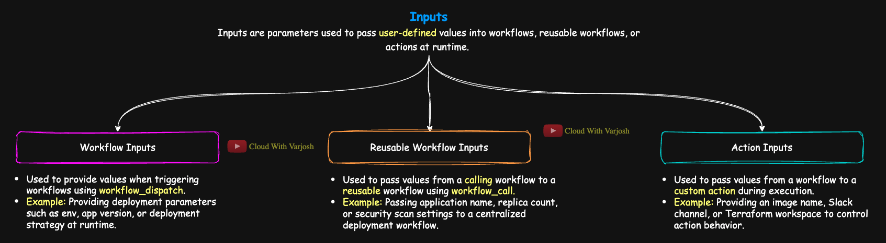

# 20 · Inputs: Workflow Inputs and Action Inputs

> **Part D: Moving data around** · Previous: [19 · Lab: Docker build and push](19-lab-docker-build-push.md) · Next: [21 · Step and job outputs](21-step-and-job-outputs.md) · [Back to INDEX](INDEX.md)
>
> **Video:** [GitHub Actions Inputs Explained | Workflow Inputs, Reusable Workflows & Production Use Cases](https://youtu.be/fLZRgNhQq3w)
>
> [](https://youtu.be/fLZRgNhQq3w)
>
> **Reusable workflow inputs** (Type 2 and Demo 2 of this lecture) are in [topic 22](22-reusable-workflows.md), because they need outputs (topic 21) first.

---

## What it is

**Inputs are parameters that pass values into workflows, reusable workflows or actions at runtime.**

Instead of hard-coding values, inputs make workflows and actions **dynamic, reusable and environment-aware**. For example, instead of always deploying to **dev**, the workflow accepts:

- **environment=dev**
- **environment=qa**
- **environment=prod**

and behaves accordingly.



There are three types:

1. **Workflow inputs**: values supplied when someone triggers a workflow through the **GitHub UI, API or CLI** with `workflow_dispatch`. *Example:* environment, app version or deployment strategy at runtime. → **This topic.**
2. **Reusable workflow inputs**: values passed from a **calling workflow** to a **reusable workflow** with `workflow_call`. *Example:* app name, replica count or security-scan settings for a central deployment workflow. → **[Topic 22](22-reusable-workflows.md).**
3. **Action inputs**: values passed from a workflow to an **action** (`with:`). *Example:* image name, Slack channel or Terraform workspace. → **This topic** (concept). Building actions comes in topics 32–34.

---

## Why it exists

Real companies use one workflow for many **environments, apps, deployment strategies and operational scenarios**. Different environments need different steps:

- **Dev**: basic build and deployment validation
- **QA**: extra security scans, integration tests, app-level tests
- **Prod**: approvals, change-management checks, production-specific controls

Instead of three workflows, one workflow uses inputs to decide which jobs and steps run:

- **Dev:** Build → Deploy
- **QA:** Build → Security Scan → Integration Tests → Deploy
- **Prod:** Build → Approval → Deploy

That makes workflows **environment-aware, reusable and efficient**. Running only what each environment needs also **saves resources**: less runner time, faster pipelines, no wasted compute on checks that aren't needed.

> **Inputs vs functions.** An **input** provides **information**. A **function** helps **process** it or make decisions.
>
> - **Inputs provide the data.**
> - **Expressions and functions process the data and make decisions.**
>
> Flow: **user provides input** → `environment=qa` → **workflow receives the value** → **expressions and functions evaluate it** → **behaviour changes**.
>
> Real pipelines use inputs, expressions and functions together. Later topics combine **inputs, outputs, artifacts, functions, variables and contexts** into production-style pipelines.

**Jenkins comparison:** workflow inputs ≈ **"This project is parameterized"** (`parameters { choice(...) booleanParam(...) string(...) }`). Action inputs ≈ the arguments of a shared-library step.

---

## Analogy

Ordering at a **coffee shop with a touch-screen kiosk**:

- The kiosk asks: size (**choice**: small/medium/large, default medium), extra shot? (**boolean**), name for the cup (**string**), number of cups (**number**).
- The barista (the workflow) follows the **same recipe** but changes what they do based on your answers.
- You can order on the **kiosk** (UI), the **app** (CLI), or the **delivery service** can order for you (API). Same answers, same coffee.
- **Action inputs** are like telling the milk-frothing machine "oat milk, extra hot". It's a smaller tool with its own settings.

---

## How it works inside

```text
UI "Run workflow" form / gh workflow run -f env=qa / POST …/dispatches {"inputs":{…}}
      │
      ▼
GitHub validates the inputs against the definitions (type, required, options)
      │   invalid → rejected before any run is created
      ▼
workflow_dispatch event with payload.inputs → run created
      │
      ▼
values available as  ${{ inputs.<name> }}   (typed: boolean stays boolean, number stays number)
            and as   ${{ github.event.inputs.<name> }}  (🆕 always STRINGS — "true"/"false")
```

> 🆕 **The `inputs` vs `github.event.inputs` trap:** `if: ${{ inputs.perform_smoke_test }}` works because `inputs` keeps the **boolean**. `if: ${{ github.event.inputs.perform_smoke_test }}` is the **string** `"false"`, which is non-empty and therefore **true**. Always use the `inputs` context.

---

## Workflow YAML / commands

### Type 1: Workflow inputs

Used with:

```yaml
on:
  workflow_dispatch:
```

Users provide values at runtime instead of editing workflow code.

**Production example: one deployment workflow for all environments.**

```yaml
on:
  workflow_dispatch:
    inputs:
      environment:
        description: Deployment Environment
        required: true
        type: choice
        default: dev
        options:
          - dev
          - qa
          - prod
```

GitHub shows a **dropdown** with **dev**, **qa** and **prod** when the workflow is run.

**The input definition, field by field:**

- **`environment`** is the **input name**, used later as **`${{ inputs.environment }}`**.

  > A workflow can define **many inputs**, each with a unique name. A deploy workflow might collect the **environment**, **application version**, **deployment strategy**, and whether to run **smoke tests**, and decide **where** and **how** to deploy, all with one workflow definition.
  >
  > ```text
  > Environment         → dev / qa / prod
  > Application Version → v1.2.0
  > Deployment Strategy → rolling / blue-green
  > Run Smoke Tests     → true / false
  > ```
  >
  > One workflow supports many deployment scenarios **without duplicating workflows or changing code**. (**Rolling** = replace instances a few at a time. **Blue-green** = run a full new copy next to the old one, then switch traffic.)

- **`description`**: friendly text shown in the UI. Optional but strongly recommended.
- **`required: true`**: the input is mandatory. The run can't start without a value.
- **`type: choice`**: shows a dropdown and restricts users to the listed values.

  Supported types for **`workflow_dispatch`**:

  | Type | Purpose | Common use cases |
  |---|---|---|
  | **`string`** | Free-form text | App version (`v1.2.0`), Docker image tag, release ID, branch name |
  | **`choice`** | Pick from predefined values | Environment (`dev`, `qa`, `prod`), deployment strategy, cloud region |
  | **`boolean`** | True/false | Enable security scans, run DB migrations, trigger smoke tests |
  | **`number`** | Numeric value | Replica count, timeout, retry count, scaling parameter |
  | **`environment`** | Pick a GitHub **Environment** | Environments with their own secrets, approvals and protection rules (topic 28) |

  With `type: boolean`, GitHub shows a **true/false checkbox** instead, which is useful for switching **optional behaviour** (security scans, DB migrations, smoke tests) on or off.

  With `type: environment`, users pick from the **GitHub Environments** configured in the repo, which can bring **environment-specific secrets, approvals and protection rules**.

  > **Best practice:** when the allowed values are known in advance, prefer **`choice`** over **`string`**. It prevents **invalid input**, improves **consistency** and gives a better UI. Choosing from `dev`/`qa`/`prod` is safer than typing it.

- **`default: dev`**: **pre-selects** a value. Users can change it, and if they don't, the default is used. That improves usability and standardizes the common path.
- **`options`**: the dropdown values. **Required** with `type: choice`.

Reading the input:

```yaml
run: echo "Deploying to ${{ inputs.environment }}"
```

If the user picks **prod**:

```text
Deploying to prod
```

> **Production insight:** workflow inputs are used for environment selection, release version selection, deployment approvals, rollback targets, maintenance, scaling and other on-demand operations.

> **Important:** inputs aren't limited to the UI. `workflow_dispatch` workflows can be started **programmatically** through the **API** or **CLI**, with input values in the request.
>
> It's like creating an **EC2 instance** (a virtual server in AWS). You can do it in the **AWS Console**, or with the **AWS CLI**, **SDKs** or **Terraform**. The result is the same; only the way you supply the values differs.
>
> - **GitHub UI** → web form
> - **GitHub CLI (`gh`)** → command-line arguments
> - **GitHub REST API** → HTTP request payload
>
> Whatever the interface, the workflow gets the same values and runs the same logic. So companies plug GitHub Actions into **deployment portals, ITSM tools, approval systems and ChatOps** (running operations from chat tools like Slack) while keeping one workflow.

### Type 3: Action inputs (concept)

**Action inputs** pass values into **actions**. Unlike workflow inputs and reusable-workflow inputs (defined in **workflows**), action inputs are defined **inside the action itself** (in its `action.yml`). That lets companies build **reusable, configurable, standard actions** for many repos and teams.

> **Note:** for now, just understand that action inputs let workflows pass configuration into actions. You'll define and consume them yourself in **topics 32–34** (custom actions).

**Production example:** a company's custom security-scanning action takes the image to scan as an input.

Action definition (`action.yml`):

```yaml
inputs:
  image-name:
    required: true
```

- **`image-name`** is the input name. The action reads it as `${{ inputs.image-name }}`.
- **`required: true`** means workflows using the action must provide it.

> **Note:** action input values arrive as **strings**. The action interprets them as text, true/false or numbers:
>
> - text → image names, app names, emails, environments
> - true/false → optional behaviour (`fail_on_high_severity: true`)
> - numbers → `retry_count: 3`, `timeout_minutes: 30`
>
> ⚠️ Corrected: was "Action Inputs support **`string`**, **`boolean`** and **`number`** data types", now "action inputs are passed as strings" because `action.yml` inputs have **no `type:` field**. Unlike `workflow_dispatch` and `workflow_call` inputs, every action input is delivered as a string (`"true"`, `"3"`), and the action must convert it.

A workflow uses it:

```yaml
- uses: company/docker-scan-action@v1
  with:
    image-name: payment-service:v1
```

- `company/docker-scan-action@v1` is the custom action
- `image-name` is the input
- `payment-service:v1` is the value

Inside the action:

```yaml
${{ inputs.image-name }}
```

Input `payment-service:v1` → behaviour: scan that image → output: scan results.

**Why it helps:** with dozens of apps needing scans before deployment, you build **one** scanning action and pass app-specific values, not one action per app. That gives **reusability, standardization, maintainability and consistency**.

> **Production insight:** action inputs are used in deployment, security-scanning, notification, compliance, infrastructure-provisioning and testing actions, and in internal platform tools.

---

### Demo 1: an environment-aware CI pipeline with workflow inputs

You'll see how workflow inputs change behaviour **without editing the workflow**. It uses the familiar Flask app with paths for **Dev**, **QA** and **Prod**.

```text
User Triggers Workflow
            │
            ▼
      Workflow Inputs
      ├── Environment
      └── Perform Smoke Test
            │
            ▼
      GitHub Actions Runner
            │
            ▼
      Build Docker Image
            │
            ▼
    Environment-Specific Logic
      ├── Dev
      ├── QA
      └── Prod
```

1. A user triggers the workflow manually.
2. They pick an environment.
3. They decide whether to smoke-test.
4. GitHub receives the values.
5. The workflow adapts.
6. You observe the result in the UI.

By the end you'll have triggered with **workflow_dispatch**, given inputs in the UI, built an image, run environment-specific steps, optionally smoke-tested, and seen one workflow behave differently per input.

> **Operational insight:** the focus is **workflow inputs**, not building a deployment platform: one workflow supports many scenarios through runtime values.

#### Step 1: Repository setup

Repo `cwvj-gha-practice` (private) and SSH, as in [topic 02](02-git-and-github-recap.md). Workflows live in the repo, and GitHub evaluates them when they're pushed.

#### Step 2: Application and supporting components

A pipeline needs more than source code: a **Dockerfile**, a **registry** (Docker Hub) and **credentials** (GitHub Secrets).

```text
project-files/
├── app.py
├── Dockerfile
├── requirements.txt
└── .github/
    └── workflows/
        └── 01-workflow-inputs-demo.yaml
```

- **2.1** Private Docker Hub repo `cwvj-flask-app` (topic 19).
- **2.2** Docker Hub access token: `gha-demo`, 1 day, Read & Write. Copy it once. Never use your password (topic 17).
- **2.3** Repository secret `DOCKERHUB_TOKEN` (repo vs org scope, never hard-code, topic 17).
- **2.4–2.6** `app.py`, `Dockerfile`, `requirements.txt`: **identical** to [topic 16](16-lab-flask-ci.md) (`/` and `/health` endpoints, port 5000, `python:3.13-slim`, `flask==3.1.1`), with the same line-by-line explanation. Copy them from [`code/16-19-flask-app/`](code/16-19-flask-app/).

#### Step 3: The workflow

`.github/workflows/01-workflow-inputs-demo.yaml`:

```yaml
name: 01 - Type 1 Workflow Inputs Demo

on:
  workflow_dispatch:
    inputs:
      environment:
        description: Deployment Environment
        required: true
        type: choice
        default: dev
        options:
          - dev
          - qa
          - prod

      perform_smoke_test:
        description: Execute Smoke Test
        required: true
        type: boolean
        default: true

env:
  APPLICATION_NAME: cwvj-flask-app
  DOCKER_USERNAME: cloudwithvarjosh
  IMAGE_TAG: v1.0.1

jobs:
  flask-ci-job:
    runs-on: ubuntu-latest

    steps:
      - name: Checkout Repository
        uses: actions/checkout@v7

      - name: Display Input Values
        run: |
          echo "Environment: ${{ inputs.environment }}"
          echo "Perform Smoke Test: ${{ inputs.perform_smoke_test }}"

      - name: Build Docker Image
        uses: docker/build-push-action@v7
        with:
          context: .
          push: false
          tags: ${{ env.DOCKER_USERNAME }}/${{ env.APPLICATION_NAME }}:${{ env.IMAGE_TAG }}

      - name: QA Validation
        if: ${{ inputs.environment == 'qa' }}
        run: |
          echo "Running QA validation checks..."
          echo "Running security validation..."
          echo "Running integration validation..."
          echo "QA validation completed successfully."

      - name: Login to DockerHub
        if: ${{ inputs.environment != 'dev' }}
        uses: docker/login-action@v4
        with:
          username: ${{ env.DOCKER_USERNAME }}
          password: ${{ secrets.DOCKERHUB_TOKEN }}

      - name: Push Docker Image
        if: ${{ inputs.environment != 'dev' }}
        uses: docker/build-push-action@v7
        with:
          context: .
          push: true
          tags: ${{ env.DOCKER_USERNAME }}/${{ env.APPLICATION_NAME }}:${{ env.IMAGE_TAG }}

      - name: Run Container
        run: |
          docker run -d \
            -p 5000:5000 \
            --name flask-container \
            ${{ env.DOCKER_USERNAME }}/${{ env.APPLICATION_NAME }}:${{ env.IMAGE_TAG }}

      - name: Smoke Test
        if: ${{ inputs.perform_smoke_test }}
        run: |
          sleep 5
          curl --fail http://localhost:5000/health
          echo "Application is healthy."

      - name: Deploy to Kubernetes
        if: ${{ inputs.environment == 'prod' }}
        run: |
          echo "Deploying application to Production Kubernetes Cluster..."
          echo "Deployment completed successfully."
```

> **Why `curl --fail`?** Because without `--fail` an HTTP 500 would still pass (topic 16).

#### Explanation

```yaml
name: 01 - Type 1 Workflow Inputs Demo
```

The **display name** in the UI. It doesn't affect behaviour, but it helps engineers find runs while reviewing **history**, troubleshooting, monitoring pipelines or analyzing deployments. Clear names matter more as repos grow.

> **Operational tip:** production repos can have **dozens or hundreds of workflows** (CI, CD, security scanning, compliance, dependency management, infrastructure, operations). Good names make troubleshooting, audits and incident investigations much easier.

```yaml
on:
  workflow_dispatch:
```

The trigger. Unlike earlier demos (`push`, `pull_request`), this runs only when a user starts it. It's required here because workflow inputs are supplied at run time through `workflow_dispatch`. Clicking **Run workflow** shows the input fields.

> **Important:** if a workflow has **both** `workflow_dispatch` and `push`, **don't assume dispatch inputs or defaults apply to push runs**. On `push`, `inputs.environment` is **empty**. Define explicit fallbacks, e.g. `${{ inputs.environment || 'dev' }}`, or event-specific logic.

> **Production insight:** manual workflows are used for **production deployments, rollbacks, DB migrations, maintenance, disaster recovery** and other tasks needing human decisions. Engineers provide runtime parameters and keep control over critical operations.

```yaml
inputs:
  environment:   # choice: dev/qa/prod, default dev
  perform_smoke_test:   # boolean, default true
```

- **`environment`** (`choice`) → a dropdown of dev/qa/prod.
- **`perform_smoke_test`** (`boolean`) → a true/false selector.
- **`default`** → pre-selected values: **`dev`** and **`true`**. Users can accept or override them.

```text
Environment        → qa
Perform Smoke Test → true
```

```text
Environment        → prod
Perform Smoke Test → false
```

> **Key observation:** the demo uses both **choice** and **boolean** so you see both UI styles, plus **`default`**.
>
> **Operational insight:** defaults also work for the **API** and **CLI**. Callers can leave out inputs that have defaults, so this request works with no inputs at all:
>
> ```bash
> curl -X POST \
>   -H "Accept: application/vnd.github+json" \
>   -H "Authorization: Bearer <GITHUB_TOKEN>" \
>   https://api.github.com/repos/<OWNER>/cwvj-gha-practice/actions/workflows/01-workflow-inputs-demo.yaml/dispatches \
>   -d '{
>     "ref": "main"
>   }'
> ```
>
> → it runs with `Environment → dev` and `Perform Smoke Test → true`. Same with the CLI:
>
> ```bash
> gh workflow run 01-workflow-inputs-demo.yaml
> ```
>
> 🆕 To pass values: `gh workflow run 01-workflow-inputs-demo.yaml -f environment=qa -f perform_smoke_test=false`, or in the API body `"inputs": {"environment": "qa", "perform_smoke_test": "false"}`. (The `<GITHUB_TOKEN>` here means a token **you** hold, like a PAT or a `gh auth` token. It isn't the workflow's own `GITHUB_TOKEN`.)

```yaml
env:
  APPLICATION_NAME: cwvj-flask-app
  DOCKER_USERNAME: cloudwithvarjosh
  IMAGE_TAG: v1.0.1
```

**Workflow-level variables**, available to all jobs and steps. No hard-coding, one place to edit. (Workflow/job/step scope: define at the **lowest scope needed**, topic 11.)

```yaml
jobs:
  flask-ci-job:
    runs-on: ubuntu-latest
```

One job (a logical unit of work) that builds the image, runs environment-specific checks, optionally smoke-tests, publishes when needed and simulates deployment. Its steps run in order on one fresh, ephemeral hosted Ubuntu runner that has the common dev tools.

> **Production insight:** bigger pipelines split into **Build, Test, Security Scan, Package, Deploy** jobs, for separation of concerns, parallelism where possible, and easier maintenance, troubleshooting and scaling.

```yaml
- name: Checkout Repository
  uses: actions/checkout@v7
```

Gets the repo contents (source, Dockerfile, workflow files) onto the runner, usually first, because later steps need them. Think of it as preparing the runner workspace.

> **Production insight:** large companies split their CI/CD across repos. One workflow may check out the **app repo** plus **deployment, Helm chart, platform automation, GitOps or Infrastructure-as-Code repos**. (`actions/checkout` with `repository:` and `path:` inputs does this.)

```yaml
- name: Display Input Values
  run: |
    echo "Environment: ${{ inputs.environment }}"
    echo "Perform Smoke Test: ${{ inputs.perform_smoke_test }}"
```

Shows the received inputs, so you can confirm at a glance whether the run was dev, qa or prod and whether smoke tests were on.

> **Operational tip:** logging key parameters early makes **troubleshooting, audits and incident analysis** much easier.

```yaml
- name: Build Docker Image
  uses: docker/build-push-action@v7
  with:
    context: .
    push: false
    tags: …
```

Builds the image **locally** (`push: false`). Every environment needs an image, so this always runs. Building first lets later steps validate, publish or deploy **the same artifact**.

> **Production insight:** mature platforms follow **Build Once, Deploy Many**: the same validated image is promoted across Dev, QA, Stage and Prod instead of being rebuilt per environment.

```yaml
- name: QA Validation
  if: ${{ inputs.environment == 'qa' }}
```

Simulates QA activities, **only for `qa`**. In a real pipeline: security scanning, integration tests, compliance checks or app verification. The point is to show inputs deciding which steps run.

> **Production insight:** **QA** is often the **final gate before production**. Many companies require security scans, integration tests, compliance checks and approvals before promoting further.

```yaml
- name: Login to DockerHub
  if: ${{ inputs.environment != 'dev' }}
```

Logs in to Docker Hub (needed before pushing), **only for qa and prod**, because those publish. Dev often builds and tests without publishing to a shared registry.

> **Production insight:** besides cloud registries (**Amazon ECR, Azure Container Registry, Google Artifact Registry**), companies use **JFrog Artifactory, Harbor, GHCR** and **Docker Hub Team/Business**. The choice depends on cloud strategy, security, artifact management needs and multi-cloud/hybrid considerations.

```yaml
- name: Push Docker Image
  if: ${{ inputs.environment != 'dev' }}
```

Publishes the image, **only for qa and prod**, so downstream environments, deployment systems or platform teams can use a validated artifact. Only approved or validated builds go to the central registry.

> **Production insight:** published images often get more **scanning, signing, vulnerability assessment and policy checks** before production approval.

> **Design consideration:** this demo **doesn't publish Dev images**. It builds, runs and validates locally on the runner. Workflow design varies: some teams publish for **all** environments including Dev, some only after smoke tests, scans, integration tests or approvals pass, and some never publish Dev builds (they're only for quick feedback). **Your workflows should reflect your app's and organization's needs** around quality, security, compliance, cost, artifact retention and release management.

> **Production consideration:** a **fixed tag** (`cloudwithvarjosh/cwvj-flask-app:v1.0.1`) keeps this demo simple. In production use **unique, immutable tags**: commit SHAs, build numbers, release versions or a combination (as in topic 19):
>
> ```text
> cloudwithvarjosh/cwvj-flask-app:v1.0.1
> cloudwithvarjosh/cwvj-flask-app:v1.0.1-build-245
> cloudwithvarjosh/cwvj-flask-app:9f2c8a7
> cloudwithvarjosh/cwvj-flask-app:2026.06.12.245
> ```
>
> Immutable tags improve **traceability, auditability, rollback and reliability**. With **Build Once, Deploy Many**, the image is built once, tagged uniquely, and promoted across **Dev, QA, UAT** (User Acceptance Testing) **and Prod**, so the exact artifact that passed testing reaches production.
>
> **Design consideration:** no tagging or promotion strategy fits everyone. Some teams rebuild per environment, others strictly promote. Align with your **release process, compliance, rollback strategy and operational practices**.

```yaml
- name: Run Container
```

Starts the app in a container on the runner, for **all environments**, because every path should first prove the image starts. It confirms the app, dependencies, config and start-up work before the artifact moves on.

> **Production insight:** **Build → Start Container → Validate → Deploy** catches start-up failures, dependency issues, missing config and runtime problems early.

```yaml
- name: Smoke Test
  if: ${{ inputs.perform_smoke_test }}
```

A simple **smoke test**, controlled entirely by the `perform_smoke_test` input: true → runs, false → skipped. It confirms the app started, is reachable and responds.

> **Production insight:** smoke tests are usually the **first check** after start-up or deployment. They're not exhaustive, just "healthy, reachable, serving requests". Pipelines often **fail immediately** if they fail, which blocks unhealthy releases.

```yaml
- name: Deploy to Kubernetes
  if: ${{ inputs.environment == 'prod' }}
```

Simulates a production deployment (**prod only**) with placeholder commands, to show one workflow supporting different paths from user inputs.

> **Production insight:** modern Kubernetes setups often deploy with **GitOps tools such as Argo CD or Flux**. GitHub Actions updates manifests, Helm values or image tags in a Git repo, and Argo CD syncs them into the cluster.

#### Expected behaviour

| Step | Dev | QA | Prod |
|---|---|---|---|
| Checkout Repository | ✓ | ✓ | ✓ |
| Display Input Values | ✓ | ✓ | ✓ |
| Build Docker Image | ✓ | ✓ | ✓ |
| QA Validation | ✗ | ✓ | ✗ |
| Login to DockerHub | ✗ | ✓ | ✓ |
| Push Docker Image | ✗ | ✓ | ✓ |
| Run Container | ✓ | ✓ | ✓ |
| Smoke Test* | Optional | Optional | Optional |
| Deploy to Kubernetes | ✗ | ✗ | ✓ |

\* Depends on `perform_smoke_test`.

| Environment | Typical path |
|---|---|
| **dev** | Build → Run Container → Smoke Test (optional) |
| **qa** | Build → QA Validation → Push Image → Run Container → Smoke Test (optional) |
| **prod** | Build → Push Image → Run Container → Smoke Test (optional) → Deploy |

> **Key observation:** the **workflow definition is the same** every time. Only the **input values** change, and GitHub decides which steps run from the conditions.
>
> **Important learning:** instead of separate Dev, QA and Prod workflows, one workflow supports many paths by combining **inputs, conditions and environment-specific logic**.
>
> **Production insight:** large organizations standardize deployments this way. Engineers provide **environment, version, strategy, rollback target or approval options**, and the same workflow adapts.

#### Step 4: Commit and push

```bash
# Add all workflow, application, and configuration changes to the Git staging area
git add .

# Create a commit containing the Workflow Inputs demo implementation
git commit -m "feat: add workflow inputs demo"

# Associate the local repository with the remote GitHub repository (one-time setup)
git remote add origin git@github.com:<YOUR_GITHUB_USERNAME>/cwvj-gha-practice.git

# Push the code to GitHub and configure the local branch to track origin/main
git push -u origin main
```

Because the only trigger is `workflow_dispatch`, **pushing doesn't run the workflow**.

Go to **Repository → Actions → 01 - Type 1 Workflow Inputs Demo → Run workflow**. GitHub shows:

```text
Environment
  • dev
  • qa
  • prod

Perform Smoke Test
  • true
  • false
```

Pick values and click **Run workflow**.

> **Production insight:** `workflow_dispatch` workflows are used for deployments, rollbacks, maintenance, DB migrations and other tasks needing runtime parameters.

> **Key observation:** unlike workflows that run automatically on `push`/`pull_request`, workflow inputs let users **influence behaviour at runtime without changing code**.

#### Step 5: Run it

**Actions → 01 - Type 1 Workflow Inputs Demo → Run workflow**, choose for example `Environment → qa`, `Perform Smoke Test → true`, then **Run workflow**. GitHub starts the run with those values.

#### Step 6: Observe

**Example 1: Dev** (`dev`, smoke test `true`)

```text
Ran:     Checkout Repository, Display Input Values, Build Docker Image, Run Container, Smoke Test
Skipped: QA Validation, Login to DockerHub, Push Docker Image, Deploy to Kubernetes
```

**Example 2: QA** (`qa`, `true`)

```text
Ran:     Checkout Repository, Display Input Values, Build Docker Image, QA Validation,
         Login to DockerHub, Push Docker Image, Run Container, Smoke Test
Skipped: Deploy to Kubernetes
```

**Example 3: Production** (`prod`, `false`)

```text
Ran:     Checkout Repository, Display Input Values, Build Docker Image, Login to DockerHub,
         Push Docker Image, Run Container, Deploy to Kubernetes
Skipped: QA Validation, Smoke Test
```

> ⚠️ Corrected: was "Skipped: QA Security Validation, **Run Container**, Smoke Test" for prod, now **Run Container runs** because that step has **no `if:`** and always executes. Also, the step is named **QA Validation**, not "QA Security Validation".

**Sample log output (prod):**

```text
✓ Display Input Values
    Environment: prod
    Perform Smoke Test: false
⊘ QA Validation
✓ Login to DockerHub        → Login Succeeded!
✓ Push Docker Image         → pushing manifest for docker.io/cloudwithvarjosh/cwvj-flask-app:v1.0.1
✓ Run Container             → 5b2d…
⊘ Smoke Test
✓ Deploy to Kubernetes
    Deploying application to Production Kubernetes Cluster...
    Deployment completed successfully.
```

---

## Hands-on lab

1. Run the demo three times (dev/true, qa/true, prod/false) and compare against the tables.
2. Run it from the CLI: `gh workflow run 01-workflow-inputs-demo.yaml -f environment=qa -f perform_smoke_test=false`, then `gh run watch`.
3. Change the smoke-test condition to `${{ github.event.inputs.perform_smoke_test }}`, run with **false**, and watch it **still run** (string `"false"` is truthy). Change it back.
4. Add `push:` as a second trigger and print `${{ inputs.environment || 'dev' }}` on a push run.
5. Add a `type: number` input `replicas` and print it.

---

## Where you'll use it

- **Manual production deploys** and **rollbacks** with a version input.
- **Maintenance jobs:** "rotate keys", "clear cache", with a target environment input.
- **ChatOps / portals:** a Slack bot calls the dispatch API with inputs.
- **Action inputs:** every `with:` you write (`python-version`, `role-to-assume`, `image-ref` in the capstone).

---

## When it breaks

| Symptom | Meaning | Fix |
|---|---|---|
| No **Run workflow** button | The workflow isn't on the default branch, or there's no `workflow_dispatch:`. | Merge to `main`. |
| `Unexpected inputs provided: ["envirnoment"]` (API/CLI) | Input name typo. | Match the names in `inputs:`. |
| `Provided value 'staging' for input 'environment' not in the list of allowed values` | A value not in `options`. | Use an allowed value, or add it to `options`. |
| Boolean step runs when `false` | You used `github.event.inputs.*` (a string). | Use `inputs.*`. |
| Input empty on `push` runs | Inputs exist only for `workflow_dispatch` (and `workflow_call`). | Fallback: `inputs.x \|\| 'default'`. |
| `HTTP 422` from the dispatch API | Wrong `ref`, a missing required input, or `workflow_dispatch` not in the file on that ref. | Check the `ref` and the inputs. |
| `HTTP 403/404` from the dispatch API | The token lacks `actions: write` (fine-grained) / `repo` scope. | Use a token with the right permission. |

---

## Quick recap

- Three input types: **workflow** (`workflow_dispatch`), **reusable workflow** (`workflow_call`, topic 22), **action** (`with:`).
- `workflow_dispatch` input types: string, choice, boolean, number, environment. Use `required`, `default`, `options`.
- Read with **`inputs.<name>`** (typed), not `github.event.inputs` (strings).
- Same workflow from the UI, `gh workflow run -f`, or the REST API.
- Inputs **provide** data. Expressions and functions **decide** with it.

**Interview questions**

1. **Q: How do you let an operator choose dev/qa/prod when running a workflow?**
   A: `workflow_dispatch` with an input of `type: choice` and `options: [dev, qa, prod]`, read as `${{ inputs.environment }}`.
2. **Q: Why might a boolean input of `false` still pass an `if:`?**
   A: If read from `github.event.inputs`, it's the string `"false"`, which is truthy. Use the `inputs` context.
3. **Q: Can a workflow with inputs be started without the UI?**
   A: Yes, with `gh workflow run … -f name=value` or `POST /repos/{owner}/{repo}/actions/workflows/{id}/dispatches`.
