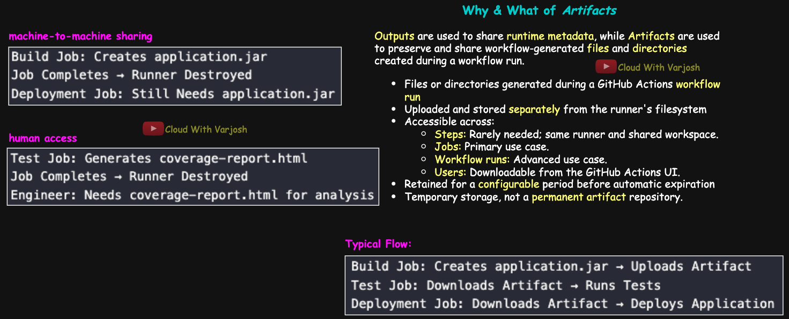

# 24 · Artifacts: Sharing and Keeping Files

> **Part D: Moving data around** · Previous: [23 · Workflow commands](23-workflow-commands-and-summaries.md) · Next: [25 · Caching](25-caching.md) · [Back to INDEX](INDEX.md)
>
> **Video:** [GitHub Actions Artifacts & Caching Explained | Share Files & Optimize Builds](https://www.youtube.com/watch?v=tw9e61Bct-E) (first half)
>
> [](https://www.youtube.com/watch?v=tw9e61Bct-E)
>
> **Code:** [`code/24-artifacts/`](code/24-artifacts/)

---

## What it is

**Artifacts are files or directories generated during a workflow run that GitHub Actions stores and makes available after the job finishes.**

Think of an artifact as a **package of workflow-generated files** that GitHub keeps **outside** the runner's temporary disk.

```text
Workflow Creates File → Upload Artifact → GitHub Stores File → Other Jobs or Users Access File
```



Once uploaded:

- GitHub stores the files and **links them to the workflow run**
- they survive after the **runner is destroyed**
- **downstream jobs** can download and use them
- engineers can download them from the **Actions UI** (as a ZIP)
- they're kept for a **configurable period** for troubleshooting, auditing, reporting and compliance

> **Mental model:** artifacts are **temporary file storage that GitHub Actions provides for workflow-generated files**. Unlike runner storage, they outlive the job that created them, and both **automation** and **people** can use them.

---

## Why it exists

Topic 21: **outputs** share small **metadata** (URLs, versions, IDs). But pipelines produce **files**:

- a build job creates an **application package**
- a test job creates **test reports** and **coverage reports**
- a security job creates vulnerability reports and **SBOM** files
- a deploy job creates deployment logs, audit records and manifests
- a data job creates large CSV, JSON, PDF or Excel files
- a UI test job creates **screenshots** and **recordings** of failed tests
- an **MLOps** pipeline (machine-learning operations) creates trained **ML models**, evaluation reports, metrics and validation reports
- an **LLMOps** pipeline (large-language-model operations) creates prompt evaluations, benchmarks, inference logs and **RAG** (Retrieval-Augmented Generation) evaluation reports

```text
application.jar
coverage-report.html
test-results.xml
security-scan.json
sbom.json
deployment.log
model.pkl
model.onnx
metrics.json
evaluation-report.json
prompt-evaluation.json
rag-evaluation.json
inference.log
```

***How can these files be shared with other jobs or downloaded after the workflow completes?***

```text
Build Job: Creates application.jar
Test Job: Requires application.jar
Deployment Job: Requires application.jar
```

- How do **downstream jobs** get files from earlier jobs?
- How do people **download** files after the run?
- How do you keep build outputs for **troubleshooting, auditing and compliance**?
- How do you share reports with **engineers, stakeholders and deployment pipelines**?
- How do you reuse one deployment package across jobs **without rebuilding** it?

It's worse because **runners are ephemeral**:

```text
Job Starts → Runner Created
Job Executes → Files Generated
Job Completes → Runner Destroyed
```

When the runner is destroyed, **files that existed only on it are lost**:

```text
Build Job: Creates application.jar
Job Completes → Runner Destroyed
Deployment Job: Still Needs application.jar
```

```text
Test Job: Generates coverage-report.html
Job Completes → Runner Destroyed
Engineer: Needs coverage-report.html for analysis
```

> **Key observation:** many files must **outlive the job and runner that created them**: for downstream jobs, downloads, troubleshooting, compliance or deployment. **Artifacts** solve this.

**Jenkins comparison:** `archiveArtifacts 'target/*.jar'` + `copyArtifacts` (plugin) ≈ `upload-artifact` + `download-artifact`. `stash`/`unstash` (sharing files between stages in one build) is the closest Jenkins match to sharing artifacts between jobs.

---

## Analogy

A **cloakroom at a concert**:

- You arrive at venue 1 (job 1), get your coat wet (create files), and **hand it to the cloakroom** with a **ticket name** (`name: flask-ci-artifacts`).
- Venue 1 closes and is demolished (the runner is destroyed). Your coat is safe in the cloakroom.
- At venue 2 (job 2) you show the ticket and **get the same coat back** (`download-artifact`).
- The cloakroom only keeps coats for **a set number of days** (retention), then throws them away.
- It's a cloakroom, **not a warehouse**. For things you must keep for years, use a real warehouse (Artifactory, Nexus, S3, GitHub Releases).

---

## How it works inside

```text
upload-artifact (in job A)
  1. expands the path globs on the runner
  2. zips the files and uploads them over HTTPS to GitHub's artifact storage (blob storage)
     using the job's internal ACTIONS_RUNTIME_TOKEN (not GITHUB_TOKEN)
  3. registers "artifact <name>, id <n>, size, SHA-256 digest" on the workflow RUN
download-artifact (in job B, same run)
  1. asks GitHub for the artifact by name (or all artifacts if no name)
  2. downloads, checks the digest, and extracts into `path` (default: $GITHUB_WORKSPACE)
UI / API
  run summary page → Artifacts section → download ZIP
  GET /repos/{o}/{r}/actions/artifacts/{id}/zip  (other runs and tools)
retention timer → when expired, artifact deleted (and stops counting toward storage)
```

🆕 Facts for the current versions (`upload-artifact@v4` and later):

- Artifacts are **immutable**: you **can't upload twice to the same name** in one run (`Conflict: an artifact with this name already exists`). Use unique names (e.g. `report-${{ matrix.os }}`) or `overwrite: true`.
- Up to **500 artifacts per job**.
- Artifact storage counts toward your plan's **storage quota** (topic 41). Short retention saves money.
- **v3 and older are deprecated and no longer work** on GitHub.com (shut down in early 2025). Use the latest major.

Artifacts can be used at different levels:

- **Steps:** technically possible but rarely needed. Steps in one job share the **same runner**, workspace and filesystem, so later steps just read the files.
- **Jobs:** the **main use**: files from one job for downstream jobs on **different runners**.
- **Workflow runs:** supported. An artifact from one run can be downloaded by **another run** (with `run-id` + `github-token` inputs on download-artifact, or via the API), while it's still within retention.

> **Best practice:** treat Actions artifacts as **temporary storage**, not a permanent artifact repository. They're ideal for sharing between jobs and keeping outputs for troubleshooting or auditing for a while. **Long-term** deliverables go to dedicated repositories like **JFrog Artifactory**, **Sonatype Nexus Repository**, or **AWS CodeArtifact**.

---

## Workflow YAML / commands

### Demo 1: share files across jobs using artifacts

You'll build and run the Flask container, create a **smoke test report** and **container logs** in one job, upload them as an artifact, then download and read them in **another job on a different runner**.

#### Step 1: Repository setup

Repo `cwvj-gha-practice` (private) and SSH, as in [topic 02](02-git-and-github-recap.md).

#### Step 2: The application

```text
project-files/
├── app.py
├── Dockerfile
├── requirements.txt
└── .github/
    └── workflows/
        └── 01-artifacts-demo.yaml
```

Files are in [`code/24-artifacts/`](code/24-artifacts/). The `Dockerfile` and `requirements.txt` (`flask==3.1.1`) are the same as topic 16. **`app.py` adds `print` lines** so the container logs have something to show:

```python
from flask import Flask, jsonify
import os

app = Flask(__name__)

print("Cloud With VarJosh Flask Application Started")

@app.get("/")
def home():
    print("Home endpoint invoked")

    return jsonify(
        message="Welcome to Cloud With VarJosh",
        platform="GitHub Actions",
        runtime="Docker + Flask"
    )

@app.get("/health")
def health():
    print("Health endpoint invoked")
    return jsonify(status="healthy"), 200

if __name__ == "__main__":
    app.run(
        host="0.0.0.0",
        port=int(os.getenv("PORT", 5000))
    )
```

> 🆕 **Tip:** Python buffers `print` output when it isn't writing to a terminal (inside a container), so lines can show up late or not at all in `docker logs`. Add `ENV PYTHONUNBUFFERED=1` to the Dockerfile, or use `print(..., flush=True)`.

> **Key observation:** this demo is about artifacts, but it needs a realistic workload that **generates files**. The Docker image provides the runtime for the Flask app.

#### Step 3: The workflow

[`code/24-artifacts/01-artifacts-demo.yaml`](code/24-artifacts/01-artifacts-demo.yaml) → `.github/workflows/01-artifacts-demo.yaml`:

```yaml
name: 01 - Artifacts Demo

on:
  workflow_dispatch:

jobs:
  flask-ci-job:
    runs-on: ubuntu-latest

    steps:
      - name: Checkout Repository
        uses: actions/checkout@v7

      - name: Build Docker Image
        uses: docker/build-push-action@v7
        with:
          context: .
          push: false
          tags: cwvj-flask-app:v1.0.1

      - name: Run Container
        run: |
          docker run -d \
            -p 5000:5000 \
            --name cwvj-flask-container \
            cwvj-flask-app:v1.0.1

      - name: Generate Smoke Test Report
        run: |
          sleep 5
          curl http://localhost:5000 > smoke-test-report.txt
          curl http://localhost:5000/health >> smoke-test-report.txt

      - name: Export Container Logs
        run: |
          docker logs cwvj-flask-container > container-logs.txt

      - name: Upload Artifacts
        uses: actions/upload-artifact@v7
        with:
          name: flask-ci-artifacts
          path: |
            smoke-test-report.txt
            container-logs.txt

  review-job:
    runs-on: ubuntu-latest

    needs:
      - flask-ci-job

    steps:
      - name: Download Artifacts
        uses: actions/download-artifact@v8
        with:
          name: flask-ci-artifacts

      - name: Review Downloaded Artifacts
        run: |
          echo "===== Smoke Test Report ====="
          cat smoke-test-report.txt

          echo ""
          echo "===== Container Logs ====="
          cat container-logs.txt
```

**Explanation:**

- **`name:`** and **`workflow_dispatch`**: a clear name helps find runs among the many workflows in a repo. The manual trigger lets you focus on artifacts (manual workflows are also used for deploys, rollbacks, maintenance and DR).
- **`flask-ci-job`**: runs on an ephemeral hosted runner, whose files are destroyed afterwards. (Workflows often check out several repos: app, GitOps, IaC, Helm charts, platform.)
- **Build Docker Image / Run Container**: build locally (`push: false`) and start the app at `http://localhost:5000`. Many pipelines confirm the app **starts** before deploying, packaging or releasing.
- **Generate Smoke Test Report**: `sleep 5` gives the app time to start. The first `curl` writes the `/` response to `smoke-test-report.txt`, and the second **appends** the `/health` response.

  ```text
  >   Creates a new file or overwrites an existing file
  >>  Appends content to an existing file
  ```

  > **Key observation:** this is the **first artifact candidate**. Right now it exists **only on the runner's disk**.

- **Export Container Logs**: `docker logs` gets the container's stdout and stderr and writes them to `container-logs.txt`, the **second** file, for example:

  ```text
  Cloud With VarJosh Flask Application Started
  Home endpoint invoked
  Health endpoint invoked
  ```

  > **Production insight:** uploading **logs** as artifacts is a common troubleshooting technique. When pipelines fail, teams upload logs, screenshots, test reports and diagnostics for root-cause analysis.

- **Upload Artifacts**: `name: flask-ci-artifacts` is the artifact's name (its "ticket"). `path:` uses a YAML `|` block to list several files (globs like `reports/**` also work). Engineers can download it from the UI, and downstream jobs use **`actions/download-artifact`**.

  > **Important:** hosted runners are **ephemeral**. Files left only on the runner are **permanently lost** when the job ends. Uploading makes them survive.
  >
  > **Key observation:** once uploaded, the files **don't depend on the runner**. They live in **GitHub-managed artifact storage**. GitHub hides the storage details, and they're available to **downstream jobs, other runs and manual download** without you managing any object storage.

- **`review-job`** with **`needs: [flask-ci-job]`**: jobs are parallel by default, so `needs` makes it wait. It runs on a **completely different runner**. Without artifacts the files wouldn't exist here.
- **Download Artifacts**: fetches `flask-ci-artifacts` and extracts it into the workspace.

  > **Important:** the original runner **no longer exists**. The files are available **only** because they were uploaded to GitHub's artifact storage.
  >
  > **Key observation:** artifacts serve **machine-to-machine** sharing (between jobs and runs) **and human access** (through the UI) for troubleshooting, auditing, reporting and operational reviews.
  >
  > **Production insight:** engineers often download **test reports, coverage reports, security scan reports, deployment logs, Terraform plans, screenshots and application packages** from the run summary page when investigating failures, validating deployments or collecting audit evidence.

- **Review Downloaded Artifacts**: `cat` prints both files, which confirms they were preserved, uploaded, transferred and downloaded.

  > **Key observation:** files created in one job were consumed in another job on a **different runner**. That's the main purpose of artifacts: preserving and moving files across execution boundaries.

> **Mental model:**
>
> ```text
> flask-ci-job:
> Build Image → Run Container → Generate Files → Upload Artifact
>
> review-job:
> Download Artifact → Consume Files
> ```
>
> Artifacts are the **bridge** that lets files outlive a runner and reach downstream jobs.

#### Common testing flow in CI/CD pipelines

Smoke testing comes up throughout this course, so here's where it fits among the testing stages:

```text
Unit → Integration → Smoke → Sanity → System → Regression → Acceptance → Production
```

| Testing type | Purpose |
|---|---|
| **Unit testing** | Checks individual functions, classes or methods **in isolation**. |
| **Integration testing** | Checks that components or services **work together** and exchange data correctly. |
| **Smoke testing** | A quick, high-level check that the app **starts** and critical features work, before further testing. Also called a **Build Verification Test (BVT)**. |
| **Sanity testing** | Checks that a **specific bug fix or new feature** works, without testing everything. |
| **System testing** | Validates the **complete app end-to-end** against functional and non-functional requirements. |
| **Regression testing** | Ensures new changes **didn't break existing** functionality. |
| **Acceptance testing** | Done by **end users or business stakeholders** to decide if the app meets business needs and is ready for release. |

> **Note:** not every pipeline runs all of these. Fast ones (**unit, integration, smoke**) usually run on every change. **Regression, system and acceptance** testing often happen later in the release pipeline or before production.

#### Artifact retention

Artifacts are **not kept forever**. After the retention period they're deleted automatically and can't be downloaded.

- Artifacts and logs are kept for **90 days by default**.
- Repository, organization and enterprise admins can change this to match **operational, security, compliance, audit and governance** needs: **Repository Settings → Actions → General → Artifact and log retention**.
- If **`retention-days`** isn't set, the repo's configured policy applies.
- Workflows can set a custom period with **`retention-days`**:

```yaml
- name: Upload Artifacts
  uses: actions/upload-artifact@v7
  with:
    name: flask-ci-artifacts
    path: smoke-test-report.txt
    retention-days: 7
```

→ deleted automatically after **7 days**.

```text
Minimum Retention (Workflow Level): 1 Day
Maximum Retention (Workflow Level): 90 Days
```

`retention-days` accepts **1–90** and can't exceed the repo/org limit.

> **Note:** at the **workflow level**, `retention-days` maxes out at **90 days** for one artifact. At the **repository level**, admins can set **artifact and log retention** up to **400 days** (private repos on paid plans. Public repos stay at 90). The repo-level policy decides the effective retention.

> **Retention and best practices**
>
> - `retention-days` sets the period per artifact, within repo/org/enterprise policy.
> - Artifacts are **temporary workflow storage**: ideal for sharing between jobs, troubleshooting, and keeping outputs for a limited time.
> - Organizations set retention policies to balance **security, compliance, auditability and storage cost**.
> - **Industry best practice:** keep artifacts only while they're useful. Long-term deliverables (release packages, compliance evidence) belong in **AWS CodeArtifact, JFrog Artifactory, Sonatype Nexus Repository, GitHub Releases or Amazon S3**.

#### Step 4: Commit and push

```bash
git add .
git commit -m "feat: add artifacts demo"
git push -u origin main
```

> **Key observation:** unlike `push`/`pull_request` workflows, this runs only when you start it, so you can focus on artifact creation, upload, download and use. (Manual workflows are common for deploys, rollbacks, DR, maintenance and infra changes that need human oversight.)

#### Step 5: Run it

**Actions → 01 - Artifacts Demo → Run workflow**.

> **Key observation:** the goal isn't containers or Flask. It's showing that files from one job **survive the runner** and are consumed by another job.

#### Step 6: Observe

Two jobs: `flask-ci-job` (creates the artifact) and `review-job` (downloads and uses it).

```text
flask-ci-job: Checkout Repository → Build Docker Image → Run Container
              → Generate Smoke Test Report → Export Container Logs → Upload Artifacts
review-job:   Download Artifacts → Review Downloaded Artifacts
```

**Sample log output:**

```text
flask-ci-job › Upload Artifacts
    With the provided path, there will be 2 files uploaded
    Artifact flask-ci-artifacts has been successfully uploaded! Final size is 412 bytes. Artifact ID is 3456789012
    Artifact download URL: https://github.com/your-user/cwvj-gha-practice/actions/runs/123/artifacts/3456789012

review-job › Download Artifacts
    Found 1 artifact(s)
    Artifact download completed successfully.

review-job › Review Downloaded Artifacts
===== Smoke Test Report =====

{"message":"Welcome to Cloud With VarJosh","platform":"GitHub Actions","runtime":"Docker + Flask"}
{"status":"healthy"}

===== Container Logs =====

Cloud With VarJosh Flask Application Started
 * Serving Flask app 'app'
 * Debug mode: off
Home endpoint invoked
Health endpoint invoked
```

This confirms the files were **generated** in `flask-ci-job`, **uploaded** to artifact storage, **downloaded** by `review-job`, and had the **expected contents**.

Also check the **run summary page → Artifacts → `flask-ci-artifacts`**, where you can download it as a **ZIP**.

> **Key takeaways:**
>
> - **Artifacts remain after the runner is destroyed**, so files can go to downstream jobs and be downloaded later. That's the core problem they solve.
> - **They can be downloaded from the UI**, which makes them valuable for troubleshooting, reports, auditing, compliance and investigations.
> - With **Docker Buildx** you may notice an automatic **`.dockerbuild`** artifact. It's a **Docker Build Record** (build metadata and logs), **not the image itself**, and is unrelated to the artifacts you upload.

### 🆕 Useful options

```yaml
- uses: actions/upload-artifact@v7
  if: ${{ !cancelled() }}            # upload test reports even when tests failed (topic 12)
  with:
    name: test-report-${{ matrix.python }}   # unique per matrix leg (immutability)
    path: reports/
    if-no-files-found: error          # warn (default) | error | ignore
    retention-days: 5
    compression-level: 6              # 0 = none (fast for already-compressed files) … 9

- uses: actions/download-artifact@v8
  with:
    pattern: test-report-*            # download several artifacts
    merge-multiple: true              # into one folder
    path: all-reports/
```

The capstone uses `if-no-files-found: error` when it saves the scanned Docker image as a `.tar` artifact, so a missing file **fails loudly** instead of uploading nothing.

---

## Hands-on lab

1. Run Demo 1 and download the ZIP from the run summary.
2. Upload a second artifact with the **same name** in `review-job` and read the conflict error. Fix it with a unique name.
3. Make the smoke test fail (`exit 1` after the curls) and add `if: ${{ !cancelled() }}` to the upload step. The report is still uploaded.
4. Set `retention-days: 1` and check the expiry date shown on the run page.
5. Build a JAR (or any file) in job A and "deploy" it in job B (`ls -l` after download): the build-once-deploy-many pattern.

---

## Where you'll use it

- **Build once, deploy many:** JAR, `dist/` or image `.tar` from build → test → deploy (the capstone passes the scanned image tarball to the ECR push job).
- **Test and coverage reports**, uploaded even on failure.
- **Security evidence:** Trivy SARIF/JSON, SBOMs.
- **Terraform plans:** plan in one job, a human reviews the artifact, apply in a later approved job.

---

## When it breaks

| Error | Meaning | Fix |
|---|---|---|
| `No files were found with the provided path: …. No artifacts will be uploaded.` (warning) | Wrong path or glob, or the file wasn't created. | `ls -R` before the upload. Use `if-no-files-found: error` to fail loudly. |
| `Conflict: an artifact with this name already exists on the workflow run` | Artifacts are immutable (v4+). | Unique names, or `overwrite: true`. |
| `Unable to download artifact(s): Artifact not found for name: x` | Name typo, different run, upload skipped or failed, or expired. | Check the upload step. For another run, use `run-id` + `github-token`. |
| `actions/upload-artifact@v3` fails: "This request has been automatically failed because it uses a deprecated version" | v3 is shut down. | Upgrade to the current major. |
| Downloaded files in an unexpected folder | Downloading **several** artifacts puts each in its own sub-folder. | Use `path:` or `merge-multiple: true`. |
| Storage quota exceeded / billing warnings | Large artifacts with long retention. | Lower `retention-days`. Delete old artifacts. |

---

## Quick recap

- Artifacts = **files** saved from a run (outputs = small values). They survive the runner.
- `upload-artifact` (name + path) → `download-artifact` (name) in another job, run, or a human download.
- Default retention 90 days (workflow max 90, repo up to 400). Use short retention.
- v4+ artifacts are **immutable**: unique names per upload. v3 is dead.
- Not a long-term repository: publish releases to Artifactory, Nexus, S3 or GitHub Releases.

**Interview questions**

1. **Q: How do you pass a built JAR from the build job to the deploy job?**
   A: `actions/upload-artifact` in build, `actions/download-artifact` in deploy (with `needs: build`).
2. **Q: Outputs vs artifacts?**
   A: Outputs are small string values passed through expressions. Artifacts are files stored by GitHub and downloadable by jobs and people.
3. **Q: How long are artifacts kept?**
   A: 90 days by default. Configurable per upload (1–90) and per repo (up to 400 for private repos).
