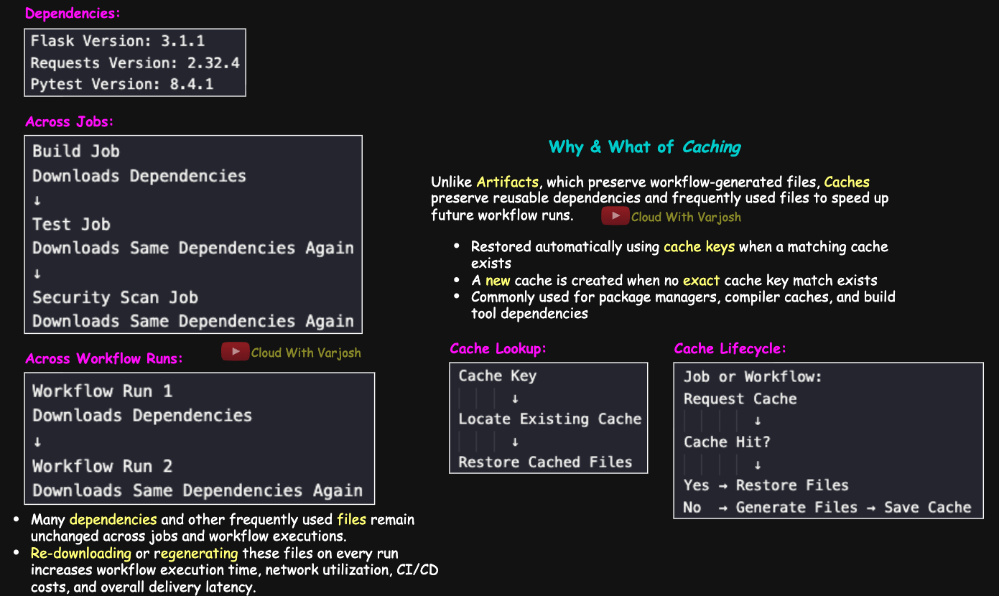

# 25 · Caching Dependencies

> **Part D: Moving data around** · Previous: [24 · Artifacts](24-artifacts.md) · Next: [26 · Matrix strategy](26-matrix-strategy.md) · [Back to INDEX](INDEX.md)
>
> **Video:** [GitHub Actions Artifacts & Caching Explained](https://www.youtube.com/watch?v=tw9e61Bct-E) (second half)
>
> **Code:** [`code/25-caching/`](code/25-caching/)

---

## What it is

**Caching stores reusable files and restores them later using a cache key.** Instead of downloading or regenerating the same files on every run, GitHub saves them once and restores them when they're needed again.

```text
Download Dependencies → Save Cache

Future Job or Workflow:
Restore Cache → Reuse Dependencies
```



A cache is a **reusable storage layer for files that are expensive to recreate but don't change often**:

| Technology | What is it? | Common cache location |
|---|---|---|
| **Maven** | Java build automation tool | `~/.m2/repository` |
| **Gradle** | Build automation tool | `~/.gradle/caches` |
| **NPM** | Node.js package manager | `~/.npm` |
| **Yarn** | JavaScript package manager | `~/.cache/yarn` |
| **Pip** | Python package manager | `~/.cache/pip` |
| **NuGet** | .NET package manager | `~/.nuget/packages` |
| **Go Modules** | Go dependency management | `~/go/pkg/mod` |
| **Docker BuildKit** | Container image build engine | Build cache and image layers |
| **Compiler caches** | Compiler optimization tools | `ccache`, `sccache` |

GitHub Actions does **not** understand Maven, NPM or Pip. It just **stores and restores folders**. Each tool then reuses its own local cache as usual.

Unlike **artifacts** (identified by **name**), **caches** are identified by a **cache key**.

---

## Why it exists

Pipelines download the same **dependencies, language packages, container layers and build tool files** again and again:

```text
Workflow Run 1:
Checkout Code → Download Dependencies → Build Application → Run Tests

Workflow Run 2:
Checkout Code → Download Dependencies → Build Application → Run Tests

Workflow Run 3:
Checkout Code → Download Dependencies → Build Application → Run Tests
```

The code changes between runs, but the dependencies often stay exactly the same:

```text
Flask Version:    3.1.1
Requests Version: 2.32.4
Pytest Version:   8.4.1
```

Downloading them every time increases **run time, network use, runner cost and developer wait time**, for no benefit. Hosted runners are **ephemeral**, so every job starts empty:

```text
Build Job Starts  → Runner Created
Build Job Ends    → Runner Destroyed

Test Job Starts   → New Runner Created
Test Job Ends     → Runner Destroyed

Security Job Starts → New Runner Created
Security Job Ends   → Runner Destroyed
```

The repeated work happens **across jobs** in one workflow:

```text
Build Job
Downloads Dependencies
↓
Test Job
Downloads Same Dependencies Again
↓
Security Scan Job
Downloads Same Dependencies Again
```

and **across workflow runs**:

```text
Workflow Run 1
Downloads Dependencies
↓
Workflow Run 2
Downloads Same Dependencies Again
```

> **Key observation:** many dependencies don't change between jobs and runs. Re-downloading them increases **run time, network use, CI/CD cost and delivery latency**. ***Can we reuse them instead?*** Yes, with **caching**, which also speeds up developer feedback and cuts cost as pipelines grow.

**Jenkins comparison:** on a long-lived Jenkins agent, `~/.m2` simply stays on disk between builds (with drift and disk-filling problems). On ephemeral GitHub runners nothing stays, so caching is explicit: you choose **what** to save and **under which key**.

---

## Analogy

A **school locker**:

- On day 1 you carry all your textbooks from home (download dependencies) and put them in a locker labelled with **this term's book list** (the **cache key** = a hash of `requirements.txt`).
- On day 2 you open the locker and the books are there (**cache hit**). You still have to **take them out and use them** (`pip install` still runs, it just doesn't download).
- If the book list changes (a new subject), the label changes. There's no locker with that label (**cache miss**), so you'd carry everything again… unless you're allowed to open **last term's locker** and only buy the new book (**restore keys**).
- The school **empties lockers not opened for 7 days** (eviction).

---

## How it works inside

`actions/cache` does **two separate things** at two different times:

```text
STEP (start of job, "Restore Pip Cache")
  compute key = pip-cache-Linux-<hash of requirements.txt>
  1. ask GitHub: exact match for key?          → yes: download + extract to path → cache-hit = 'true'
  2. else try each restore-key PREFIX in order → match: restore NEWEST matching → cache-hit = 'false'
  3. else                                       → nothing restored            → cache-hit = ''
  (a miss does NOT fail the job; GitHub doesn't create a cache yet)

POST STEP (end of job, "Post Restore Pip Cache") — only if the job SUCCEEDED
  if there was NO exact hit: compress path → upload → saved under key
  if exact hit: skip (caches are immutable; a key is never overwritten)
```

```text
Restore Cache
→ Cache Miss
→ Install Dependencies (pip downloads + fills ~/.cache/pip)
→ Job Succeeds
→ Post Step: Save Cache under the key
```

🆕 Rules that explain most "why didn't my cache hit?" questions:

| Rule | Detail |
|---|---|
| **Branch scoping** | A run can restore caches from **its own branch**, the **base branch** of a PR, and the **default branch**. A cache created on `feature/a` is **not** visible to `feature/b` or `main`. Warm caches on `main`. |
| **Immutable keys** | You can't overwrite a key. Change the key (via `hashFiles`) to store a new version. |
| **Saved only on success** | A failed job saves nothing (or use `actions/cache/save` with `if: always()`). |
| **Version** | The cache also includes the `path` and compression method. A different `path` = a different cache, even with the same key. |
| **Size and eviction** | Default **10 GB per repo** (larger limits can be bought). Caches **unused for 7 days are deleted**. When full, the oldest are evicted first. |
| **Platform** | Caches made on Linux don't restore on Windows unless `enableCrossOsArchive` is set. Include `runner.os` in keys. |

---

## Workflow YAML / commands

### Demo 2: reuse dependencies across jobs using caching

#### Steps 1–2: Repository and application

Repo `cwvj-gha-practice` and SSH, as in [topic 02](02-git-and-github-recap.md). Files in [`code/25-caching/`](code/25-caching/): the same `app.py` as topic 24, and **`requirements.txt` with three packages**, so caching has something to save:

```text
flask==3.1.1
requests==2.32.4
pytest==8.4.1
```

#### Step 3: The workflow

[`code/25-caching/01-caching-demo.yaml`](code/25-caching/01-caching-demo.yaml) → `.github/workflows/01-caching-demo.yaml`:

```yaml
name: 01 - Caching Demo

on:
  workflow_dispatch:

jobs:
  build-job:
    runs-on: ubuntu-latest

    steps:
      - name: Checkout Repository
        uses: actions/checkout@v7

      - name: Setup Python
        uses: actions/setup-python@v6
        with:
          python-version: "3.13"

      - name: Restore Pip Cache
        id: pip-cache
        uses: actions/cache@v6
        with:
          path: ~/.cache/pip
          key: pip-cache-${{ runner.os }}-${{ hashFiles('requirements.txt') }}

      - name: Display Cache Status
        run: |
          echo "Cache Hit: ${{ steps.pip-cache.outputs.cache-hit }}"

      - name: Install Dependencies
        run: |
          pip install -r requirements.txt

  test-job:
    runs-on: ubuntu-latest

    needs:
      - build-job

    steps:
      - name: Checkout Repository
        uses: actions/checkout@v7

      - name: Setup Python
        uses: actions/setup-python@v6
        with:
          python-version: "3.13"

      - name: Restore Pip Cache
        id: pip-cache
        uses: actions/cache@v6
        with:
          path: ~/.cache/pip
          key: pip-cache-${{ runner.os }}-${{ hashFiles('requirements.txt') }}

      - name: Display Cache Status
        run: |
          echo "Cache Hit: ${{ steps.pip-cache.outputs.cache-hit }}"

      - name: Install Dependencies
        run: |
          pip install -r requirements.txt
```

> ⚠️ Corrected: was `actions/checkout@v5` and `actions/cache@v5`, now `actions/checkout@v7` and `actions/cache@v6`, because both are the current majors (cache v6.0 shipped in June 2026). `setup-python@v6` is current.

**Explanation:**

- **`name` / `workflow_dispatch`**: clear names help in repos with dozens of workflows. Manual triggering gives full control over **when** it runs, so you can watch cache behaviour across runs without extra executions. (Engineers often test caching, deployments and troubleshooting manually before enabling `push`/`pull_request`.)
- **Runners are ephemeral**, which is exactly why caching is needed.
- **Checkout**: most CI/CD steps need the repo. Here it's also needed so `hashFiles('requirements.txt')` can find the file.
- **Setup Python** (`python-version: "3.13"`): pins the runtime. Explicit runtime versions improve reproducibility and reduce environment problems.
- **Restore Pip Cache** (`uses: actions/cache@v6`): restores earlier caches **and** saves new ones after a successful job. Caches live **outside** the runner lifecycle, so they survive and are reused by other jobs and later runs.

  > **Production insight:** dependency caching is one of the **most common CI/CD optimizations**.

- **`id: pip-cache`**: many actions expose outputs, and the `id` lets later steps reference them (`steps.pip-cache.outputs.cache-hit`).
- **`with:`**: an action's configuration. Every action has its own options.

  > **Operational tip:** always **read the action's documentation** to understand its options.

- **`path: ~/.cache/pip`**: when `pip install -r requirements.txt` downloads `flask`, `requests` and `pytest`, pip stores them in **its own cache folder** `~/.cache/pip`. That's the folder we save and restore.

  > **Important:** we're **not caching the Flask app**. We're caching the **files pip downloaded** for `requirements.txt`.
  >
  > **Key observation:** caching isn't long-term storage. It's for **eliminating repeated work** by reusing files that rarely change.

- **`key: pip-cache-${{ runner.os }}-${{ hashFiles('requirements.txt') }}`**:
  - `pip-cache-` → a readable prefix
  - `${{ runner.os }}` → `Linux` (caches differ by OS)
  - `${{ hashFiles('requirements.txt') }}` → a fingerprint of the file's **contents** (topic 12)
  - result like `pip-cache-Linux-a8f32…`. Same file → same key → **hit**. Edit the file → new key → **miss**.

  > **Key observation:** **cache keys decide whether a cache can be reused or a new one is needed.** This pattern is used for **Maven, Gradle, NPM, Yarn, NuGet and Pip**.

  | Example key | Meaning |
  |---|---|
  | `maven-linux-v1` | manual version bump |
  | `npm-linux-<package-lock hash>` | changes whenever the lock file changes |

- **Display Cache Status** reads the action's built-in **`cache-hit`** output:

  ```text
  true  → Exact Cache Match Found → Cached Files Restored

  false → Cache Restored Using Restore Keys
           (No Exact Key Match Found)

  ⚠️ Corrected for actions/cache v4+: `false` is ALSO what a complete miss returns,
     so `cache-hit != 'true'` is the only reliable test for "not an exact hit".
  ```

  To tell a partial (restore-key) hit from a full miss, use the `cache-matched-key` output (empty on a miss). After a miss, once the job **succeeds**, GitHub creates a **new cache** for that key, and later jobs and runs with the same key restore it.

  ```text
  First Workflow Run
  → Cache Hit:
  → Download Dependencies
  → Create Cache
  ```

  ```text
  Second Workflow Run
  → Cache Hit: true
  → Restore Cache
  ```

  > **Connection to topic 21:** we read `steps.pip-cache.outputs.cache-hit` but never wrote it. **Actions expose their own built-in outputs.**
  >
  > **Terraform analogy:** like Terraform resources and modules that expose attributes (**IDs, ARNs, IPs**) and outputs you reference directly, GitHub actions expose outputs like `cache-hit`.
  >
  > **Operational tip:** log hit/miss while testing a new cache. It quickly confirms that the key, path and restore logic work.
  >
  > **Key observation:** a **cache hit doesn't mean dependencies are installed**. It means the files were **restored**. The tool still has to use them.

- **Install Dependencies** (`pip install -r requirements.txt`): pip reads the requirements and makes sure the packages exist. With an exact hit, the files are already in `~/.cache/pip`, so pip reuses them instead of downloading from **PyPI** (the Python Package Index). On a miss, pip downloads them and GitHub saves a new cache at the end of the job. With restore keys, pip reuses some files and downloads only what's new.

  > **Important:** GitHub Actions **doesn't tell pip, Maven, NPM or Gradle to use a cache**. The cache action just **puts the folder back** (`~/.cache/pip`, `~/.m2/repository`) before the install, and the tool behaves normally: it checks its local cache first and downloads only what's missing. The **cache key is used only by GitHub Actions**, never by the package manager.
  >
  > **Important:** a cache **doesn't install anything**. `pip install` must still run, but it can reuse cached files, and that's where the time is saved.

  ```text
  Restore Cache        → files put back in ~/.cache/pip   (GitHub Actions)
  Install Dependencies → pip uses them, downloads the rest (pip)
  ```

  > **Production insight:** many people assume a cache restore makes installs unnecessary. In reality **pip, Maven, Gradle, NPM and Yarn still run their normal install commands**, just faster, with less network use.

- **`test-job`** (`needs: build-job`): build, test, security scan, package and deploy jobs often need the same dependencies. Even though `test-job` runs on a **different runner**, it restores the **same cache**, because GitHub stores caches outside individual runners.

  > **Production insight:** `needs` models stages like **Build → Test → Security Scan → Package → Deploy**. A dependency downloaded once can be reused by **many jobs and future runs**, which cuts download time, network use and pipeline duration.

#### Step 4: Commit and push

```bash
git add .
git commit -m "feat: add caching demo"
git push -u origin main
```

#### Step 5: Run it

**Actions → 01 - Caching Demo → Run workflow**. The first time a key is used, `build-job` gets a **miss**, downloads the dependencies, and saves a cache when it succeeds.

#### Step 6: Observe

**Run #1, sample log output:**

```text
build-job › Restore Pip Cache
    Cache not found for input keys: pip-cache-Linux-5f1c…
build-job › Display Cache Status
    Cache Hit:
build-job › Install Dependencies
    Downloading flask-3.1.1-py3-none-any.whl (103 kB)
    Downloading requests-2.32.4-py3-none-any.whl (64 kB)
    …
build-job › Post Restore Pip Cache
    Cache Size: ~4 MB (4123456 B)
    Cache saved with key: pip-cache-Linux-5f1c…

test-job › Restore Pip Cache
    Cache restored successfully
    Cache restored from key: pip-cache-Linux-5f1c…
test-job › Display Cache Status
    Cache Hit: true
test-job › Install Dependencies
    Using cached flask-3.1.1-py3-none-any.whl (103 kB)      ← no download
test-job › Post Restore Pip Cache
    Cache hit occurred on the primary key pip-cache-Linux-5f1c…, not saving cache.
```

```text
Build Job
→ No Cache Restored
→ Download Dependencies
→ Job Completes Successfully
→ Cache Created
```

```text
Test Job
→ Exact Cache Match Found
→ Restore Cache
→ Reuse Dependencies
```

That's **cache reuse across jobs**.

**Run #2:** both jobs print `Cache Hit: true`.

```text
Workflow Run #1
→ Create Cache
```

```text
Workflow Run #2
→ Restore Existing Cache
```

That's **cache reuse across workflow runs**, the other common scenario.

> **Key observation:** the two jobs run on **different runners** but share the cache, because GitHub stores caches **outside the runner lifecycle**. A dependency downloaded once can be reused by many jobs and runs, cutting download time, network use, runner time and cost.

> **Try this:** add `pandas==2.3.1` to `requirements.txt`, commit and run again. You'll see `Cache Hit:` (blank), because:
>
> ```text
> requirements.txt Changes
> → Hash Changes
> → Cache Key Changes
> → No Matching Cache Found
> → Download Dependencies
> → Create New Cache
> ```
>
> After that, runs with the new `requirements.txt` show `Cache Hit: true`. This is how **cache keys control reuse and invalidation**.

### Restore keys: partial matches

Dependencies change over time. Even a tiny change gives a **new key** and a **miss**:

```text
Flask 3.1.1
Requests 2.32.4
Pytest 8.4.1
```

Upgrade Requests:

```text
Flask 3.1.1
Requests 2.32.5
Pytest 8.4.1
```

or add a package:

```text
Flask 3.1.1
Requests 2.32.4
Pytest 8.4.1
Pandas 2.3.1
```

```text
requirements.txt Changes
→ Hash Changes
→ Cache Key Changes
→ Exact Cache Match Not Found
```

Without restore keys, GitHub downloads **everything** again, even though only one package changed. **Restore keys** let GitHub fall back to **similar** caches using **prefix** keys, searched **top to bottom**, most specific first:

```yaml
- name: Restore Pip Cache
  uses: actions/cache@v6
  with:
    path: ~/.cache/pip
    key: pip-cache-${{ runner.os }}-${{ hashFiles('requirements.txt') }}
    restore-keys: |
      pip-cache-${{ runner.os }}-
      pip-cache-
```

```text
Try Exact Cache Key
→ pip-cache-Linux-a8f32...
```

```text
Try Restore Key #1
→ pip-cache-Linux-
```

```text
Try Restore Key #2
→ pip-cache-
```

If several caches match a restore key, the **most recently created** one is restored.

```text
Exact Cache Match Not Found
→ Try Restore Keys
→ Restore Closest Matching Cache
→ Reuse Existing Dependencies
→ Download Only Missing or Updated Dependencies
→ Job Completes Successfully
→ Create Updated Cache
```

The package manager reuses most files and downloads only new or changed ones.

> **Important:** restore keys **don't replace the primary key**. The **exact key is always tried first**. Restore keys are used **only if there's no exact match**.
>
> **Key observation:** they're searched **in order**, from most to least specific, and the **newest** cache matching the first matching prefix wins.
>
> **Why not in the demo?** The lecture focused on the core ideas (**paths, keys, hits, misses**) and said restore keys would come back in the **capstone**. ⚠️ Corrected: the capstone (topic 45) doesn't write restore keys itself. It uses `setup-java` (`cache: maven`) and `setup-node` (`cache: npm`), whose built-in caching builds the keys for you.

### Cache retention

Like artifacts, caches **aren't kept forever**. But unlike artifacts, **you can't set retention per cache**. GitHub manages it at the **repository, organization or enterprise** level.

- Caches **not accessed within the retention period** are removed. On GitHub.com the default is **7 days**.
- Caches are subject to **repository storage limits** (10 GB by default). Older caches may be evicted to make room.
- Workflow authors **can't** set cache retention in a workflow. Admins define the maximum policy.

> **Cache lifecycle and best practices**
>
> - Caches are for **performance**, not long-term storage.
> - Cache only **reusable dependencies and frequently used files** that are expensive to download or regenerate.
> - Use **meaningful keys**, so caches are invalidated only when dependencies change.
> - **Don't cache logs, reports, binaries or other outputs.** Those are **artifacts**.
>
> References: [Dependency caching reference](https://docs.github.com/en/actions/reference/workflows-and-actions/dependency-caching) · [Dependency caching concepts](https://docs.github.com/en/actions/concepts/workflows-and-actions/dependency-caching)

### Artifacts vs caches

> They look similar (both store files in **GitHub-managed storage**), but they solve different problems and **can't be swapped**.

| Mechanism | Primary purpose | Common examples |
|---|---|---|
| **Artifacts** | Preserve and share **files produced by a job** (deliverables, reports, logs, outputs) for downstream jobs, user downloads or post-run review. | `application.jar`, `test-report.html`, `deployment.log`, `coverage-report.html`, `security-scan.json`, `sbom.json`, `terraform.tfplan` |
| **Caching** | Reuse **files that rarely change** (dependencies, package manager and build tool caches) across **jobs and runs** to cut time, network and cost. | Maven (`~/.m2`), NPM (`~/.npm`), Pip (`~/.cache/pip`), Gradle (`~/.gradle`), Yarn, NuGet, Go modules, Docker layer cache |

> **Key observation:**
>
> ```text
> Workflow Produces a File → Artifact
>
> Workflow Reuses a File → Cache
> ```
>
> If the file is a workflow **output** to keep or share → **artifact**. If it's **reused** to avoid re-downloading → **cache**.

> **Important:** artifacts hold **files from the delivery lifecycle** (binaries, test/coverage/scan reports, logs), **downloadable from the UI** by engineers or used by later jobs. Caches hold **files downloaded or generated by build tools** (mostly internet dependencies) and are **not meant for people to download or inspect**. They only speed up runs. Retention also differs: **artifacts 90 days** by default (configurable), **caches evicted after 7 days unused**.

> **Mental model:**
>
> ```text
> Save Files Using Cache Key
>           ↓
> Restore Files Using Same Cache Key
> ```
>
> Caching is for **reuse**, not for **keeping** important outputs.

### 🆕 Shortcut: built-in caching in setup actions

Most setup actions can do this for you, with no separate `actions/cache` step:

```yaml
- uses: actions/setup-python@v6
  with:
    python-version: "3.13"
    cache: pip                         # keys on requirements*.txt automatically
- uses: actions/setup-node@v6
  with:
    node-version: 24
    cache: npm                         # keys on package-lock.json
- uses: actions/setup-java@v6
  with:
    distribution: temurin
    java-version: "21"
    cache: maven                       # keys on **/pom.xml
```

The capstone (topic 45) uses `cache: maven` and `cache: npm` this way.

For **Docker layer caching** with build-push-action, use GitHub's cache backend:

```yaml
- uses: docker/setup-buildx-action@v4
- uses: docker/build-push-action@v7
  with:
    context: .
    cache-from: type=gha
    cache-to: type=gha,mode=max
```

---

## Hands-on lab

1. Run the demo twice and match the sample logs for run #1 and run #2.
2. Do the "Try this" pandas change. Then add the `restore-keys` block, change requirements again, and watch `Cache Hit: false` (a partial restore) plus fewer downloads.
3. Create a branch `feature/cache`, change the key prefix (`pip-v2-`), and run there. Back on `main`, that cache **isn't** visible (branch scoping).
4. **Actions → Caches** (left sidebar): see your caches, their sizes and last-used times, and delete one. Or use `gh cache list` / `gh cache delete <key>`.
5. Replace the manual cache step with `setup-python`'s `cache: pip` and compare.

---

## Where you'll use it

- **Every language pipeline:** Maven, Gradle, npm, pip, Go caches (capstone backend and frontend jobs).
- **Docker builds:** `type=gha` layer caching.
- **Monorepos:** one cache key per service, with `hashFiles('services/payments/package-lock.json')`.
- **Cost and speed reviews:** "why is CI 12 minutes?" Usually dependency downloads.

---

## When it breaks

| Symptom | Meaning | Fix |
|---|---|---|
| **Always a cache miss** | The key changes every run (it includes `github.sha` or a timestamp), `hashFiles` matched nothing (empty), or the path is wrong. | Print the key. Check the `hashFiles` glob runs **after checkout**. |
| Miss on `main` though a feature branch has the cache | Branch scoping. | Let `main` build the cache (a push to main or a scheduled warm-up). |
| `Cache not found` right after a failed run | Caches are saved **only on success**. | Fix the failure, or split into `actions/cache/restore` + `actions/cache/save` with `if: always()`. |
| `Failed to save: Unable to reserve cache with key …, another job may be creating this cache` | Parallel jobs racing to save the same key (common with a matrix). | Harmless. Only one save wins. Or use per-leg keys. |
| Restored but still downloading everything | Cached the wrong folder (not where the tool stores packages). | Check the tool's cache dir (`pip cache dir`, `npm config get cache`). |
| Stale or broken dependencies | A restore key gave an old cache and the tool didn't refresh it. | Bump the key version (`v2-`). Clear caches with `gh cache delete --all`. |
| Cache too big / evicted quickly | Over the 10 GB repo budget. | Cache less (not `node_modules`, just `~/.npm`), and use fewer key variants. |

---

## Quick recap

- Cache = **reused** files (dependencies) keyed by `key`. Artifact = **produced** files, keyed by name.
- `actions/cache`: restore at the step (exact key → restore-keys prefixes → miss), save in the **post** step only on success and only if there was no exact hit.
- `cache-hit`: `'true'` exact, `'false'` restore-key match, `''` miss.
- Branch scoped, immutable keys, 7-day idle eviction, 10 GB per repo.
- Setup actions have built-in `cache:`. Docker uses `type=gha`.

**Interview questions**

1. **Q: How do you avoid re-downloading Maven dependencies on every run?**
   A: Cache `~/.m2/repository` with a key like `maven-${{ runner.os }}-${{ hashFiles('**/pom.xml') }}`, or use `setup-java` with `cache: maven`.
2. **Q: Cache vs artifact?**
   A: A cache speeds up runs by reusing rarely-changing files (dependencies), it isn't for people, and it's evicted after 7 days idle. An artifact keeps files a run **produced** for later jobs or download, for 90 days by default.
3. **Q: Why might a PR never hit the cache that `main` built?**
   A: It usually can (the default branch is readable), unless the key differs, for example a different `hashFiles` result or OS. A cache built on **another feature branch**, though, is never visible.

---

### References

- [Storing workflow data as artifacts](https://docs.github.com/actions/using-workflows/storing-workflow-data-as-artifacts)
- [Dependency caching reference](https://docs.github.com/actions/reference/workflows-and-actions/dependency-caching) · [concepts](https://docs.github.com/actions/concepts/workflows-and-actions/dependency-caching)
- [actions/upload-artifact](https://github.com/actions/upload-artifact) · [actions/download-artifact](https://github.com/actions/download-artifact) · [actions/cache](https://github.com/actions/cache)
