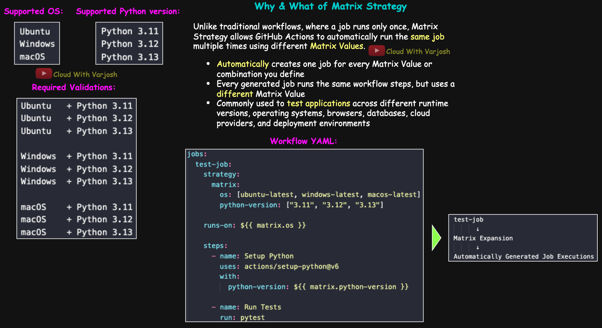

# 26 · Matrix Strategy

> **Part D: Moving data around** · Previous: [25 · Caching](25-caching.md) · Next: [27 · Service containers and container jobs](27-service-and-container-jobs.md) · [Back to INDEX](INDEX.md)
>
> **Video:** [GitHub Actions Matrix Strategy Explained | Multi-OS, Multi-Version Testing at Scale](https://www.youtube.com/watch?v=B5XzHnO_guo)
>
> [](https://www.youtube.com/watch?v=B5XzHnO_guo)
>
> **Code:** [`code/26-matrix-strategy/`](code/26-matrix-strategy/)

---

## What it is

A **matrix strategy** lets **one job definition run many times**, and each run uses a different **combination of values** you list.

```yaml
jobs:
  test-job:
    strategy:
      matrix:
        os: [ubuntu-latest, windows-latest, macos-latest]
        python-version: ["3.11", "3.12", "3.13"]

    runs-on: ${{ matrix.os }}

    steps:
      - name: Setup Python
        uses: actions/setup-python@v6
        with:
          python-version: ${{ matrix.python-version }}

      - name: Run Tests
        run: pytest
```

There's **one job** (`test-job`), but GitHub **expands** it into every combination:

```text
test-job
      ↓
Matrix Expansion
      ↓
Automatically Generated Job Executions
```

```text
Ubuntu   + Python 3.11
Ubuntu   + Python 3.12
Ubuntu   + Python 3.13

Windows  + Python 3.11
Windows  + Python 3.12
Windows  + Python 3.13

macOS    + Python 3.11
macOS    + Python 3.12
macOS    + Python 3.13
```

```text
3 Operating Systems × 3 Python Versions = 9 Job Executions
```



Each generated job gets its **own runner**, runs **independently**, and has its **own logs, status and results**. Instead of hard-coding `runs-on: ubuntu-latest` and `python-version: "3.13"`, we write `${{ matrix.os }}` and `${{ matrix.python-version }}`, and GitHub substitutes the right values for each job:

```text
matrix.os             → ubuntu-latest
matrix.python-version → 3.11
```

```text
matrix.os             → windows-latest
matrix.python-version → 3.12
```

```text
matrix.os             → macos-latest
matrix.python-version → 3.13
```

```text
Same Workflow Logic
        ↓
Different Matrix Values
        ↓
Different Job Executions
```

---

## Why it exists

So far every workflow ran **one job on one runner**. Whether one environment is enough depends on **how your software is distributed and where it runs**.

Apps deployed to **Kubernetes, Amazon ECS, Azure Container Apps or Google Cloud Run** run in a **standardized** runtime. Every deployment uses the same container image, so OS, runtime and dependencies are consistent, and testing one environment is often enough.

But many apps run in environments **you don't control**:

- **Virtual machines:** customer-managed VMs with different OSs, Python/Java versions, libraries and configs.
- **Desktop apps:** must be validated on **Windows, macOS and Linux** before release.
- **CLI tools and SDKs:** installed on developers' laptops with different OSs and runtimes.
- **Open-source projects:** maintainers can't control users' environments.
- **Libraries and frameworks:** Python, Node.js or Java packages must work on every officially supported runtime.

```text
Requires Java 17 or later
Supports Python 3.11+
Compatible with Windows, macOS and Linux
```

Those statements aren't guesses. They come from **testing every supported combination**. If your app supports **Ubuntu, Windows, macOS** and **Python 3.11, 3.12, 3.13**, testing only **Ubuntu + Python 3.13** proves nothing about the rest:

- a dependency may behave differently on **Windows** than on **Linux**
- a library fine on **3.13** may misbehave on **3.11**
- file paths, shell commands, environment variables and filesystem behaviour differ between OSs

Without a matrix you'd write **nine nearly identical jobs**:

```text
test-ubuntu-python311
test-ubuntu-python312
test-ubuntu-python313

test-windows-python311
test-windows-python312
test-windows-python313

test-macos-python311
test-macos-python312
test-macos-python313
```

Add **PostgreSQL 15/16** and **Chrome/Firefox/Edge/Safari**:

```text
3 Operating Systems
× 3 Python Versions
× 2 Database Versions
× 4 Browsers

= 72 Job Executions
```

Add **AWS/Azure/Google Cloud**:

```text
3 × 3 × 2 × 4 × 3

= 216 Job Executions
```

Maintaining 216 copy-pasted jobs means every change must be copied 216 times, which leads to **configuration drift** (copies slowly becoming different).

> ***Can we define a job once and have GitHub run it automatically for every combination?*** Yes, with a **matrix strategy**.

Benefits:

- **no duplicate job definitions**: written once
- **maintainability**: change one place
- **scales easily**: add an OS, runtime, browser, cloud or environment with one line
- **parallel execution**: much shorter total time

**Jenkins comparison:** the Declarative Pipeline `matrix { axes { axis { name 'OS'; values 'linux','windows' } } }` block, or the old "Multi-configuration project" job type, does the same thing.

---

## Analogy

A **paint-sample machine**:

- You give it **one recipe** ("paint a test card").
- And two lists: **colours** (red, blue, green) and **finishes** (matte, gloss).
- It paints **6 cards at once on 6 separate tables**: red-matte, red-gloss, blue-matte…
- Each card is painted the **same way**, only the inputs differ.
- If one card smudges, by default the machine **stops the others** (`fail-fast`). You can tell it to finish them all anyway.

---

## How it works inside

```text
workflow run starts
 └─ job with strategy.matrix is ready
      1. GitHub computes the cartesian product of all lists
      2. applies exclude: (remove combinations)
      3. applies include: (add keys to matching combos, or add new combos)
      4. creates one JOB per combination, named "test-job (ubuntu-latest, 3.11)"
      5. queues them (up to max-parallel at once) → each gets its own fresh runner
      6. in every job, matrix.<key> holds that combination's values
      7. if one fails and fail-fast: true (default) → cancel the remaining in-progress/queued ones
```

> **Key observation:**
>
> - A matrix does **not** make one runner repeat the job. GitHub creates **many independent jobs**.
> - Each gets a **fresh runner**, runs **all the steps** on its own, with its own **logs, status and results**.
> - GitHub **tries** to run them in parallel, but the order **depends on runner availability and isn't guaranteed**.
> - Every combination is a separate job, so **runner usage and billing grow with the number of jobs**, even though you wrote one job.

> **Key observation:** a matrix doesn't create different logic. It creates **many executions of the same job**, each with different **matrix values**.

🆕 **Limits:** up to **256 jobs** per matrix per workflow run. Matrix values can be strings, numbers, booleans, or objects.

> **Connection to topic 11:** you've used the `github`, `runner`, `steps` and `inputs` contexts. **`matrix`** works the same way. Its values are just generated from the strategy.

---

## Workflow YAML / commands

### Demo: test across Python versions

You'll run the same job on several Python versions, use **matrix variables** and the **matrix context**, and watch the jobs run in parallel.

#### Steps 1–2: Repo and app

Repo and SSH as in [topic 02](02-git-and-github-recap.md). Files in [`code/26-matrix-strategy/`](code/26-matrix-strategy/): the same `app.py` as topic 24 (with `/` and `/health`, the endpoints smoke tests, monitoring, load balancers and **Kubernetes readiness probes** use) and `requirements.txt` with `flask==3.1.1`. (Later the capstone combines matrix **and caching** so installs stay fast even with many matrix jobs.)

#### Step 3: The workflow

[`code/26-matrix-strategy/01-matrix-demo.yaml`](code/26-matrix-strategy/01-matrix-demo.yaml) → `.github/workflows/01-matrix-demo.yaml`:

```yaml
name: 01 - Matrix Strategy Demo

on:
  workflow_dispatch:

jobs:
  test-job:
    runs-on: ubuntu-latest

    strategy:
      matrix:
        python-version:
          - "3.11"
          - "3.12"
          - "3.13"

    steps:
      - name: Checkout Repository
        uses: actions/checkout@v7

      - name: Setup Python
        uses: actions/setup-python@v6
        with:
          python-version: ${{ matrix.python-version }}

      - name: Display Matrix Information
        run: |
          echo "Runner OS: ${{ runner.os }}"
          echo "Matrix Python Version: ${{ matrix.python-version }}"

      - name: Install Dependencies
        run: |
          pip install -r requirements.txt

      - name: Execute Application
        run: |
          python app.py &
          APP_PID=$!

          sleep 5

          curl --fail http://127.0.0.1:5000/health

          echo "Application executed successfully."

          echo "Matrix Python Version : ${{ matrix.python-version }}"
          python --version

          kill $APP_PID
```

> **Note:** checkout, setup-python and install were covered earlier. Here we focus on the **matrix strategy**, the **matrix context**, and how one job definition becomes many jobs.

**Explanation:**

- `strategy:` holds settings for **how** the job is expanded. `matrix:` defines the **matrix variables**. Here one variable, `python-version`, has three **matrix values**. (Versions are **quoted**, so `3.10` doesn't become `3.1`, topic 03.)

  > **Key observation:** the matrix doesn't duplicate your workflow. GitHub **generates many executions of the same job**, each with a different value.
  >
  > **Production insight:** matrix variables aren't only language versions. Teams build matrices of **OSs, compiler versions, database versions, browser versions, cloud providers, Kubernetes versions and deployment environments**.

- `${{ matrix.python-version }}` reads the current job's value from the **matrix context**. `setup-python` installs exactly that version.
- **Execute Application** (new shell tricks from topic 04):
  - `python app.py &` starts the app **in the background** (`&`), so the script continues.
  - `APP_PID=$!` saves the **process ID** of that background process (`$!`).
  - `curl --fail …/health` fails the step on HTTP errors.
  - `python --version` proves which interpreter ran.
  - `kill $APP_PID` stops the app.

#### Step 4: Commit and push

```bash
git add .
git commit -m "feat: add matrix strategy demo"
git push -u origin main
```

> **Key observation:** `workflow_dispatch` gives you control over when it runs, so you can repeatedly watch the matrix expand without unnecessary runs. (Engineers often test matrix configs manually before enabling `push`/`pull_request`.)

#### Step 5: Run it

**Actions → 01 - Matrix Strategy Demo → Run workflow**.

> **Key observation:** this is the core purpose. Instead of hand-writing near-identical jobs, GitHub generates **one job per matrix value**.

#### Step 6: Observe

```text
test-job (3.11)
test-job (3.12)
test-job (3.13)
```

Each runs the **same steps** with a different value:

```text
Checkout Repository
→ Setup Python
→ Install Dependencies
→ Start Application
→ Validate Health Endpoint
→ Display Python Version
→ Stop Application
```

**Sample log output (one per job):**

```text
test-job (3.11)                       test-job (3.12)                       test-job (3.13)
  Runner OS: Linux                      Runner OS: Linux                      Runner OS: Linux
  Matrix Python Version: 3.11           Matrix Python Version: 3.12           Matrix Python Version: 3.13
  {"status":"healthy"}                  {"status":"healthy"}                  {"status":"healthy"}
  Application executed successfully.    Application executed successfully.    Application executed successfully.
  Matrix Python Version : 3.11          Matrix Python Version : 3.12          Matrix Python Version : 3.13
  Python 3.11.x                         Python 3.12.x                         Python 3.13.x
```

GitHub substituted the right value for each job before running it:

```text
Matrix Value
        ↓
Setup Python
        ↓
Install Matching Python Version
        ↓
Execute Same Workflow Steps
```

> **Key observation:** a matrix creates **independent jobs**, not separate workflows. Each gets a **fresh runner**, runs the **same steps**, and has its **own logs, status and results**.

> **Try this:** add another version:
>
> ```yaml
> python-version:
>   - "3.10"
>   - "3.11"
>   - "3.12"
>   - "3.13"
> ```
>
> Now you get **four** jobs. The job count scales automatically with the values.
>
> ⚠️ Note (added): Python **3.10 reached end-of-life in October 2026**. Use it only to test compatibility for old users. Python **3.14** (released October 2025) is the newest version to add.

### 🆕 Controlling the matrix: `include`, `exclude`, `fail-fast`, `max-parallel`

```yaml
jobs:
  test:
    runs-on: ${{ matrix.os }}
    continue-on-error: ${{ matrix.experimental }}   # topic 14
    strategy:
      fail-fast: false          # default true: one failure cancels the rest
      max-parallel: 4           # at most 4 matrix jobs at the same time
      matrix:
        os: [ubuntu-24.04, windows-latest, macos-latest]
        python: ["3.12", "3.13"]
        experimental: [false]
        exclude:
          - os: macos-latest    # drop one combination
            python: "3.12"
        include:
          - os: ubuntu-24.04    # ADD a key to an existing combo
            python: "3.13"
            coverage: true
          - os: ubuntu-24.04    # ADD a brand-new combo
            python: "3.14"
            experimental: true
    steps:
      - uses: actions/setup-python@v6
        with:
          python-version: ${{ matrix.python }}
      - run: python --version
      - if: ${{ matrix.coverage }}
        run: echo "uploading coverage only once"
```

How GitHub builds this:

```text
1. product: 3 os × 2 python = 6 combos (experimental=false on all)
2. exclude macos+3.12        → 5 combos
3. include #1 matches ubuntu+3.13 → adds coverage: true to it
   include #2 matches nothing exactly → NEW combo ubuntu+3.14 (experimental: true)
→ 6 jobs total
```

| Key | Default | Meaning |
|---|---|---|
| `fail-fast` | `true` | If **any** matrix job fails, cancel the others in progress or queued. Set `false` to see **all** results (common for compatibility testing). |
| `max-parallel` | as many as runners allow | Limit concurrent jobs, e.g. to protect a shared test database or stay within a runner budget. |
| `exclude` | — | Remove combinations (unsupported pairs). |
| `include` | — | Add extra keys to matching combinations, or add new combinations. |

> ⚠️ Corrected (vocabulary, from topic 06): **`fail-fast`** is this matrix setting: "cancel sibling matrix jobs when one fails". It is **not** the general rule that a failing step skips the rest of its job.

### 🆕 Dynamic matrix from a previous job

```yaml
jobs:
  plan:
    runs-on: ubuntu-latest
    outputs:
      services: ${{ steps.find.outputs.services }}
    steps:
      - uses: actions/checkout@v7
      - id: find
        run: echo "services=$(ls services | jq -R -s -c 'split("\n")[:-1]')" >> "$GITHUB_OUTPUT"
        # → ["orders","payments","users"]

  build:
    needs: plan
    runs-on: ubuntu-latest
    strategy:
      matrix:
        service: ${{ fromJSON(needs.plan.outputs.services) }}   # topic 12
    steps:
      - run: echo "building ${{ matrix.service }}"
```

(`jq` is a command-line JSON tool, pre-installed on hosted runners. `-R -s -c 'split("\n")[:-1]'` turns lines into a compact JSON array.)

**Sample log output:**

```text
plan            → services=["orders","payments","users"]
build (orders)  → building orders
build (payments)→ building payments
build (users)   → building users
```

---

## Hands-on lab

1. Run the demo and open each of the three jobs.
2. Add `os: [ubuntu-latest, windows-latest]` and `runs-on: ${{ matrix.os }}`. You get 6 jobs. Why does `kill $APP_PID` behave differently on Windows? (It runs under Git Bash only if you add `shell: bash`. Try it.)
3. Make 3.12 fail on purpose (`if [ "${{ matrix.python-version }}" = "3.12" ]; then exit 1; fi`). With the default `fail-fast`, the others get **cancelled**. Set `fail-fast: false` and re-run.
4. Add `max-parallel: 1` and watch them run one at a time.
5. Build the dynamic-matrix example with a `services/` folder containing three sub-folders.

---

## Where you'll use it

- **Libraries and CLIs:** OS × runtime compatibility before a release.
- **Monorepos:** a dynamic matrix of changed services.
- **Multi-environment deploys:** `environment: [dev, qa]` (with care: deploys usually need order, so use `max-parallel: 1` or separate jobs).
- **Browser testing:** Chrome/Firefox/Safari × screen sizes.
- **Infrastructure:** Terraform `plan` per region or account.

---

## When it breaks

| Symptom | Meaning | Fix |
|---|---|---|
| Other matrix jobs show **cancelled** | `fail-fast: true` (default) after one failure. | `fail-fast: false` to see all results. |
| `Error when evaluating 'strategy' … fromJSON` | The dynamic matrix input is empty or not valid JSON. | Print the output first. Make sure it's a compact JSON array. |
| `Matrix vector 'python' does not contain any values` | An empty list (often a dynamic matrix with nothing to build). | Guard the job with `if: needs.plan.outputs.services != '[]'`. |
| `The strategy configuration was canceled because "test._3_12" failed` | Same as fail-fast. | As above. |
| Python `3.1` installed | Unquoted `3.10`. | Quote versions. |
| `Exceeded the maximum number of 256 jobs in a matrix` | Too many combinations. | `exclude`, or split workflows. |
| Bill/minutes jumped | Every combination is billed (macOS and Windows cost more, topic 41). | Trim the matrix. Run the full matrix only on `main` or nightly. |
| Job outputs from a matrix are "wrong" | The last matrix job overwrites the shared output name. | Use artifacts per leg (`name: result-${{ matrix.x }}`). |

---

## Quick recap

- `strategy.matrix` = one job definition → one **job per combination**, each on its own runner, in parallel when possible.
- Read values with `${{ matrix.<key> }}`.
- `exclude` removes combos, `include` adds keys or combos, `fail-fast` (default true) cancels siblings, `max-parallel` limits concurrency.
- Dynamic matrices: `fromJSON(needs.x.outputs.list)`.
- Max 256 jobs, and billing grows with every combination.

**Interview questions**

1. **Q: How many jobs does `os: [a,b,c]` × `node: [20,22]` with one `exclude` create?**
   A: 3×2 = 6, minus 1 = **5**.
2. **Q: What does `fail-fast: false` do?**
   A: It lets all matrix jobs finish even if one fails (the default `true` cancels the rest).
3. **Q: How do you build a matrix from data computed at runtime?**
   A: Output a JSON array from an earlier job and use `matrix: x: ${{ fromJSON(needs.job.outputs.list) }}`.

---

### References

- [Using a matrix for your jobs](https://docs.github.com/actions/using-jobs/using-a-matrix-for-your-jobs)
- [Workflow syntax](https://docs.github.com/actions/reference/workflows-and-actions/workflow-syntax)
- [Contexts](https://docs.github.com/actions/learn-github-actions/contexts) · [Expressions](https://docs.github.com/actions/learn-github-actions/expressions)
- [actions/setup-python](https://github.com/actions/setup-python)
