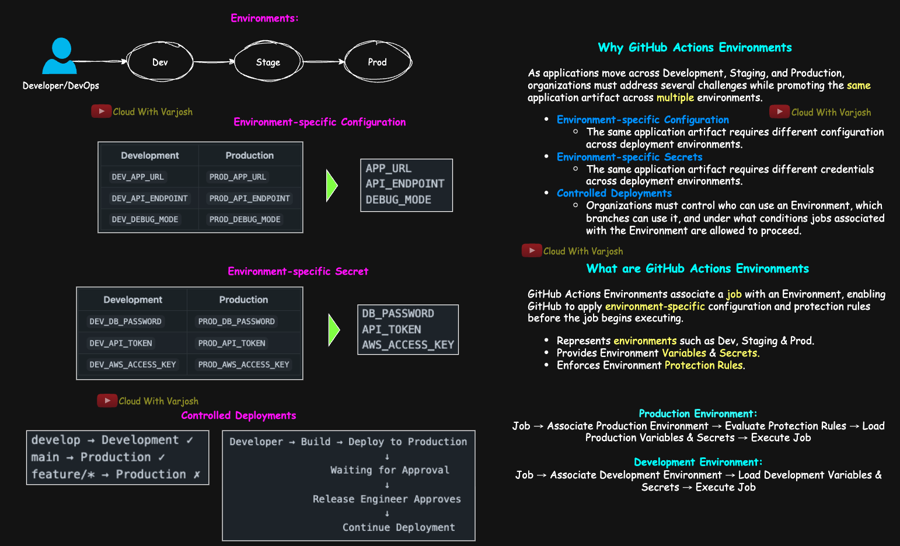

# 28 · Environments: Variables, Secrets, Approvals and Protection Rules

> **Part E: Deployment control** · Previous: [27 · Service containers](27-service-and-container-jobs.md) · Next: [29 · Concurrency](29-concurrency.md) · [Back to INDEX](INDEX.md)
>
> **Video:** [GitHub Actions Environments Explained | Variables, Secrets, Approvals & Protection Rules](https://www.youtube.com/watch?v=p_qnXBlJg20)
>
> [](https://www.youtube.com/watch?v=p_qnXBlJg20)

---

## What it is

A GitHub Actions **environment** is a named target, such as `dev`, `staging` or `prod`, that you create in **Settings → Environments**. A job **associates** with it using one line:

```yaml
jobs:
  deploy:
    runs-on: ubuntu-latest
    environment: production
    steps:
      ...
```

From your side it's a single line. From GitHub's side, the **job lifecycle changes**. Before the job starts, GitHub associates it with the environment, **evaluates that environment's protection rules**, **loads its variables and secrets**, and only then lets the job run.

```text
Job → Associate Environment → Evaluate Protection Rules → Load Environment Configuration → Execute Job
```

| Capability | Purpose |
|---|---|
| **Environment variables** | Environment-specific configuration values for the job. |
| **Environment secrets** | Environment-specific credentials for the job. |
| **Deployment branch restrictions** | Restrict which branches (or tags) may use the environment. |
| **Required reviewers** | A manual approval before the job may proceed. |
| **Wait timer** | Delay the job after approval for a set time. |
| **Deployment history** | Record deployment activity for audit and traceability. |
| 🆕 Custom deployment protection rules | A GitHub App or external service (ServiceNow, Datadog…) decides whether the job may proceed. |
| 🆕 Prevent self-review / admin bypass | Stop the person who triggered it from approving, or let admins skip the rules. |

Environments are mainly for **deployment** jobs, but **any job** that needs environment-specific config or protection can use one.



---

## Why it exists

Until now, every deployment behaved the same way. Once the deployment job started, it ran, without considering **where** it was deploying or **what governance** applied. Small projects can live with that. **Enterprise software is rarely deployed straight to production.** It moves through several environments:

```text
Developer → Development → Staging → Production
```

| Environment | Purpose |
|---|---|
| **Development** | Developer validation and early integration |
| **Staging (pre-production)** | Production-like environment for final validation before release |
| **Production** | Live customer traffic |

> **Note:** there's no standard set of environments. Some teams have only **Development** and **Production**. Others add **QA, UAT, Performance or Disaster Recovery (DR)**. The **application architect** usually decides the strategy together with the **DevOps/platform team**.

### Build once, deploy many

Mature pipelines **build once** and **promote the same artifact** through every environment instead of rebuilding for each one:

- **Containerized apps:** built once as a **container image**. The package (a **JAR, WAR** or binaries) is inside the image, so promoting the image across **Development, Staging (pre-production) and Production** promotes the package too.
- **Traditional apps:** packaged as **JAR, WAR, ZIP, EXE, MSI, RPM, DEB** or similar and promoted across the same environments, often to **VMs** or physical servers.

```text
Build Once → Deploy to Development → Promote Same Artifact → Deploy to Staging → Promote Same Artifact → Deploy to Production
```

### Three challenges environments solve

```text
Deploy Development → Deploy Staging → Deploy Production
```

That looks simple, but real deployments raise problems you can't fix with scripts alone. You need control over **how, when and under what conditions** deployments run.

**Challenge 1: environment-specific configuration.** Each environment has different URLs, databases, API endpoints, feature flags and settings, while the **artifact stays the same**. Without support for this, teams invent naming conventions:

| Development | Production |
|---|---|
| `DEV_APP_URL` | `PROD_APP_URL` |
| `DEV_API_ENDPOINT` | `PROD_API_ENDPOINT` |
| `DEV_DEBUG_MODE` | `PROD_DEBUG_MODE` |

That gets messy as environments grow, and every workflow needs extra logic to pick the right one. Ideally the workflow just says `APP_URL`, `API_ENDPOINT`, `DEBUG_MODE` and the platform supplies the right value.

> **Production insight:** modern pipelines **externalize configuration** from the artifact and inject it at deploy time with **environment variables, Kubernetes ConfigMaps, AWS Systems Manager Parameter Store, AWS AppConfig, Azure App Configuration** and similar tools.

**Challenge 2: environment-specific secrets.** Same story for credentials:

| Development | Production |
|---|---|
| `DEV_DB_PASSWORD` | `PROD_DB_PASSWORD` |
| `DEV_API_TOKEN` | `PROD_API_TOKEN` |
| `DEV_AWS_ACCESS_KEY` | `PROD_AWS_ACCESS_KEY` |

Ideally the workflow just says `DB_PASSWORD`, `API_TOKEN`, `AWS_ACCESS_KEY`.

> **Production insight:** secrets usually live in **AWS Secrets Manager, Azure Key Vault, Google Secret Manager, HashiCorp Vault or Kubernetes Secrets**. Teams prefer **consistent secret names**, with the platform injecting environment-specific values.

**Challenge 3: controlled deployments.** The closer to **production**, the stricter the controls: **which branches** may use it, **who** may approve it, and **what conditions** must hold. These controls usually apply to deployment jobs, but they can apply to **any job** that uses an environment.

```text
develop → Development ✓
main → Production ✓
feature/* → Production ✗
```

```text
Developer → Build → Production Job
                          ↓
                 Waiting for Approval
                          ↓
              Release Engineer Approves
                          ↓
                   Continue Execution
```

A **wait timer** after approval gives a short window for **final checks, coordination or last-minute cancellation**. Without these controls, an unauthorized or accidental job could hit a sensitive environment and cause **outages, failed releases, security issues or compliance violations**. You need the controls **without stuffing governance logic into every workflow**.

> ***Can GitHub provide a built-in way to represent environments that handles configuration, secrets and controlled deployments?*** Yes: **environments**.

**Jenkins comparison:** Jenkins has no built-in equivalent. Teams combine the `input` step (manual approval), folder-scoped credentials and the Lockable Resources plugin. GitHub environments bundle all three, plus deployment history.

---

## Analogy

**Airport security zones:**

- The **building** (repository) has public areas and restricted zones: **Domestic** (dev) and **International** (prod).
- Your **boarding pass** says which zone you're heading to (`environment: prod`).
- Before you enter **International**: only passengers from certain **gates** may pass (**branch restrictions**), an officer must **stamp your passport** (**required reviewers**), and you may be held in a waiting area for **10 minutes** (**wait timer**).
- Inside the zone you get things that only exist there, like duty-free prices (**environment variables and secrets**).
- Every entry is **logged** (**deployment history**).
- The security zone **doesn't fly the plane** (environments **don't deploy anything**). The pilot (your `kubectl`/Helm steps) still does the flying.

---

## How it works inside

### Environments are governance, not deployment tools

Environments are often confused with deployment tools. They **don't deploy anything**. They decide **whether a job may use an environment**, **which variables and secrets it gets**, and **which protection rules must pass first**. The workflow still deploys, using:

```text
kubectl • Helm • Terraform • AWS CLI • Azure CLI • Docker • SSH • Ansible
```

```text
Workflow → Job → GitHub Actions Environment → Protection Rules → Variables & Secrets → Execute Job
                                                           ↓
                                              Deployment Tool (if required)
                                                           ↓
                                                Target Environment
```

```text
Job → Associate Production Environment → Evaluate Protection Rules → Load Production Variables & Secrets → Execute Job
```

```text
Job → Associate Development Environment → Load Development Variables & Secrets → Execute Job
```

The **workflow logic stays nearly identical**. The job's behaviour changes with the **associated environment**.

> **Key observation:** environments are **governance mechanisms**, not deployment tools. They let GitHub apply **environment-specific config**, evaluate **protection rules** and record **deployment history** without making workflows more complex. Deploying is still the workflow's job.

### Where environments sit in the evaluation order

Environments are separate from **triggers, event filters, activity types and job conditions**. Each works at a different stage:

```text
Workflow Trigger (on:)
        ↓
Event Filters & Activity Types
        ↓
Job Conditions (if:)
        ↓
Job Dependencies (needs)
        ↓
Environment Association (environment:)
        ↓
Job Executes
```

| Feature | Purpose |
|---|---|
| **Workflow trigger (`on:`)** | **When** a workflow starts. |
| **Event filters and activity types** | **Which events** may trigger it. |
| **Job conditions (`if:`)** | **Whether a job runs**. |
| **Job dependencies (`needs`)** | Order between jobs. |
| **Environments (`environment:`)** | Associate a job with an environment, so GitHub provides **variables, secrets, protection rules, deployment history** and other environment-specific capabilities before the job runs. |

Environments **don't decide whether a workflow or job runs**. They matter only **after GitHub has decided to run the job**.

```yaml
on:
  push:
    branches:
      - main

jobs:
  deploy:
    if: github.ref_name == 'main'
    environment: prod
```

```text
Push to main
        ↓
Workflow Trigger (on:)
        ↓
Evaluate Event Filters
        ↓
Evaluate Job Condition (if:)
        ↓
Associate Job with prod Environment
        ↓
Evaluate Protection Rules
        ↓
Load Environment Configuration
        ↓
Execute Job
```

> ⚠️ Corrected: was "Associate → **Load Environment Configuration → Evaluate Protection Rules**", now "**Evaluate Protection Rules → Load Environment Configuration**" because GitHub releases environment secrets **only after** every protection rule (branch policy, reviewers, wait timer) has passed. That's what keeps prod secrets out of an unapproved job. The lecture's other diagrams already used this order.

> **Key observation:** these features **complement** each other. `on:` = when the workflow starts, filters = which events, `if:` = whether a job runs, `needs:` = when relative to other jobs, `environment:` = **which config and controls apply** before the job runs.

### The lifecycle with protection rules

```text
job ready (needs satisfied, if: true)
  → GitHub creates a "deployment" record for <environment>, status: queued/waiting
  → 1. deployment branch/tag policy: is this ref allowed?          ✗ → job FAILS (rejected)
  → 2. required reviewers: pause, notify reviewers (up to 30 days)  rejected → job fails
  → 3. wait timer: sleep N minutes (0–43,200 = 30 days)
  → 4. custom protection rules (apps) must approve
  → all pass → environment SECRETS and VARS released to the job → runner assigned
  → steps run → deployment status: success/failure → shown in Deployments history
```

The job **waits without using a runner** while it's pending approval or in the wait timer.

### Plan availability

> **Note:** this course uses a **GitHub Free** personal account with a **private repo**. GitHub changes features and licensing often, so check the official pages before deciding on an upgrade. Environments are one capability among many. Compare whole plans:
>
> - **CI/CD and automation** → GitHub Actions, environments, hosted runners, Codespaces
> - **Security** → GitHub Advanced Security, Secret Protection, Dependabot, code scanning
> - **Collaboration** → PR reviews, CODEOWNERS, repository rules, branch protection
> - **Enterprise** → SAML/SSO, SCIM provisioning, audit logs, Enterprise Managed Users (EMU), compliance and governance
>
> [GitHub Pricing](https://github.com/pricing) · [GitHub plans](https://docs.github.com/en/enterprise-cloud/latest/get-started/learning-about-github/githubs-plans) · [Deployments and environments](https://docs.github.com/en/actions/reference/workflows-and-actions/deployments-and-environments)

Summary (from GitHub's plan pages and a test on a Free account):

| Repo type and plan | Environments, env variables/secrets, branch restrictions | Required reviewers, wait timer, custom rules |
|---|---|---|
| **Public** repo, any plan | ✓ | ✓ |
| **Private** repo, Free | ✓ (⚠️ GitHub's docs have listed environments for private repos as Pro/Team/Enterprise only; this row comes from a test on a Free account, so re-check before relying on it) | ✗ not offered |
| **Private/internal** repo, Enterprise | ✓ | ✓ |

GitHub changes these limits often, and its docs have listed different plan rules over time. Always confirm on the [deployments and environments](https://docs.github.com/en/actions/reference/workflows-and-actions/deployments-and-environments) page for your plan. That's why the lab in this topic temporarily makes the demo repo **public** to show reviewers and wait timers. The capstone does the same in topic 54.

---

## Workflow YAML / commands

### Demo 1: deploy using environments

Two environments, **dev** and **prod**, one workflow. GitHub supplies the right config and secrets based on the environment. You'll see how environments make pipelines **more secure, easier to manage and closer to production practice**.

#### Step 1: Repository setup

Repo `cwvj-gha-practice` (private) and SSH, as in [topic 02](02-git-and-github-recap.md).

#### Step 2: The application

Reuse the same containerized Flask app (the `print`-logging version from [`code/24-artifacts/`](code/24-artifacts/)) so you can focus on environments.

#### Step 3: Docker Hub

**3.1 Private repository:** **Docker Hub → Repositories → Create Repository**, name `cwvj-flask-app`, visibility **Private**. The URL is like `docker.io/<your-dockerhub-username>/cwvj-flask-app`. The workflow will push:

```text
<your-dockerhub-username>/cwvj-flask-app:<git-commit-sha>
<your-dockerhub-username>/cwvj-flask-app:latest
```

> **Operational note:** private registries match production practice. They block unauthorized access and control who can **pull, push or manage** images.

**3.2 Access token:** each job runs on its own runner and must authenticate to protected resources. Create a Docker Hub **Personal Access Token**: description `gha-demo`, expiry `1 Day`, `Read & Write`. Copy it once. **Never use your password.**

> **Operational note:** Docker Hub tokens are **account level**. Anything using the token inherits its permissions.
>
> **Production insight:** most companies use **private registries** (**Amazon ECR, GHCR, ACR, GAR, JFrog Artifactory, Harbor**) and avoid long-lived credentials with **short-lived credentials, rotation, least privilege and central secret management**.

#### Step 4: Variables, secrets and environments

Two scopes:

- **Repository variables and secrets** for values common to the whole repo
- **Environment variables** for values that differ per environment

```text
Repository Variables & Secrets → Build Job (CI)
GitHub Actions Environments → Environment Variables → Deployment Jobs (CD)
```

**4.1 Repository level** (**Repository → Settings → Secrets and variables → Actions**):

| Variable | Why |
|---|---|
| `DOCKERHUB_USERNAME` | Used by the build job when publishing images. |

| Secret | Why |
|---|---|
| `DOCKERHUB_TOKEN` | Used by the build job to authenticate with Docker Hub. |

> **Why repository scope?** The build job is **CI**. It runs before any deployment and uses the same Docker Hub account for every target, so these belong at **repository** scope, not copied into each environment.

**4.2 Environments.** **Settings → Environments → New environment**: create `dev` and `prod`. In each, add **environment variables**:

| Variable | Dev | Prod | Why |
|---|---|---|---|
| `APP_URL` | `app.dev.cwvj.io` | `app.cwvj.io` | Environment-specific app config. |
| `DEBUG_MODE` | `true` | `false` | Behaviour that changes per environment. |

No secrets yet, on purpose. This first part shows **variables**. Later you'll add **branch restrictions, required reviewers, wait timers, deployment history and protection rules**, one at a time, with almost no YAML changes. (Companies may add **QA, UAT, pre-production or performance** environments. The concepts are identical.)

> **Production insight:** the scopes:
>
> | Scope | Typical use |
> |---|---|
> | **Workflow (`env`)** | Temporary values within a workflow or job. |
> | **Repository variables and secrets** | Repo-wide values: registry credentials, cloud regions, reusable config. |
> | **Organization variables and secrets** | Values shared across repos in an org. |
> | **Environment variables and secrets** | Config and credentials specific to Development, Staging, Production. |
>
> If the same name exists at several scopes, the **most specific wins**. For jobs with an environment, **environment** values override **repository** and **organization** ones. Set defaults broadly and override only what differs.

> **Key observation:** environments aren't just another place for variables and secrets. Those are **one capability**. Their main purpose is **deployment governance**: **branch restrictions, required reviewers, wait timers, protection rules and deployment history**, making deployments **secure, controlled and auditable**.

#### Step 5: The workflow

`.github/workflows/01-environments-demo.yaml`:

```yaml
name: 01 - GitHub Actions Environments Demo

on:
  push:
    branches:
      - "feature/**"
      - develop
      - main

jobs:
  build-job:
    name: Build & Publish Image
    runs-on: ubuntu-latest

    steps:
      - name: Checkout Repository
        uses: actions/checkout@v7

      - name: Login to Docker Hub
        uses: docker/login-action@v4
        with:
          username: ${{ vars.DOCKERHUB_USERNAME }}
          password: ${{ secrets.DOCKERHUB_TOKEN }}

      - name: Build & Push Docker Image
        uses: docker/build-push-action@v7
        with:
          context: .
          push: true
          tags: |
            ${{ vars.DOCKERHUB_USERNAME }}/cwvj-flask-app:${{ github.sha }}
            ${{ vars.DOCKERHUB_USERNAME }}/cwvj-flask-app:latest

  deploy-dev-job:
    name: Deploy to Development
    if: github.ref_name == 'develop'
    needs: build-job
    runs-on: ubuntu-latest
    environment: dev

    steps:
      - name: Display Branch Information
        run: |
          echo "Branch : ${{ github.ref_name }}"

      - name: Display Environment Configuration
        run: |
          echo "Application URL : ${{ vars.APP_URL }}"
          echo "Debug Mode      : ${{ vars.DEBUG_MODE }}"

      - name: Login to Docker Hub
        uses: docker/login-action@v4
        with:
          username: ${{ vars.DOCKERHUB_USERNAME }}
          password: ${{ secrets.DOCKERHUB_TOKEN }}

      - name: Run Container
        run: |
          docker run -d \
            -p 5000:5000 \
            --name cwvj-flask-container \
            ${{ vars.DOCKERHUB_USERNAME }}/cwvj-flask-app:${{ github.sha }}

      - name: Smoke Test Application
        run: |
          sleep 5
          curl --fail http://127.0.0.1:5000/
          curl --fail http://127.0.0.1:5000/health

      - name: Display Container Logs
        run: docker logs cwvj-flask-container

  deploy-prod-job:
    name: Deploy to Production
    if: github.ref_name == 'main'
    needs: build-job
    runs-on: ubuntu-latest
    environment: prod

    steps:
      - name: Display Branch Information
        run: |
          echo "Branch : ${{ github.ref_name }}"

      - name: Display Environment Configuration
        run: |
          echo "Application URL : ${{ vars.APP_URL }}"
          echo "Debug Mode      : ${{ vars.DEBUG_MODE }}"

      - name: Login to Docker Hub
        uses: docker/login-action@v4
        with:
          username: ${{ vars.DOCKERHUB_USERNAME }}
          password: ${{ secrets.DOCKERHUB_TOKEN }}

      - name: Run Container
        run: |
          docker run -d \
            -p 5000:5000 \
            --name cwvj-flask-container \
            ${{ vars.DOCKERHUB_USERNAME }}/cwvj-flask-app:${{ github.sha }}

      - name: Smoke Test Application
        run: |
          sleep 5
          curl --fail http://127.0.0.1:5000/
          curl --fail http://127.0.0.1:5000/health

      - name: Display Container Logs
        run: docker logs cwvj-flask-container
```

**Explanation:**

- **Triggers:** `push` to `feature/**`, `develop` or `main`. Feature branches get **CI only** (build), with no deploy job.

  > **Production insight:** branching strategies differ (**GitHub Flow, Git Flow, trunk-based development**), but the principle is the same: **CI on every change, deployments only from branches that represent promotable versions**, and **build once, promote the same immutable artifact**.
  >
  > **Key observation:** here "build once" is the **principle**, not this workflow's implementation. This workflow rebuilds on every push for simplicity. Production pipelines separate **artifact creation** from **artifact promotion**. (The capstone does it properly: DEV deploys the SHA-tagged image built in CI, and PROD deploys that **same** image.)

- **`build-job`** has **no environment**. It uses the **repository** variable and secret (`vars.DOCKERHUB_USERNAME`, `secrets.DOCKERHUB_TOKEN`), because it's CI and common to all targets. It pushes two tags: the immutable **commit SHA** and a moving **`latest`**.

  > **Production insight:** repo-level variables and secrets suit values shared across the repo: **registry credentials, cloud regions, artifact repository URLs** and any config that doesn't change per environment.

- **`deploy-dev-job` / `deploy-prod-job`**: `if: github.ref_name == 'develop'` / `'main'` decides **which** deploy job runs. `needs: build-job` waits for the image. `environment: dev` / `prod` attaches the environment.

  > **Key observation:** GitHub evaluates `if` **before provisioning a runner**. If it's false, the whole job is skipped.
  >
  > **Key observation:** changing `environment: dev` to `environment: prod` does far more than switch values. It attaches a **different environment**, with its own **variables, secrets, protection rules and deployment history**. That's why environments are **governance**, not just storage.
  >
  > **Key observation 2:** **`if`** controls **whether a job runs**. **Deployment branch restrictions** control **whether that job may use the environment** (its variables, secrets and rules). Environment protection is an **extra layer, independent of the workflow logic**: even if someone edits the `if:`, a `feature/*` branch still can't use `prod`.

- **Display Environment Configuration** prints `vars.APP_URL` and `vars.DEBUG_MODE`. The **same expressions** give different values per environment.

  > **Key observation:** the workflow is identical for both targets. Only the **injected environment variables** differ. That's **deployment logic separated from environment config**.

- **Login to Docker Hub again** in each deploy job:

  > **Key observation:** authentication in one job **isn't shared** with later jobs, because each job has a fresh runner. And `environment:` **doesn't replace** repository/org variables and secrets. It **adds a higher-precedence scope**, which is why `vars.DOCKERHUB_USERNAME` still works here.
  >
  > **Important:** if a variable or secret exists at several scopes, the **most specific** wins:
  >
  > ```text
  > Environment
  >       ↓
  > Repository
  >       ↓
  > Organization
  > ```
  >
  > If `APP_URL` exists in the repo **and** in `dev`, a job with `environment: dev` uses the **environment** value, and the repo value is the default. Define common config at repo/org level and override only what differs.

- **Run Container / Smoke Test / Display Container Logs**: the deploy job **doesn't rebuild**. It pulls and runs the image published by `build-job` (simulating a deployment on the runner).

  > **Key observation:** separating **building** from **deploying** reflects how modern pipelines decouple artifact creation from artifact consumption.

#### Step 6: Commit and push (main and develop)

```bash
# Initialize a new Git repository (one-time setup)
git init

# Rename the default branch to main (required only if your local Git still uses 'master')
git branch -M main

# Add all application, workflow, and configuration changes to the Git staging area
git add .

# Create a commit containing the GitHub Actions Environments demo implementation
git commit -m "feat: add github actions environments demo"

# Associate the local repository with the remote GitHub repository (one-time setup)
git remote add origin git@github.com:<YOUR_GITHUB_USERNAME>/cwvj-gha-practice.git

# Push the main branch and configure it to track the remote branch
git push -u origin main

# Create and switch to the develop branch
git checkout -b develop

# Push the develop branch and configure it to track the remote branch
git push -u origin develop
```

The workflow uses `push`, so it starts as soon as the code is pushed: **Actions → 01 - GitHub Actions Environments Demo**.

> **Production insight:** this demo pushes straight to `develop` and `main` for simplicity. In enterprises, long-lived branches (**develop, staging, release, main**) are usually **protected** (no direct pushes, topic 30). Developers work on **feature branches**, open **PRs**, pass reviews and automated checks, then merge, and the **merge** triggers the pipeline. The branching strategy and names come from the **application architect, DevOps architect** or company standards.

#### Step 7: Two runs

Two runs start: one from the push to **`main`**, one from creating and pushing **`develop`**. Same YAML, different branch, different deploy job.

#### Step 8: Observe

```text
main run:    Build Job → Deploy to Production
develop run: Build Job → Deploy to Development
```

Both runs share the **same build job** (checkout → login → build → publish), which has **no environment** and uses **repository** credentials (CI). Then `needs: build-job` hands over to the deploy job:

```text
Deploy Job → Locate GitHub Actions Environment → Evaluate Protection Rules → Load Environment Variables → Start Deployment
```

**Sample log output, Display Environment Configuration:**

```text
develop run                              main run
Branch          : develop                Branch          : main
Application URL : app.dev.cwvj.io        Application URL : app.cwvj.io
Debug Mode      : true                   Debug Mode      : false
```

`APP_URL` and `DEBUG_MODE` are **hard-coded nowhere**. Then: Run Container → Smoke Test → Display Container Logs:

```text
Cloud With VarJosh Flask Application Started
Home endpoint invoked
Health endpoint invoked
```

That confirms the container started, the smoke tests passed and the "deployment" completed.

```text
Same Workflow YAML
        │
        ├── Push to develop → Build Job → Deploy to Development → dev Environment
        │
        └── Push to main → Build Job → Deploy to Production → prod Environment
```

> **Key observation:** **not one line of YAML changed**. GitHub picked the deploy job by branch, attached the environment, injected the right variables and applied its governance. Companies keep **one deployment workflow** and let GitHub supply config and governance per target.

> **Try this:** change `APP_URL` in the **dev** environment and push to `develop`. The new value is used immediately, with **no YAML change**. Deployment config is fully decoupled from deployment logic.

---

### Demo 2: add governance, with almost no YAML changes

You'll add **branch restrictions**, **required reviewers**, a **wait timer**, and look at **deployment history**.

#### Enhancement 1: Deployment branch restrictions

Right now any branch that reaches a deploy job could use `dev` or `prod`. In **Settings → Environments → dev / prod → Deployment branches and tags → Selected branches and tags**:

```text
dev → Selected Branches → develop
prod → Selected Branches → main
```

```text
develop ─────────────► dev Environment ✓

main ────────────────► prod Environment ✓

feature/* ───────────► prod Environment ✗
feature/* ───────────► dev Environment ✗
```

```text
Deployment Job
        ↓
Locate Environment
        ↓
Evaluate Deployment Rules
        ↓
Allowed?
      ↙      ↘
    Yes      No
     ↓        ↓
Load Environment   Block Deployment
Configuration
```

The restriction applies to the **environment**, not to individual variables or secrets. If it isn't allowed, the job never gets the environment's **variables, secrets or other capabilities**. (🆕 The job **fails** with `Branch "feature/x" is not allowed to deploy to prod due to environment protection rules.`)

> **Key observation:** branch restrictions protect the **environment itself**. Only approved branches can deploy, **however the workflow is written**.

#### Enhancement 2: More protection rules (plans and visibility)

On a **GitHub Free** account with a **private** repo, only part of the environment features are offered. Environments also support:

- required reviewers
- wait timers
- custom deployment protection rules
- administrator bypass

The lecture **temporarily changed the demo repo to public**, which is fine because it only contains demo code. In production, repos stay **private** and the organization picks the right plan. After switching to public and refreshing the environment page:

```text
Required Reviewers
Wait Timer
Custom Deployment Rules
Administrator Bypass
```

> **Production insight:** **repo visibility and GitHub plan decide which environment features you get.** Before upgrading from **Free** to **Team** or **Enterprise**, or making a repo public, evaluate the **complete feature set**. **Security, repository rules, code owners, audit logs, compliance, identity management, Advanced Security and CI/CD governance** often matter more than any single feature.

#### Enhancement 3: Required reviewers and wait timer

```text
prod → Required Reviewers → <your GitHub username>   (lecture: CloudWithVarJosh)
prod → Wait Timer → 1 Minute
```

**Required reviewers** add a **manual approval gate**: GitHub pauses and waits for an authorized reviewer to **approve or reject**.

```text
Build Job → Deploy to Production → Waiting for Approval → Reviewer Approves → Continue Deployment
```

Production can't be deployed automatically without human oversight. In many companies, prod deploys need approval from **technical leads, release managers, platform teams** or the **Change Advisory Board (CAB)**.

The **wait timer** (1 minute here) waits **after approval** before proceeding:

```text
Approval Received → Wait 1 Minute → Start Deployment
```

In production, wait timers are often much longer:

- **Change management and maintenance windows:** deploys allowed only in **approved windows** or after final **change approval**. The timer makes sure the deploy starts in the window without anyone pressing a button.
- **Operational coordination:** big deploys involve **operations, platform, database, network and application support** teams. The delay gives time for prerequisites and readiness checks.
- **Cancellation window:** time to **pause or cancel** if a new issue appears: a critical incident, a failed dependency deploy, or a business decision to postpone.

> **Key observation:** reviewers and wait timers are configured **entirely in the environment**. The YAML **doesn't change**. Governance without workflow complexity.

#### Validating the enhanced deployment

Make a tiny change, e.g. `name: 01 - GitHub Actions Environments Demo (Enhanced)`:

```bash
git add .
git commit -m "feat: demonstrate deployment governance"
git push origin main
```

```text
Push to main → Build & Publish Image → Deploy to Production → Required Reviewer Approval → Wait Timer → Load Environment Configuration → Execute Deployment → Record Deployment History
```

**Sample UI and log output:**

```text
Deploy to Production   ⏳ Waiting
  "Review pending deployments"  →  ☑ prod   comment: "release 1.4 ok"  →  [Approve and deploy]
  ⏱ Wait timer: 1 minute remaining
  ✓ Deploy to Production
      Branch          : main
      Application URL : app.cwvj.io
      Debug Mode      : false
```

After approval GitHub waits out the timer, then runs. Open **Code → Deployments** (or the `prod` environment) to see the **deployment history**:

- **Status** (succeeded or failed)
- **Target environment**
- **Commit** (which version)
- **Actor** (who started it and who approved it)
- **Time** (an audit trail)

It answers: *Who deployed this version? Which commit? When? Did it succeed?*

> **Final observation:** a simple pipeline became a **governed** one (**branch restrictions, required reviewers, wait timers, deployment history**) with almost no YAML change. **Separating deployment logic from deployment governance** is one of the most powerful things environments give you.

### 🆕 More environment syntax

```yaml
jobs:
  deploy:
    runs-on: ubuntu-latest
    environment:
      name: prod
      url: ${{ steps.deploy.outputs.url }}     # shown as a clickable link on the run graph and in Deployments
    concurrency: prod-deploy                    # one prod deploy at a time (topic 29)
    steps:
      - id: deploy
        run: echo "url=https://app.cwvj.io" >> "$GITHUB_OUTPUT"
```

```yaml
on:
  workflow_dispatch:
    inputs:
      target:
        type: environment          # dropdown of your environments (topic 20)
jobs:
  deploy:
    environment: ${{ inputs.target }}
```

---

## Hands-on lab

1. Do Demo 1 (dev and prod variables) and compare the two runs.
2. Add a `DB_PASSWORD` **environment secret** with different values in dev and prod. Print its length in each deploy job to prove which one arrived.
3. Add branch restrictions, then push to `feature/x` with the `if:` removed from the prod job, and watch it **fail** at the environment gate.
4. Make the repo public (temporarily), add yourself as a required reviewer and a 1-minute wait timer, push to `main`, and approve. Then try **Reject**.
5. Add `url:` to the prod environment and click the link on the run graph.

---

## Where you'll use it

- **Every CD pipeline:** `dev`/`staging`/`prod` with different config and secrets.
- **Approvals:** change control for production (CAB, release managers).
- **OIDC trust policies:** the cloud role trusts only `repo:org/app:environment:prod` (topic 36). The capstone uses environments `dev` and `prod` for exactly this.
- **Audits:** "who deployed what, when, approved by whom?" comes from deployment history.

---

## When it breaks

| Symptom | Meaning | Fix |
|---|---|---|
| `Branch "x" is not allowed to deploy to prod due to environment protection rules` | Branch policy blocked it. | Deploy from an allowed branch, or update the policy. |
| Job stuck **Waiting** forever | Required reviewers haven't approved (it expires after 30 days). | A reviewer clicks **Review deployments**. Check that reviewers have access. |
| `vars.APP_URL` empty in the deploy job | The job lacks `environment:`, there's an environment name typo (a new empty environment gets auto-created!), or the variable is in the wrong environment. | Check the name spelling under **Settings → Environments**. |
| Secret empty | An environment secret used in a job without `environment:`, or a fork PR. | Add `environment:`. Topic 17. |
| No "Required reviewers" option | Private repo on Free/Pro/Team. | Public repo, or an Enterprise plan. |
| Can't approve your own deployment | **Prevent self-review** is enabled. | Another reviewer approves. |
| Two prod deploys overlap | No concurrency control. | `concurrency: prod-deploy` (topic 29). |

---

## Quick recap

- `environment: <name>` attaches a job to an environment: **variables, secrets, branch rules, reviewers, wait timer, custom rules, deployment history**.
- Environments are **governance**, not deployment tools. Your steps still deploy.
- Evaluation: `on` → filters → `if` → `needs` → **protection rules → secrets released** → run.
- Precedence: **environment > repository > organization**.
- Plan and visibility matter: reviewers and timers on private repos need Enterprise.

**Interview questions**

1. **Q: How do you require manual approval before a production deploy in GitHub Actions?**
   A: Create a `prod` environment with **required reviewers**, and set `environment: prod` on the deploy job. It pauses until approved.
2. **Q: `if: github.ref == 'refs/heads/main'` vs a deployment branch restriction?**
   A: `if` decides whether the job runs (anyone can edit the workflow). The branch restriction is enforced by the environment itself and blocks secrets for any other branch, even if the YAML is changed.
3. **Q: Repo secret and env secret have the same name. Which wins?**
   A: The environment secret, for jobs using that environment.

---

### References

- [Using environments for deployment](https://docs.github.com/actions/deployment/targeting-different-environments/using-environments-for-deployment) · [Deployments and environments](https://docs.github.com/actions/reference/workflows-and-actions/deployments-and-environments)
- [Variables](https://docs.github.com/actions/learn-github-actions/variables) · [Secrets](https://docs.github.com/actions/security-guides/encrypted-secrets) · [Contexts](https://docs.github.com/actions/learn-github-actions/contexts) · [Expressions](https://docs.github.com/actions/learn-github-actions/expressions) · [Workflow syntax](https://docs.github.com/actions/using-workflows/workflow-syntax-for-github-actions)
- [GitHub Pricing](https://github.com/pricing) · [GitHub plans](https://docs.github.com/get-started/learning-about-github/githubs-plans)
- Docker: [Access tokens](https://docs.docker.com/security/access-tokens/) · [Docker Hub](https://docs.docker.com/docker-hub/) · [CLI reference](https://docs.docker.com/reference/cli/docker/)
