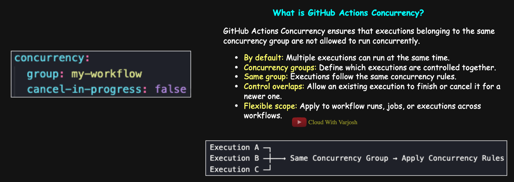
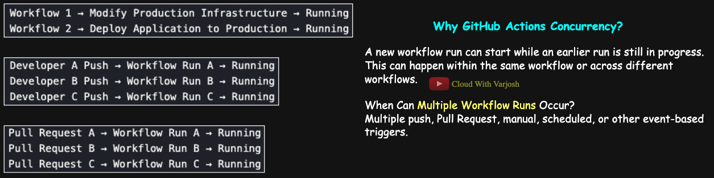
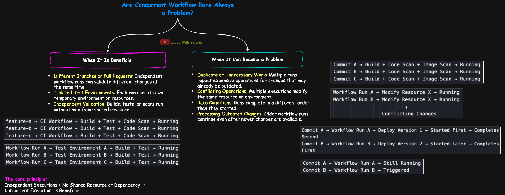

# 29 · Concurrency: Controlling Overlapping Runs

> **Part E: Deployment control** · Previous: [28 · Environments](28-environments.md) · Next: [30 · Branch protection and rulesets](30-branch-protection-and-rulesets.md) · [Back to INDEX](INDEX.md)
>
> **Video:** [GitHub Actions Concurrency Explained | Prevent Overlapping Runs & Control Workflow Execution](https://www.youtube.com/watch?v=0wXdpfNSWuI)
>
> [](https://www.youtube.com/watch?v=0wXdpfNSWuI)
>
> **Code:** [`code/29-concurrency/`](code/29-concurrency/)

---

## What it is

**GitHub Actions concurrency ensures that executions in the same concurrency group don't run at the same time.**

By default GitHub can run **many workflow runs or jobs at once**. If a workflow is triggered again while an earlier run is still going, both run concurrently:

```text
Workflow Run A → Running

Workflow Run B → Running
```

Concurrency lets you decide **which executions are controlled together** using a **concurrency group**: a name you choose. Executions with the **same group** follow the same rules. Executions in different groups are independent.

```text
Execution A ─┐
             │
Execution B ─┼──→ Same Concurrency Group
             │
Execution C ─┘
```

```text
Execution A ─┐
Execution B ─┼──→ production-changes
Execution C ─┘
```

When executions in a group overlap, there are two common behaviours:

```text
Allow Current Execution to Finish → New Execution Waits

OR

Cancel Current Execution → Newer Execution Proceeds
```

```yaml
concurrency:
  group: my-workflow
  cancel-in-progress: false
```

```text
group               → Defines which executions are controlled together
cancel-in-progress  → Determines whether an in-progress execution
                      should be cancelled when a newer execution enters the group
```

- **`cancel-in-progress: false`**: the running execution **continues**, and the newer one **doesn't overlap** with it. It waits as **pending**.
- **`cancel-in-progress: true`**: a newer execution **cancels** the running one in the same group.



> **Important:** a concurrency group does **not** define an order or a dependency. It controls **whether executions in the group may overlap**, not the business sequence in which they run.

> **Key idea:** the **group** says **which executions are controlled together**. The configuration says **how overlaps are handled**.

---

## Why it exists

A workflow can be triggered **many times before an earlier run finishes**: multiple pushes, PRs, manual runs, schedules or other events. Often that's fine. Sometimes **overlapping runs cause duplicate work, conflicting changes, race conditions, or processing of outdated changes**.



The need isn't limited to runs of the **same workflow**. **Different workflows** may touch the same resource:

```text
Workflow 1 → Modify Production Infrastructure → Running
Workflow 2 → Deploy Application to Production → Running
```

### When can multiple runs happen?

1. **Multiple pushes:** several developers push within a short time.

   ```text
   Developer A Push → Workflow Run A → Running
   Developer B Push → Workflow Run B → Running
   Developer C Push → Workflow Run C → Running
   ```

2. **Multiple pull requests:**

   ```text
   Pull Request A → Workflow Run A → Running
   Pull Request B → Workflow Run B → Running
   Pull Request C → Workflow Run C → Running
   ```

3. **Repeated triggers:** schedules, manual `workflow_dispatch` or other events while a run is still going.

**A new event can create a new run even when an earlier one hasn't finished.**

### Are concurrent runs always a problem?

**No.** It depends on **what they do** and whether they're **independent** or touch the **same resources**.



**Category 1: concurrency is beneficial** (independent executions)

1. **Different branches or PRs:** each run validates different code, so build, test, lint and scans can run together.

   ```text
   feature-a → CI Workflow → Build + Test + Code Scan → Running
   feature-b → CI Workflow → Build + Test + Code Scan → Running
   feature-c → CI Workflow → Build + Test + Code Scan → Running
   ```

2. **Isolated test environments:** each run creates its own temporary environment or container.

   ```text
   Workflow Run A → Test Environment A → Build + Test → Running
   Workflow Run B → Test Environment B → Build + Test → Running
   Workflow Run C → Test Environment C → Build + Test → Running
   ```

3. **Independent validation of different commits:** unit tests, linting, static analysis and code scanning that change no shared resource.

```text
Independent Executions + No Shared Resource or Dependency → Concurrent Execution Is Beneficial
```

The same goes for executions from **different workflows** that don't share resources.

> **Key idea:** concurrency is good when executions are **independent**. Whether they come from the same or different workflows matters less than whether they **share resources, depend on each other, or interfere with each other's results**.

**Category 2: concurrency becomes a problem** (executions that aren't independent)

1. **Duplicate or unnecessary work:** a long CI run (build + code scan + image scan) for Commit A is still running when B and C arrive:

   ```text
   Commit A → Build + Code Scan + Image Scan → Running
   Commit B → Build + Code Scan + Image Scan → Running
   Commit C → Build + Code Scan + Image Scan → Running
   ```

   All three use **runner time**, but maybe only the latest commit matters.

2. **Conflicting operations** on the **same resource**:
   - **AWS security group:** two runs modify the same security group based on different assumptions about its state.
   - **Kubernetes resources:** two runs update the same Deployment or ConfigMap and overwrite each other.
   - **Infrastructure:** two Terraform runs against the **same state**, causing state conflicts or unexpected changes.

   ```text
   Workflow Run A → Modify Resource X → Running
   Workflow Run B → Modify Resource X → Running
                            ↓
                    Conflicting Changes
   ```

3. **Race conditions:** completion order differs from trigger order.

   ```text
   Commit A → Workflow Run A → Deploy Version 1 → Started First → Completes Second
   Commit B → Workflow Run B → Deploy Version 2 → Started Later → Completes First
   ```

   **Version 1 could overwrite Version 2.**

   > A race is especially bad when runs process different commits. Commit A's run does more work and takes longer. Commit B (the newer, desired state) finishes first:
   >
   > ```text
   > Commit A → Workflow Run A → Starts
   >                         ↓
   >                    Takes Longer
   >
   > Commit B → Workflow Run B → Starts Later
   >                         ↓
   >                    Completes First
   >
   > Workflow Run A → Completes Later
   > ```
   >
   > Run A was working on an **older state** but applies its changes **after** B. The final code, infrastructure or environment **may not reflect the latest commit**:
   >
   > ```text
   > Commit A → Older State → Run A → Completes Last
   >
   > Commit B → Latest State → Run B → Completes First
   >
   > Final State → May Reflect Commit A Instead of Commit B
   > ```
   >
   > Here `cancel-in-progress: true` helps. If **only the latest commit matters**, the newer run supersedes the older one.

4. **Processing outdated changes:**

   ```text
   Commit A → Workflow Run A → Still Running
   Commit B → Workflow Run B → Triggered
   ```

   We may not want to keep spending resources on A, because **B supersedes it**.

> **Key idea:** the goal is **not** to prevent concurrency. Independent runs give faster feedback. But when newer runs make older ones unnecessary, runs modify shared resources, or completion order affects the result, you need control, for runs of the same workflow **or** related runs from different workflows. That's what **concurrency** gives you.

**Jenkins comparison:** `options { disableConcurrentBuilds() }` ≈ workflow-level concurrency with `cancel-in-progress: false`. `disableConcurrentBuilds(abortPrevious: true)` ≈ `cancel-in-progress: true`. The **Lockable Resources** plugin (`lock('prod') { … }`) ≈ a shared job-level group across pipelines.

---

## Analogy

A **single-occupancy bathroom on a train** (group `bathroom-car-3`):

- `cancel-in-progress: false`: the person inside **finishes**, and the next person **waits at the door**. There's room for only **one person waiting**. If a third person arrives, the one waiting gives up their spot (the newest replaces the pending one).
- `cancel-in-progress: true`: whoever arrives **kicks the current person out** (cancels them). Fine for "who's next to read the latest news", terrible for "someone mid-surgery" (a half-applied Terraform).
- `queue: max`: a proper **queue of up to 100 people**, each waiting their turn.
- A **different carriage** (`bathroom-car-4`, a dynamic group per branch) has its **own** bathroom, so they don't affect each other.

---

## How it works inside

```text
run (or job) is about to start with concurrency.group = G (evaluated from expressions)
  ├─ nothing running in G           → start
  └─ something running in G
        cancel-in-progress: true    → cancel the running one, start this one
        cancel-in-progress: false   → this one becomes PENDING
              default queue: 1 pending slot → an existing PENDING run in G is CANCELLED
                                             and replaced by this newer one
              queue: max            → up to 100 may wait (in order); more → cancelled
running one finishes → next pending in G starts
```

- Group names are **per repository** (case-insensitive). The same name in another repo is a different group.
- Pending runs show as **"Pending"** / "Waiting for a run in the same concurrency group to complete".
- Concurrency is evaluated **before** runners are assigned, so pending runs use no minutes.

---

## Workflow YAML / commands

### Demo: see the default behaviour, then add concurrency

#### Step 1: Repository

Repo `cwvj-gha-practice` (private) and SSH, as in [topic 02](02-git-and-github-recap.md).

#### Step 2: A long-running workflow

The run must last long enough for you to trigger more runs while it's going. [`code/29-concurrency/.github/workflows/01-concurrency-demo.yaml`](code/29-concurrency/.github/workflows/01-concurrency-demo.yaml):

```yaml
name: GitHub Actions Concurrency Demo

on:
  push:
    branches:
      - main

  workflow_dispatch:

jobs:
  concurrency-demo-job:
    runs-on: ubuntu-latest

    steps:
      - name: Start Workflow
        run: |
          echo "Workflow started"
          echo "Run ID: ${{ github.run_id }}"
          echo "Commit SHA: ${{ github.sha }}"

      - name: Simulate a Long-Running Task
        run: |
          echo "Long-running task started"
          sleep 120
          echo "Long-running task completed"

      - name: Complete Workflow
        run: |
          echo "Workflow completed successfully"
```

No concurrency yet. First you observe the default.

- **Triggers:** `push` to `main` and `workflow_dispatch`. Both are handy for creating more runs (push a commit or click **Run workflow**) **before the earlier run finishes**.
- **Job:** one job on a hosted Ubuntu runner. Without concurrency, every trigger creates a new run regardless of earlier runs:

  ```text
  Run A → Running
  Run B → Triggered → Running
  Run C → Triggered → Running
  ```

- **Steps:** print the **Run ID** and **commit SHA** (to tell runs apart), `sleep 120` (keeps each run alive for **two minutes**), then finish.

#### Step 3: Push and observe the default

```bash
# Add all changes to the Git staging area
git add .

# Create a commit containing the GitHub Actions Concurrency demo
git commit -m "feat: add concurrency demo"

# Associate the local repository with the remote GitHub repository (one-time setup)
git remote add origin git@github.com:<YOUR_GITHUB_USERNAME>/cwvj-gha-practice.git

# Push the code to GitHub and configure the local branch to track origin/main
git push -u origin main
```

```text
Commit A
    ↓
Workflow Run A
    ↓
Running
```

While **Run A** is running, click **Run workflow** (that's **Run B**), then again (**Run C**):

```text
Run A → Running
Run B → Running
Run C → Running
```

All three run concurrently. That's the default: **runs of the same workflow can overlap**.

> **Observation:** three runs at once. Depending on what they do, that may be fine, useful, or something to control.

#### Step 4: Add a concurrency group

```yaml
name: GitHub Actions Concurrency Demo

on:
  push:
    branches:
      - main

  workflow_dispatch:

concurrency:
  group: concurrency-demo
  cancel-in-progress: false

jobs:
  concurrency-demo-job:
    runs-on: ubuntu-latest

    steps:
      - name: Start Workflow
        run: |
          echo "Workflow started"
          echo "Run ID: ${{ github.run_id }}"
          echo "Commit SHA: ${{ github.sha }}"

      - name: Simulate a Long-Running Task
        run: |
          echo "Long-running task started"
          sleep 120
          echo "Long-running task completed"

      - name: Complete Workflow
        run: |
          echo "Workflow completed successfully"
```

**The concurrency block:**

- **Workflow level**, so the rule applies to the **whole run**.
- `group: concurrency-demo`: every run of this workflow is in the **same group**.
- `cancel-in-progress: false`: a running execution is **not cancelled** when a new one joins.

```text
concurrency
     │
     ├── group: concurrency-demo
     │
     └── cancel-in-progress: false
```

```text
Workflow Run A ─┐
                ├──→ concurrency-demo
Workflow Run B ─┘
```

```text
Run A → Running → Completes → Run B Starts → Completes
```

If **Run A is running**, Run B **won't overlap**. It becomes **pending** and starts after A completes.

> **Important:** by default a group has **at most one running and one pending** execution. If another run arrives while one is running and one is pending, the **new run replaces the pending one**.
>
> GitHub Actions also supports **`queue: max`** (added May 2026), which allows **up to 100 pending** executions in the group. Example:
>
> ```yaml
> concurrency:
>   group: prod-deploy
>   queue: max              # keep every pending run, process them in order
> ```
>
> `queue: max` **can't be combined with `cancel-in-progress: true`**. When the queue is full, extra runs are cancelled.

> **Key idea:** the same group prevents overlap. `cancel-in-progress: false` lets the current run **finish** while the newer one waits as **pending**.

#### When `cancel-in-progress: true` is useful

Sometimes an older run is **no longer relevant** once a newer one starts. For example, a controlled dev environment where **one developer or a small coordinated team** pushes often to the same branch, and only the **latest code** matters:

```text
Commit A → Workflow Run A → Running
Commit B → Workflow Run B → Triggered
```

```yaml
concurrency:
  group: concurrency-demo
  cancel-in-progress: true
```

```text
Run A → Running
             ↓
Run B Triggered → Cancel Run A → Run B Starts
```

That's useful when **only the latest state matters**, like CI on a frequently updated branch, where building, testing or scanning an older commit has little value.

> **Key idea:** use `cancel-in-progress: true` when **newer executions should supersede older ones**. Be **careful** with operations that modify infrastructure or shared environments. Cancelling midway may leave the target **incomplete** or in a bad state.

#### Where can concurrency be defined?

**1. Workflow-level** (the top-level `concurrency:` key) controls the **entire run**:

```yaml
concurrency:
  group: concurrency-demo
  cancel-in-progress: false

jobs:
  concurrency-demo-job:
    runs-on: ubuntu-latest
```

- **a. Runs of the same workflow:** with `Job 1 + Job 2 + Job 3`:

  ```text
  Workflow Run A → Job 1 + Job 2 + Job 3 ─┐
                                           ├──→ concurrency-demo
  Workflow Run B → Job 1 + Job 2 + Job 3 ─┘
  ```

  If A is running, B waits as pending (subject to the pending-run behaviour).

- **b. Runs of different workflows in the same repo:**

  ```text
  Infrastructure Workflow Run ─┐
                               ├──→ production-changes
  Deployment Workflow Run ─────┘
  ```

  Both define `group: production-changes`, `cancel-in-progress: false`:

  ```text
  Infrastructure Workflow → Running
  Deployment Workflow     → Pending
  ```

  This is useful when **whole workflows** that touch the same environment or infrastructure mustn't overlap.

> **Key idea:** at workflow level the group controls the **entire run**, from the same or different workflows.
>
> **Note:** groups are **per repository**. The same name in another repo doesn't link them.
>
> **Important:** sharing a group creates **no order** between workflows. It doesn't mean `Workflow 1 → Workflow 2 → Workflow 3`. For ordering use **`needs`** (jobs in one workflow), **workflow triggering mechanisms** (`workflow_run`, topic 31) or other orchestration. **Don't use concurrency for sequencing, because order isn't guaranteed.**

**2. Job-level** (`concurrency:` inside a job) controls **only that job**:

```yaml
jobs:
  deploy-job:
    runs-on: ubuntu-latest
    concurrency:
      group: production-changes
      cancel-in-progress: false
```

- **a. The same job across runs:** with `Build Job → Test Job → Deploy Job` and concurrency only on Deploy:

  ```text
  Workflow Run A → Build → Test → Deploy
  Workflow Run B → Build → Test → Deploy
  ```

  The runs themselves aren't restricted:

  ```text
  Workflow Run A → Build → Running
  Workflow Run B → Build → Running
  Workflow Run A → Test  → Running
  Workflow Run B → Test  → Running
  ```

  But at the shared job:

  ```text
  Workflow Run A → Deploy Job → Running
  Workflow Run B → Deploy Job → Pending
  ```

  ```text
  Build  → Can Execute Concurrently
  Test   → Can Execute Concurrently
  Deploy → Controlled Using Concurrency
  ```

- **b. Jobs across different workflows:**

  ```text
  Infrastructure Workflow → Infrastructure Job
  Deployment Workflow     → Deployment Job
  ```

  ```text
  Infrastructure Workflow → Infrastructure Job ─┐
                                                ├──→ production-changes
  Deployment Workflow     → Deployment Job ─────┘
  ```

  Other jobs aren't restricted:

  ```text
  Infrastructure Workflow
  Validate → Running
  Plan     → Running
  Apply    → Running

  Deployment Workflow
  Build    → Running
  Test     → Running
  Deploy   → Pending
  ```

  **Apply** and **Deploy** share the group, so they don't overlap, which is useful when two workflows act on the **same environment or shared infrastructure**:

  ```text
  Infrastructure Workflow → Modify Production Infrastructure
  Deployment Workflow     → Deploy Application to Production
  ```

  ```text
  Infrastructure Job ─┐
                      ├──→ production-changes → Controlled Together
  Deployment Job ─────┘
  ```

> **Key idea:** with job-level concurrency the **workflow keeps running independently**. Only the jobs in the same group are prevented from overlapping, whether they're in different runs of one workflow or in different workflows in the same repo.

> **Key idea:** concurrency can control a **whole run** or a **specific job**, across the same or different workflows in a repo. The **group identifies what's controlled together**, and the configuration decides **how overlaps are handled**.

This demo uses **workflow-level** concurrency because it's easiest to see.

#### Step 5: Re-trigger after adding the block

**1. Push:**

```bash
git add .
git commit -m "feat: Add concurrency configuration"
git push
```

```text
Run A → Running
```

**2. While A is running, click Run workflow:**

```text
Run A → Running
Run B → Pending
```

Because `cancel-in-progress: false`:

```text
Current Execution → Continues Running
New Execution     → Becomes Pending
```

```text
Run A → Running → Completes
                    ↓
              Run B → Starts
                    ↓
              Run B → Completes
```

**Run B doesn't start while Run A is running.**

**3. While A is running and B is pending, trigger once more:**

```text
Run A → Running
Run B → Cancelled
Run C → Pending
```

```text
Run A → Completed
Run C → Starts
```

```text
Run A → Running → Completes
Run B → Pending → Replaced / Cancelled
Run C → Pending → Starts After Run A
```

That's because a group allows **one running and one pending** by default, and the newest replaces the pending one.

**Sample log/UI output:**

```text
GitHub Actions Concurrency Demo  #12  ● In progress
GitHub Actions Concurrency Demo  #13  ✗ Cancelled
    "Canceling since a higher priority waiting request for concurrency-demo exists"
GitHub Actions Concurrency Demo  #14  ◌ Pending
    "Waiting for a run in the same concurrency group to complete"
```

> **Observation:** with `cancel-in-progress: false`, the running execution finishes, but that **doesn't mean an unlimited queue**. Only **one pending** is kept, and newer ones replace it. Use `queue: max` (up to 100) if every run must be processed in order.

#### Demo summary

```text
Without Concurrency
Run A → Running
Run B → Running
Both Runs Can Execute Concurrently
```

```text
concurrency:
  group: concurrency-demo
  cancel-in-progress: false
```

```text
Run A → Running
Run B → Pending
Run A Completes → Run B Starts
```

```text
Run A → Running
Run B → Pending
Run C Triggered → Run B Replaced → Run C Pending
```

- **Without concurrency**, runs overlap freely.
- A **group** identifies what's controlled together.
- `cancel-in-progress: false` → the current run finishes, the newer one is pending.
- Default: **one running, one pending**. A newer run replaces the pending one.
- It applies to **workflow runs, specific jobs, or executions from several workflows** sharing a group.

> **Final takeaway:** concurrency controls **which related executions may overlap and how newer ones are handled**.

### Dynamic concurrency groups

A **static** group (`concurrency-demo`) puts **every** run in one group:

```text
Any Trigger → concurrency-demo → Controlled Together
```

So runs from **different branches** would affect each other. Usually you want concurrency **per branch, environment, PR or other context**. Build the name with an **expression**:

```yaml
concurrency:
  group: concurrency-demo-${{ github.ref_name }}
  cancel-in-progress: true
```

`${{ github.ref_name }}` is the **short branch or tag name**, evaluated per run:

```text
main branch → concurrency-demo-main
```

```text
feature-a branch → concurrency-demo-feature-a
```

```text
main branch runs      → concurrency-demo-main → Controlled Together
feature-a branch runs → concurrency-demo-feature-a → Controlled Together
```

```text
main branch      → concurrency-demo-main
feature-a branch → concurrency-demo-feature-a
Different Groups → Can Execute Independently
```

With `cancel-in-progress: true`, a newer run on the **same branch** cancels the older one:

```text
main branch
Run A → Running
Run B → Triggered → Cancel Run A → Run B Starts
```

```text
Static Group
All Branches → One Group → All Runs Affect Each Other
```

```text
Branch / Environment / Pull Request
              ↓
     Dynamic Concurrency Group
              ↓
   Control Only Related Runs
```

> **Key idea:** groups needn't be static. **Expressions** generate the name per run, so **only related executions affect each other**.

### 🆕 Production patterns to copy

```yaml
# 1. CI: cancel superseded runs per PR or branch (most common pattern on the internet)
concurrency:
  group: ${{ github.workflow }}-${{ github.head_ref || github.ref }}
  cancel-in-progress: true
# head_ref = PR source branch (only set on PR events); falls back to ref for pushes

# 2. CD: never cancel a deploy midway; one at a time per environment
jobs:
  deploy:
    environment: prod
    concurrency:
      group: deploy-prod
      cancel-in-progress: false

# 3. Cancel only for PRs, never for main
concurrency:
  group: ci-${{ github.ref }}
  cancel-in-progress: ${{ github.event_name == 'pull_request' }}
```

Including `${{ github.workflow }}` stops two **different** workflows from accidentally sharing a group.

---

## Hands-on lab

1. Do Steps 2–5 and reproduce Running / Pending / Cancelled.
2. Switch to `cancel-in-progress: true` and trigger twice. The first is cancelled (`Canceling since a higher priority waiting request…`).
3. Use the dynamic group, push to `main` and `feature-a` at the same time, and see both run.
4. Replace `cancel-in-progress` with `queue: max`, trigger 4 times, and see 3 pending runs processed in order.
5. Add a second workflow with the same group `concurrency-demo` and watch it wait for the first.

---

## Where you'll use it

- **CI on PRs:** cancel superseded runs to save minutes (pattern 1).
- **Deploys and Terraform:** a job-level group per environment, `cancel-in-progress: false`, so applies are never interrupted.
- **Shared test databases:** serialize integration tests that use one external resource.
- **Capstone:** deploy workflows to DEV and PROD use concurrency so two deployments to the same namespace never overlap.

---

## When it breaks

| Symptom | Meaning | Fix |
|---|---|---|
| Runs show **Cancelled** unexpectedly: "higher priority waiting request" | A newer run replaced the pending one (default one-pending rule). | Expected. Use `queue: max` if every run must execute. |
| Deploys cancelled halfway, environment broken | `cancel-in-progress: true` on a deploy. | Use `false` for deploy/infra jobs. |
| Unrelated branches block each other | A static group name. | Add `${{ github.ref }}` / `head_ref` to the group. |
| Two different workflows block each other | The same group string in both. | Prefix with `${{ github.workflow }}`. |
| `queue: max` validation error | Combined with `cancel-in-progress: true`. | Remove one. |
| Expecting order (workflow 1 then 2) | Concurrency doesn't sequence. | Use `needs` or `workflow_run`. |
| Group expression error on `push` | `github.head_ref` is empty on push. | Use `github.head_ref \|\| github.ref`. |

---

## Quick recap

- `concurrency.group` = which executions are controlled together (per repo). Workflow level or job level.
- `cancel-in-progress: false` → current finishes, new one pending (**1 pending slot**, newest wins). `true` → new one cancels current.
- `queue: max` → up to 100 pending, in order (not with cancel-in-progress true).
- Dynamic groups (`${{ github.workflow }}-${{ github.head_ref || github.ref }}`) limit control to related runs.
- Concurrency prevents **overlap**. It doesn't define **order**.

**Interview questions**

1. **Q: How do you cancel outdated CI runs when a developer pushes again to the same PR?**
   A: `concurrency: { group: ${{ github.workflow }}-${{ github.head_ref || github.ref }}, cancel-in-progress: true }`.
2. **Q: Three runs hit a group with `cancel-in-progress: false`. What happens?**
   A: The first runs, the second becomes pending, and the third replaces the second as pending (the second is cancelled), unless `queue: max` is set.
3. **Q: Why not `cancel-in-progress: true` on a Terraform apply job?**
   A: Cancelling midway can leave infrastructure and state half-applied. Let it finish and queue the next one.

---

### References

- [Control workflow concurrency](https://docs.github.com/en/actions/how-tos/write-workflows/choose-when-workflows-run/control-workflow-concurrency)
- [Contexts reference](https://docs.github.com/en/actions/learn-github-actions/contexts)
- [Using jobs](https://docs.github.com/en/actions/how-tos/write-workflows/choose-what-workflows-do/use-jobs)
- [Reusing workflow configurations](https://docs.github.com/en/actions/concepts/workflows-and-actions/reusing-workflow-configurations)
- [Events that trigger workflows](https://docs.github.com/en/actions/reference/events-that-trigger-workflows)
- [Changelog: concurrency groups now allow larger queues (May 2026)](https://github.blog/changelog/2026-05-07-github-actions-concurrency-groups-now-allow-larger-queues)
